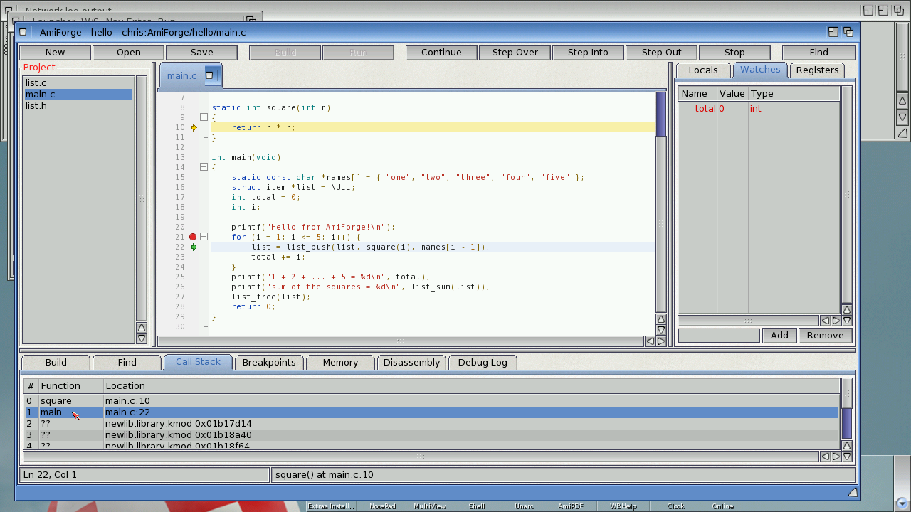
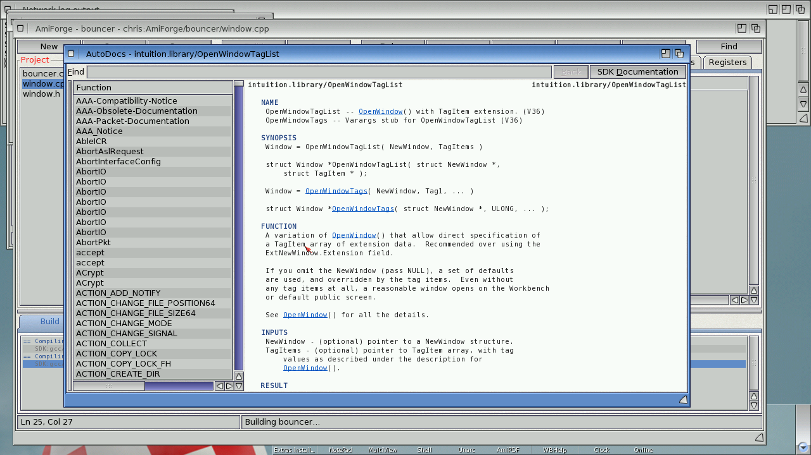
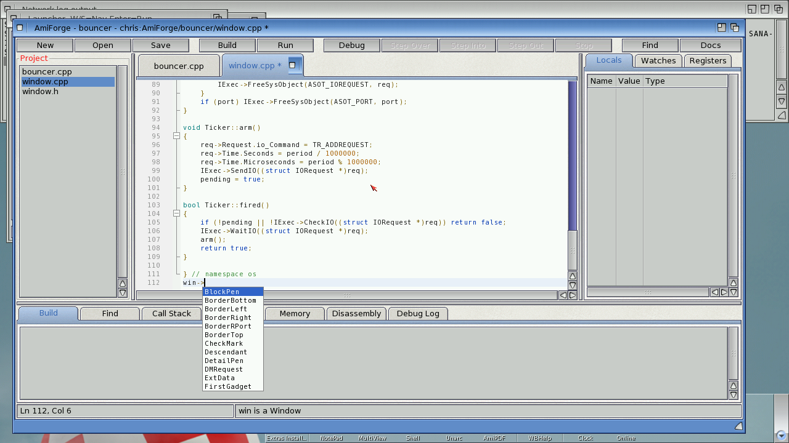
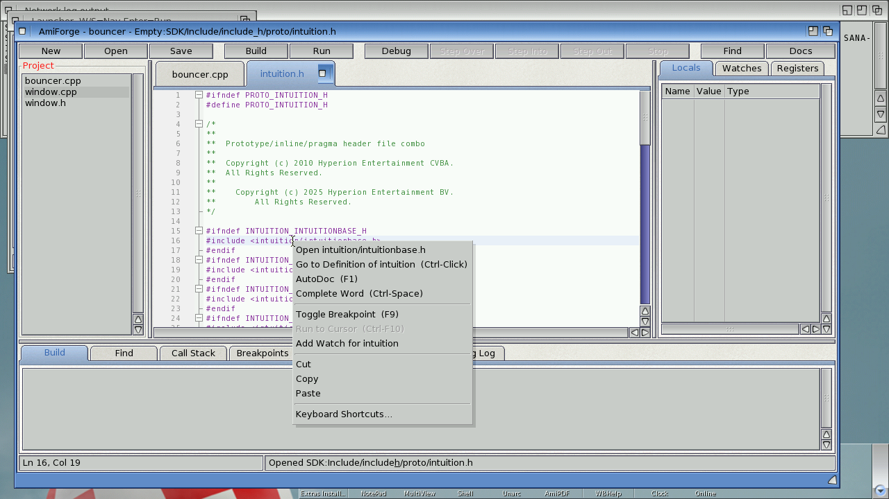
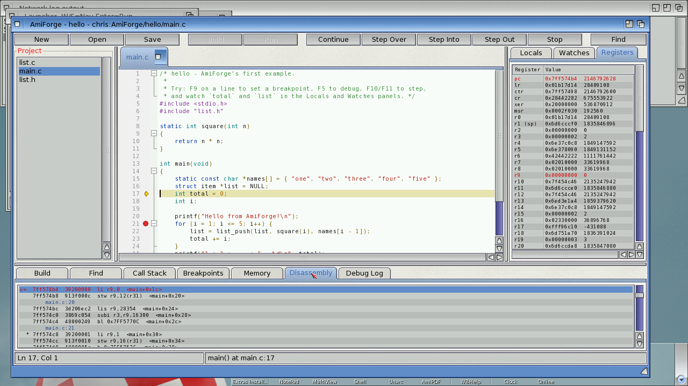

# AmiForge

**A native IDE for AmigaOS 4.1 (PowerPC).** It runs on the Amiga itself, with a modern editor,
the SDK's GCC, a source-level debugger, the AutoDocs one key away, and Git.



## Features

- **Editor**: a port of [Scintilla](https://www.scintilla.org/) to AmigaOS 4.
  - Tabbed, multi-file editing with syntax highlighting for C, C++, PowerPC assembler (GNU `as`),
    makefiles and diffs.
  - Line numbers, folding, brace matching and auto-indent.
  - Find/replace with regular expressions, Find in Files, go to line, and comment/uncomment.
- **Code completion**:
  - pops up as you type;
  - `IExec->` lists exec.library's functions;
  - `os::` lists a namespace's contents;
  - `win->` lists the members of `win`'s type, including OS structs from the SDK headers;
  - calltips show the parameters of OS functions, your functions, constructors and methods, with
    the current argument highlighted.
- **Navigation**: Ctrl-click (or F12) opens an `#include`d header or goes to a definition. A
  context menu on the right mouse button has everything that applies to the word under the
  pointer.
- **AutoDocs**: F1 on an OS function opens its AutoDoc. The browser searches all of them, and
  references between entries are links.
- **Building**: the AmigaOS 4.1 SDK's native GCC 11.5 (C, C++, assembler).
  - Projects build incrementally, in the background.
  - Errors and warnings are marked in the editor and clickable in the build log.
  - Ctrl-F5 builds and runs.
- **Debugging**: AmiForge has its own debugger, built on the exec debug interface; it doesn't
  use GDB.
  - Breakpoints, including conditional ones; step over, into and out; run to cursor; instruction
    stepping.
  - Locals and watches with expandable structs, arrays and pointers, and changed values in red.
  - Registers, call stack, memory and disassembly views.
  - Crashes are caught and shown at the source line.
- **Git and GitHub**: clone, status, diff, log, commit, pull and push from the Git menu, using
  SimpleGit from the SDK.
- **Projects**: `.afp` files with Workbench icons, recent projects, and breakpoints and watches
  that are saved with the project.

| | |
|---|---|
|  |  |
| *F1 opens the AutoDoc; references are links* | *`win->` lists the fields of `struct Window` from the SDK headers* |
|  |  |
| *Right-click: headers, definitions, docs, debugging* | *Registers, and disassembly with source lines* |

## Getting started

1. Install the **AmigaOS 4.1 SDK** with GCC 11 (from Hyperion), so that `SDK:` is assigned.
2. Unpack **AmiForge.lha** and run **Install-AmiForge**, or copy the `AmiForge` drawer anywhere.
3. Open `Examples/hello/hello.afp`, then press **F7** to build, **Ctrl-F5** to run and **F5** to
   debug.

Under QEMU's `sam460ex`, also run `Tools/QEMUCopyFix` at boot. QEMU doesn't emulate the DMA
engine that exec uses for large memory copies, and without it C++ compiles fail.

The **[user guide](docs/user-guide.md)** covers everything: a five-minute tour, editing,
completion and navigation, AutoDocs, projects, building, debugging, Git and GitHub, the
examples, QEMU, troubleshooting, and every key.

## Examples

| Example | What it shows |
|---|---|
| `hello` | C: a linked list across two files, to step through in the debugger |
| `shapes` | C++: classes, virtual functions, `std::vector`, `std::unique_ptr` |
| `asmdemo` | C calling a PowerPC assembler function |
| `bouncer` | C++ using the OS: an Intuition window with a GadTools menu, graphics.library drawing, IDCMP input and timer.device |

## Requirements

- AmigaOS 4.1 Final Edition (exec 53.70 or newer).
- The AmigaOS 4.1 SDK (54.x) with GCC 11, as `SDK:`.
- For Git: SimpleGit (`sgit.lha` from the SDK), networking, and a disk with long file names
  (FFS `DOS\7`, SFS/02 or NGFS).

## Building AmiForge

AmiForge is cross-compiled with the adtools GCC 11 toolchain in Docker:

```
tools/build.sh            # build/AmiForge
tools/make-dist.sh        # dist/AmiForge.lha
```

See **[docs/building.md](docs/building.md)** for the details, the source layout and how to test
on an OS4 machine. [docs/DESIGN.md](docs/DESIGN.md) describes the architecture, and
[docs/debugger-notes.md](docs/debugger-notes.md) records what was learned about debugging on
AmigaOS 4.

## Licence

AmiForge is under the MIT licence (see [LICENSE](LICENSE)). It includes Scintilla and Lexilla by
Neil Hodgson, under their own licence (`third_party/*/License.txt`). The AmigaOS 4.1 SDK and GCC
are not included; they come from Hyperion and the adtools project.
