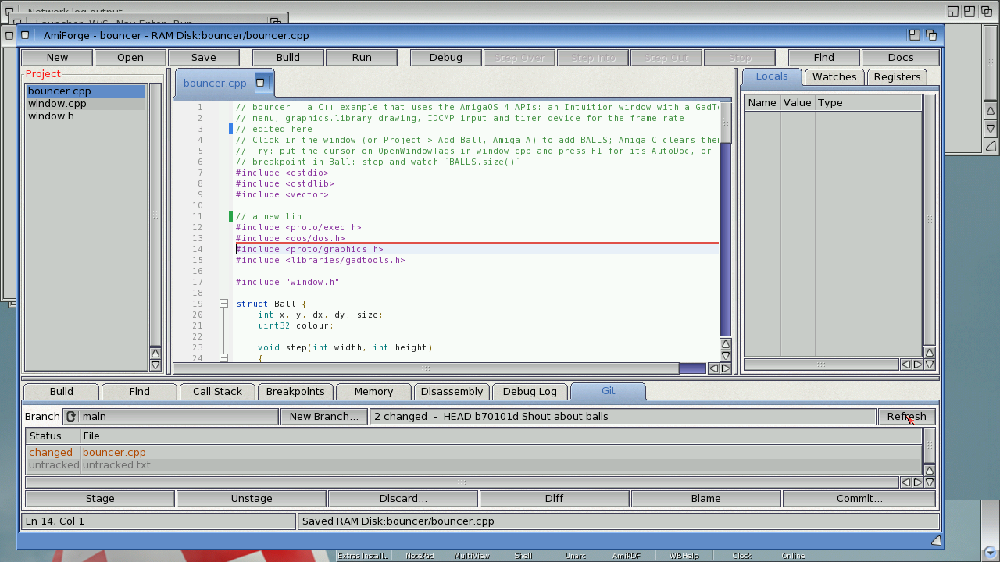
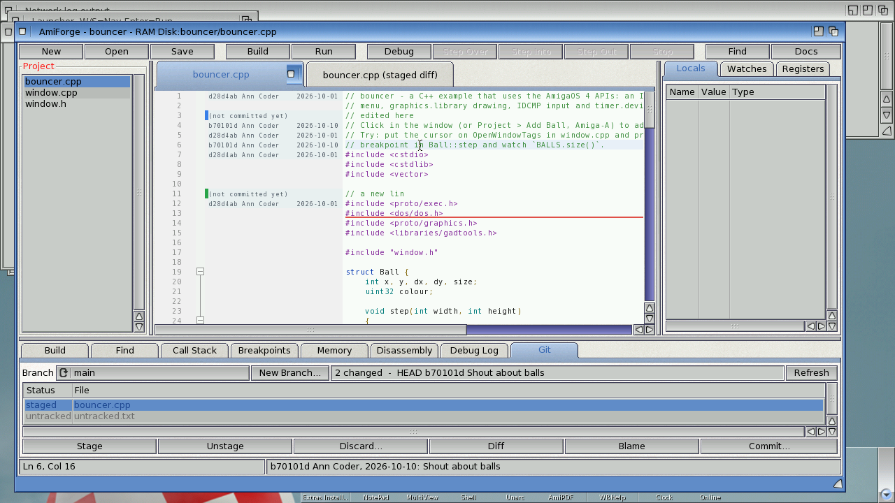
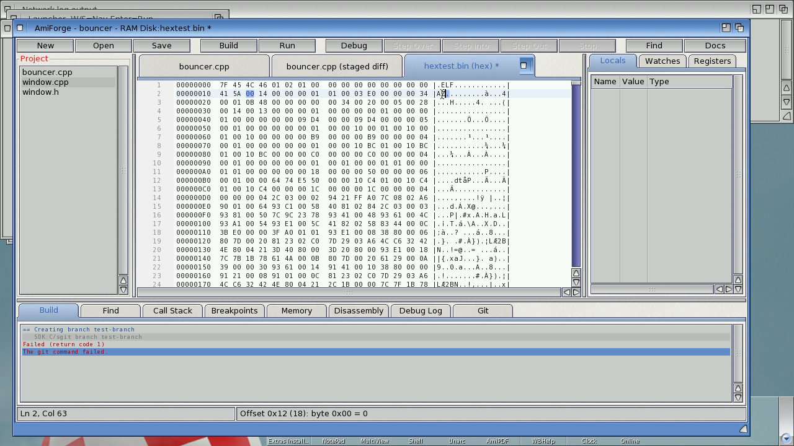
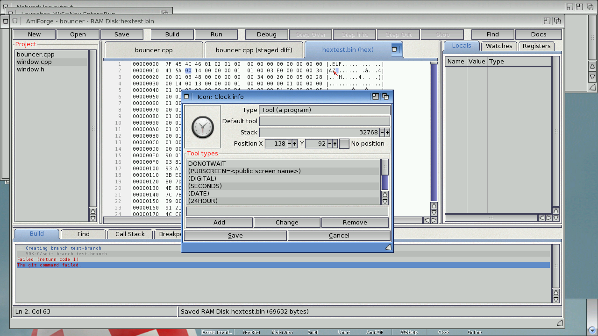
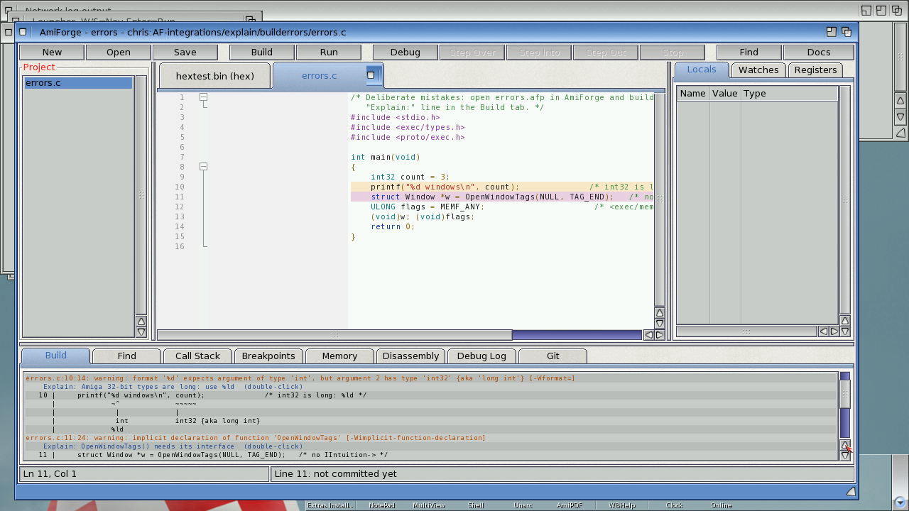
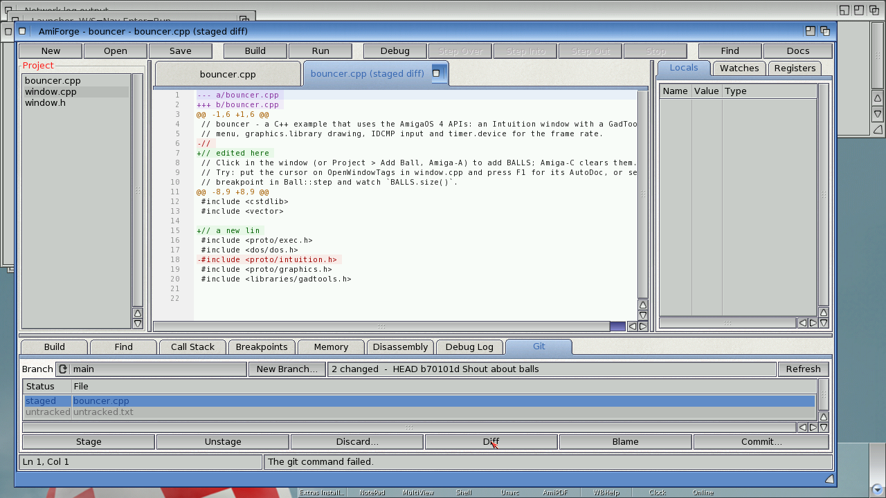

# Git panel, resource editors, ARexx, distributed builds and explanations

## The Git panel

AmiForge reads git repositories itself (loose objects, packs and deltas, the index), so
everything that only looks at the repository is instant: SimpleGit is only started for
commands that change something.

### Change markers

A thin bar next to the text shows how the file differs from the last commit (HEAD):

| Bar | Meaning |
|---|---|
| green | lines you added |
| blue | lines you changed |
| red line | lines were deleted here |

The markers follow your typing (a moment after you stop) and are updated when you save.
**Click a bar** to see what the lines were in HEAD.

### The Git tab



**Git > Git Panel** (or the **Git** tab at the bottom) shows the repository of the project:

- **Branch**: the current branch. Choose another one to switch to it (AmiForge asks first if
  there are uncommitted changes, and re-reads open files that changed). **New Branch...**
  creates a branch at the current commit and switches to it.
- The changed files, with their state: *changed*, *staged*, *staged, changed*, *added*,
  *deleted*, *untracked*. Files matched by `.gitignore` aren't listed.
- **Stage** (`git add`), **Unstage**, **Discard...** (throws away the file's unstaged changes;
  for an untracked file, deletes it), **Diff** (or double-click a file): the file's changes in a
  read-only tab, as a unified diff.
- **Blame** and **Commit...** (the same as Git > Commit).

### Blame



**Git > Blame (toggle)** adds a margin with the commit, author and date of each line (shown on
the first line of each block from the same commit). Lines you haven't committed say so.
Moving the cursor shows the line's commit in the status bar; **click the margin** for the
whole commit message. AmiForge follows the file's history back through up to 60 commits that
changed it.

## The hex editor



Files that aren't text (or any file, with **File > Open as Hex...**) open in a hex editor
tab:

```
00000000  46 4F 52 4D 00 00 1A 2C  49 4C 42 4D 42 4D 48 44 |FORM...,ILBMBMHD|
```

- Type hex digits over the hex columns, or characters over the text column; the byte under
  the cursor is highlighted in both and described in the status bar. Typing at the very end
  adds bytes.
- **Amiga-Z** undoes, **Amiga-L** goes to an offset (`1A2B`, `0x1A2B`, `$1A2B`, or `#1234`
  for decimal), **Amiga-F** finds bytes (`4E 75`) or text (`FORM`, or `"4E75"` in quotes for
  text that looks like hex), **F3** finds the next one.
- **Save** writes the bytes back exactly as they are; nothing else in the file changes.

## Icons and pictures



- Opening a **.info** file opens the **icon editor**: the icon's image and type, its default
  tool, stack size, position (or none) and tool types (select one to edit it; **Add**,
  **Change**, **Remove**). **Save** writes the icon back; the image isn't touched.
- Opening a **picture** (IFF ILBM, PNG, JPEG, GIF, or anything else a datatype understands)
  shows it in a window of its own, with its size, depth and format in the title. Esc closes it.

## ARexx

AmiForge has an ARexx port, **AMIFORGE** (AMIFORGE.1 for a second copy). Commands return
their results in `RESULT`; `RC` is 5 when a FIND finds nothing and 10 for a bad argument.

| Command | Template | What it does |
|---|---|---|
| OPEN | FILE/A/F | Open a file |
| SAVE / SAVEAS | — / FILE/A/F | Save the current file |
| CLOSE | FORCE/S | Close it (FORCE: without asking) |
| GOTO | LINE/N/A,COL/N | Move the cursor |
| GETLINE, GETCOL, GETFILE, GETWORD | | The cursor's line, column, the file, the word at the cursor |
| GETTEXT | ALL/S | The selection ("" if none); ALL: the whole file |
| GETLINETEXT | LINE/N | A line's text |
| INSERT / REPLACE | TEXT/F | Insert at the cursor / replace the selection (`\n`, `\t`, `\\`) |
| SELECT | FROMLINE/N/A,TOLINE/N/A | Select whole lines |
| FIND | TEXT/A/F | Find from the cursor; RESULT is the line |
| BUILD, RUN, DEBUG, STOP | | Build, run, debug, stop debugging |
| PROJECT / GETPROJECT | FILE/A/F | Open a project / its .afp |
| STATUS | TEXT/F | Show text in the status bar |
| REQUEST | TEXT/A/F | Ask OK/Cancel; RESULT 1 or 0 |
| QUIT | FORCE/S | Quit |
| HELP | COMMAND | The commands, or one command's template |

Arguments can be given in order or by name (`GOTO LINE=12 COL=5`).

### Macros

`.rexx` files in **PROGDIR:Rexx/** (next to AmiForge) and in the project's **Rexx/** drawer
appear in the **Macros** menu; they run with AMIFORGE as their host. **Rescan Macros** picks up
new ones. Three come with AmiForge:

- **HeaderComment**: a comment with the file's name and today's date at the top.
- **SortLines**: sorts the selected lines.
- **IfZero**: wraps the selection (or the cursor's line) in `#if 0` / `#endif`.

A macro started from a Shell (`rx MyMacro.rexx`) should begin with
`IF ADDRESS() = 'REXX' THEN ADDRESS AMIFORGE`, like these.

## Distributed builds (distcc)

Compiling under emulation is slow. With **Build > Distributed Builds (distcc)...** AmiForge
compiles C and C++ files with `SDK:C/distcc`: the preprocessor and the linker still run on the
Amiga, but the compiling - most of the time - happens on another machine with a PPC AmigaOS
cross-compiler.

1. On the machine that runs QEMU (macOS or Linux, with Docker): `tools/distcc-server.sh start`.
   It builds a small image from the same GCC 11 cross-compiler the SDK has and runs `distccd`
   on port 3632 of `127.0.0.1`.
2. In AmiForge: **Build > Distributed Builds**, tick the box and give the host as the Amiga
   sees it: QEMU's user networking forwards the guest's gateway address to the host's
   `127.0.0.1`, so that's `10.0.2.2` by default (or e.g. `192.168.101.2` with
   `net=192.168.101.0/24`). Several hosts can be listed: `host[:port][/jobs]`.
3. Build. The build log shows "Compiling x.cpp (distcc)". If the server can't be reached,
   distcc compiles on the Amiga as before.

The setting is saved in the project (`distcc=1`, `distcchosts=...`); tick "Use these hosts for
other projects too" to keep them in `ENVARC:AmiForge/DistccHosts`.

## Explanations



AmiForge knows the usual Amiga-specific causes of build errors and crashes:

- In the **Build** tab, an error or warning it recognises gets an extra line,
  `Explain: ...`; double-click it (or **Build > Explain Error**) for the full explanation. It
  covers, among others: OS functions called without their interface (`IIntuition->...`),
  missing `<proto/...>` headers and OS constants, Amiga types without `<exec/types.h>`,
  `%d` with 32-bit Amiga types, redeclared `SysBase`/`IntuitionBase`, undefined interfaces
  (`-lauto`), C++ without `-athread=native`, `__USE_INLINE__` macros clashing with C++ names,
  APTR casts in C++, `STRPTR` and string literals, OS3 headers and timer names, big stack
  frames, multiple definitions, `-lm`, small-data overflows.
- When the debugger catches a crash, the **Debug Log** explains it from the registers and the
  call stack: a NULL pointer (and which field, from the faulting instruction's offset), a NULL
  interface when the line calls `IXxx->`, freed or uninitialised memory (MungWall's
  `0xDEADBEEF` / `0xABADCAFE`), a crash inside an OS function from a bad argument, a stack
  overflow (with the `$STACK:` cookie to fix it), calling a NULL function pointer, jumping to
  data, misaligned access, traps from `assert()`/`abort()`. **Debug > Explain Crash** shows it
  again.


