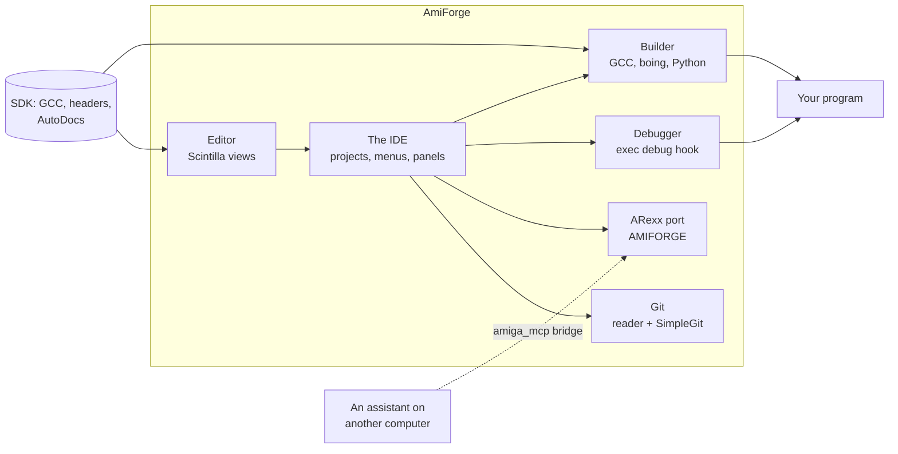

# Introduction and installing

AmiForge is an integrated development environment that runs on AmigaOS 4.1. You write, build,
run and debug your programs in one window on the Amiga itself: C, C++ and PowerPC assembler
with the SDK's GCC, Python and other scripting languages, and Boing BASIC. This chapter says
what AmiForge does, what it needs, and how to install it.

## What AmiForge does

- **An editor** built on Scintilla, with highlighting for C, C++, PowerPC assembler, makefiles,
  diffs, Python, Lua, Perl, shell scripts, ARexx, AmigaDOS scripts, JSON, YAML, Markdown and
  Boing BASIC; tabs, a split view, a minimap, multiple cursors, snippets and two colour themes.
- **Completion that knows the OS**: type `IIntuition->` and the list shows that interface's
  functions; type `win->` for a `struct Window *` and it shows the structure's members, read
  from the SDK's headers. **F1** opens the AutoDoc of the function under the cursor.
- **Projects and templates**: a project file lists the sources and remembers the settings,
  breakpoints and watches. Templates make a working Shell program, a ReAction application, a
  commodity, a screen blanker, an AHI player, a shared library, a device, a Python script or a
  Boing BASIC program in a few clicks.
- **Builds in the background** with the SDK's GCC, with errors you can click and explanations
  of the Amiga-specific ones; optionally distributed to a faster machine with distcc.
- **A source-level debugger** of its own (it doesn't use GDB): breakpoints with conditions,
  stepping, the variables, the call stack, memory, registers and disassembly; crashes are
  caught before the Grim Reaper appears. **Edit and Continue** patches changed code into the
  stopped program, and three tools show its windows and gadgets, the memory and files it never
  gave back, and where its time goes.
- **A GUI designer** for ReAction windows that writes the C code, and that is also the form
  designer for Boing BASIC programs, with a Menu Editor.
- **Git** through SimpleGit, with change markers in the editor, blame, a diff view and a
  panel for staging, committing and switching branches; **GitHub** cloning, pulling and pushing.
- **A Markdown preview**, a hex editor, an icon editor and a picture viewer.
- **ARexx and MCP control**: every action has an ARexx command, and an AI assistant on another
  computer can drive AmiForge through the Model Context Protocol.



*Figure: The parts of AmiForge and what they work with*

## What you need

| What | Why |
|---|---|
| AmigaOS 4.1 Final Edition (exec 53.70 or newer) | AmiForge uses ReAction, and exec's debug interface for the debugger |
| A Workbench screen of 16 or 24 bits | The editor works on 8-bit screens too, but looks best in more colours |
| **The AmigaOS 4.1 SDK (54.x) with GCC 11**, with `SDK:` assigned | The compilers (`gcc`, `g++`, `as`, `ld`), the headers, and the AutoDocs |
| SimpleGit (`sgit`, in the SDK's `sgit.lha`) | Only for the Git menu |
| Networking with a default gateway | Only for cloning, pulling and pushing |
| A disk with long file names (FFS `DOS\7`, SFS/02, NGFS) | Only for Git repositories (see [Git and GitHub](11-git.md)) |
| Python 3 for AmigaOS 4 | Only for Python projects |
| Boing BASIC (`boing`) | Only for Boing BASIC projects |

AmiForge runs on real AmigaOS 4 machines and on QEMU's `sam460ex` machine. Under QEMU one
extra program is needed; see [Running under QEMU](14-qemu.md).

## Installing

1. **Install the SDK.** Use the SDK's own installer and include GCC 11 (or see [Installing the
   SDK from a Shell](#installing-the-sdk-from-a-shell)). Afterwards `SDK:` is assigned at boot
   and `gcc -v` works in a Shell.
2. **Install AmiForge.** Unpack `AmiForge.lha` and double-click **Install-AmiForge**, or run it
   from a Shell with the drawer to install into: `Install-AmiForge Work:Development`. You can
   also copy the `AmiForge` drawer anywhere you like.
3. **Under QEMU only:** copy `AmiForge/Tools/QEMUCopyFix` to `C:` and add
   `Run >NIL: C:QEMUCopyFix` to `S:User-Startup` (see [Running under QEMU](14-qemu.md)).
4. **Start AmiForge**: double-click its icon or a project's icon, or from a Shell run
   `AmiForge [project.afp | file.c ...]`. Started with nothing to open, it reopens the last
   project, or shows the project browser the first time.

The `AmiForge` drawer holds:

| Drawer or file | What it is |
|---|---|
| `AmiForge` | The program |
| `Docs/` | This manual as an AmigaGuide (`AmiForge-Manual.guide`) and as text, with its pictures |
| `Examples/` | Example projects, and the default projects folder |
| `Templates/` | The project templates |
| `Rexx/` | Example ARexx macros (the Macros menu) |
| `Tools/QEMUCopyFix` | The fix for QEMU (see [Running under QEMU](14-qemu.md)) |

**Help > User Manual** opens this manual in AmiForge.

### Installing the SDK from a Shell

The source repository has a script, `tools/sdk/make-install-script.py`, that reads the SDK's
`package.xml` and writes an AmigaDOS script that unpacks the SDK's base, GCC 11, the binutils,
newlib, pthreads and the Unix tools, and runs their post-install steps as the SDK installer
would:

```sh
tools/sdk/make-install-script.py SDK_Install/package.xml DH1:SDK-Install DH0:SDK > install-sdk
```

Copy the SDK's `.lha` files and `install-sdk` to `DH1:SDK-Install` on the Amiga, then:

```amigados
Execute DH1:SDK-Install/install-sdk
```

and add these lines to `S:User-Startup`:

```amigados
Assign SDK: DH0:SDK
Execute SDK:S/sdk-startup
```

## About this manual

[A guided tour](02-tour.md) shows the main things in ten minutes. The chapters after it
describe each part of AmiForge in turn, and the [exercises](exercises/README.md) are tutorials
that build complete projects step by step; their finished versions are in the source
repository's `examples/manual/` drawer. The appendices are references: the
[keys](appendix-a-keys.md), the [ARexx commands](appendix-b-commands.md), the
[menus](appendix-c-menus.md) and [the files AmiForge keeps](appendix-d-files.md).

- `Code like this` is something you type: C, a Shell command, a file or drawer name.
- **Menu > Item** is a menu item; **F7** or **Amiga-B** is a key. Amiga means the right Amiga
  key. F11, F12 and Break are on PC keyboards (and QEMU passes them on); on an Amiga keyboard
  use the menus instead.
- The manual describes AmiForge 0.3.1.
