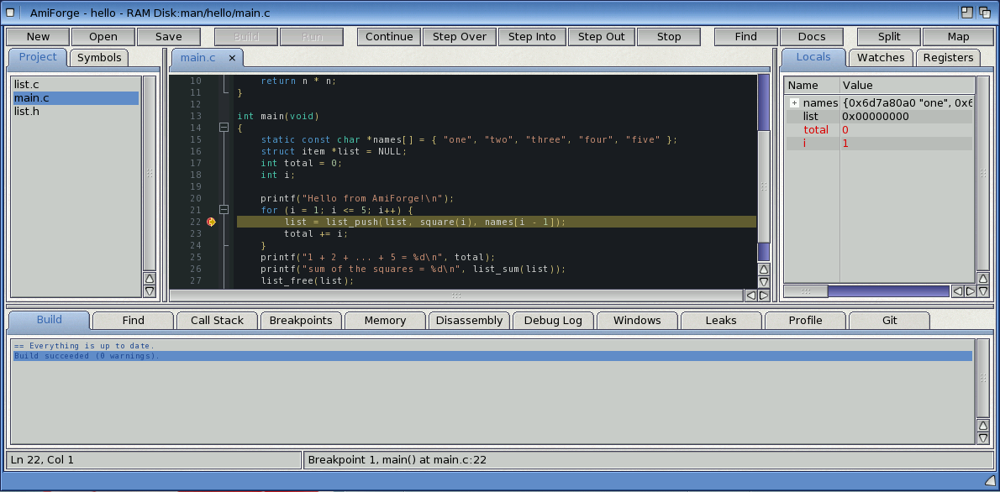
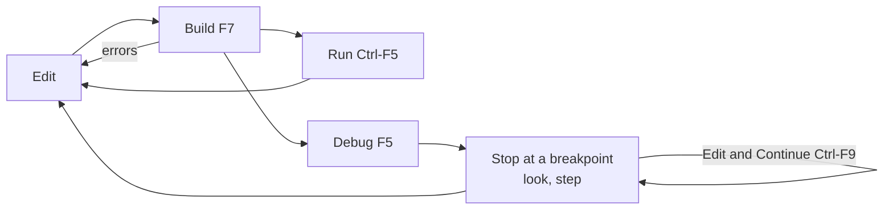

# A guided tour

This tour takes about ten minutes. It uses the `hello` example that comes with AmiForge: a
small C program that builds a linked list across two files. You open it, build it, run it,
stop it at a breakpoint, look at its variables, and read an AutoDoc.



*AmiForge with the hello example open, stopped at a breakpoint*

## Open the example

Start AmiForge. Choose **Project > Open Project** (**Amiga-P**): the requester starts in the
projects folder, which is AmiForge's `Examples` drawer until you choose another. Open
`hello/hello.afp`. You can also double-click `hello.afp`'s icon on Workbench.

The **Project** tab on the left lists the project's files: `main.c`, `list.c` and `list.h`.
Click `main.c` to open it in the editor.

## Build and run

Press **F7** (or **Build > Build**, **Amiga-B**). The **Build** tab at the bottom shows each
command as it runs and ends with "Build succeeded". Only what changed is compiled again next
time.

Press **Ctrl-F5** (or **F6**, **Amiga-E**). The program runs in a console window and prints:

```output
Hello from AmiForge!
1 + 2 + ... + 5 = 15
sum of the squares = 55
```

Close the console window.

## Stop at a breakpoint

Click in the margin to the left of line 22, `list = list_push(list, square(i), names[i - 1]);`
(or put the cursor on it and press **F9**). A red circle marks the breakpoint.

Press **F5**. AmiForge builds if it needs to and starts the program under the debugger. It
stops at the start of `main()` (the project's "Stop at main() when debugging" setting); press
**F5** again to run on to the breakpoint. The yellow arrow shows the line about to run.

## Look at the variables

The **Locals** tab on the right shows `main()`'s variables: `names`, `list`, `total` and `i`.
Click the arrow beside `names` to see the array's elements. The **Watches** tab already watches
`total` (the project remembers its watches).

Press **F10** to step over a line, and **F11** on line 22 to step into `square()`. Values that
changed at the last step turn red. **Shift-F11** steps back out. Press **F5** to run on to the
breakpoint again: `list` now points to the first item; open it to follow `next`.

Press **Shift-F5** to stop the program.

## Read an AutoDoc

Put the cursor on `printf` and press **F1** (or the **Help** key). The AutoDocs window opens at
`printf`'s entry in the newlib documentation. Names of other functions are links. Close the
window.

## Let completion help

On an empty line inside `main()`, type `list_`. After three letters a list pops up with the
functions from `list.h`: choose one with the cursor keys and **Return**. Then type `(`: a call
tip shows the parameters. Press **Esc**, then **Amiga-Z** to undo.

## What next

- [The window and editing](03-editing.md) describes the editor in full.
- [Building and running](06-building.md) and [Debugging](08-debugging.md) go further with
  what you just did.
- [Exercise 1](exercises/01-first-program.md) makes a new program from a template.



*Figure: The edit, build, run and debug cycle*
