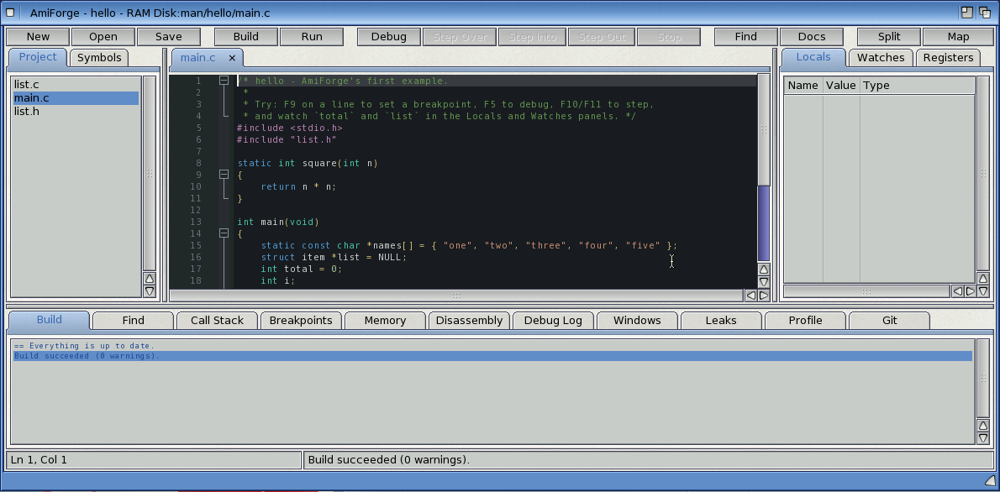
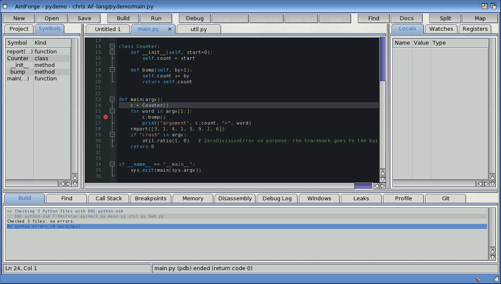
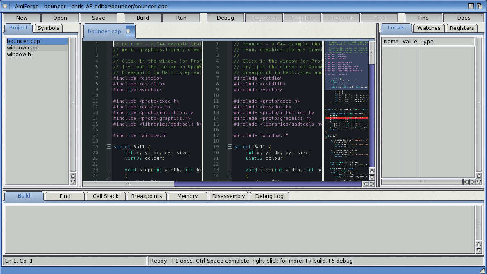
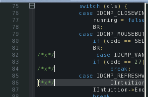
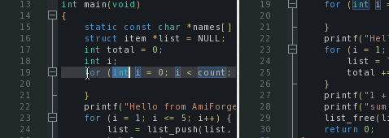
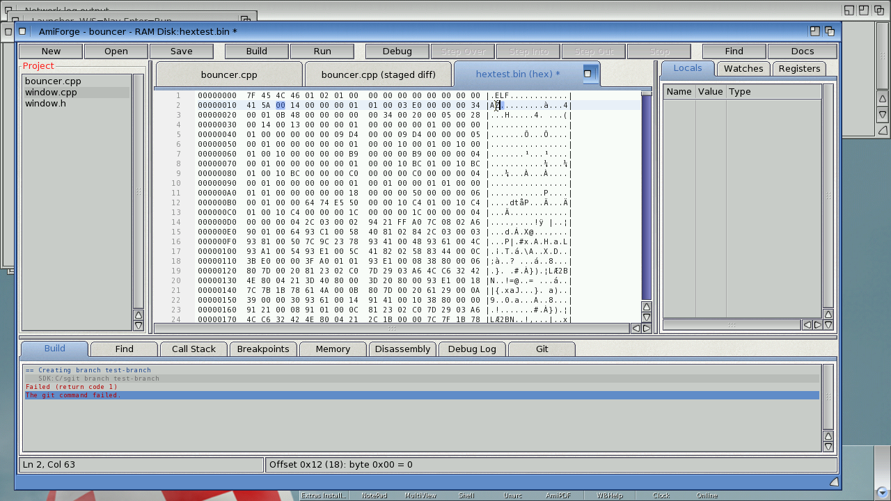
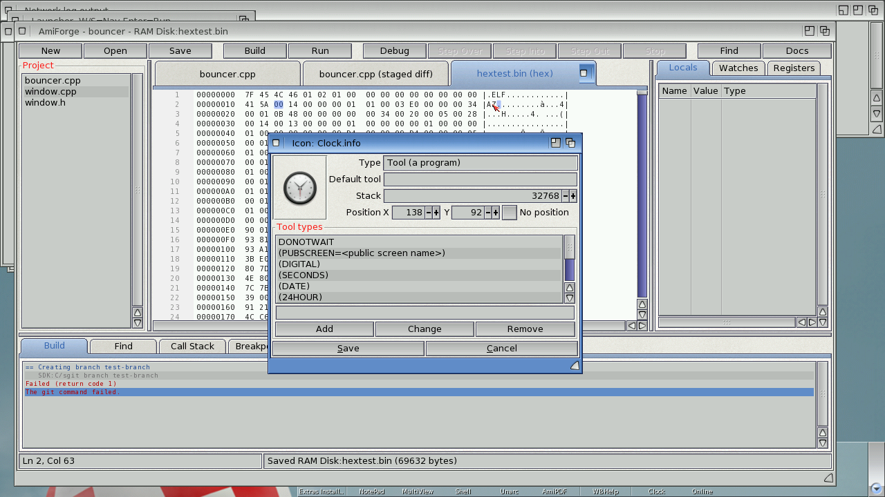

# The window and editing

This chapter describes AmiForge's window and its editor: the panels, the editing keys, finding
and replacing, the split view and minimap, the themes, multiple cursors and snippets, and the
editors for files that aren't text.

## The window



*The main window: the project and the editor, the variable panels, and the Build tab*

- **The toolbar**: New, Open and Save; Build and Run; Debug, Step Over, Step Into, Step Out and
  Stop; Find; Docs (the AutoDoc for the word at the cursor); **Split** and **Map**, which stay
  pressed while the split view or the minimap is on.
- **The left panel**: **Project**, the project's files, sources first (click one to open it),
  and **Symbols**, the outline of the current file (see [Completion and
  navigation](04-navigation.md#the-symbol-outline)).
- **The editor**: one tab per file. The **x** on the active tab closes it, and a `*` after
  the name means it has changes that aren't saved. The margins hold:
  - the line numbers;
  - markers: a red circle for a breakpoint (hollow if it's disabled), a yellow arrow and
    highlight where the program is stopped, a green arrow for the stack frame you selected,
    and a red or amber background on lines with compiler errors or warnings;
  - fold boxes, which collapse and expand blocks;
  - when the file is in a Git repository, bars that mark the changed lines (see
    [Git and GitHub](11-git.md)).
- **The right panel**: **Locals**, **Watches** and **Registers**, filled in while debugging.
- **The bottom panel**:
  - **Build**: what the compiler and Git print. Click an error to go to it.
  - **Find**: the results of Find in Files and Find All References.
  - **Call Stack**, **Breakpoints**, **Memory** and **Disassembly**: the debugger's.
  - **Debug Log**: what the debugger did, and why the program stopped.
  - **Windows**, **Leaks** and **Profile**: the [debugger tools](10-debugger-tools.md).
  - **Git**: the [Git panel](11-git.md#the-git-panel).
- **The status bar**: the cursor's line and column on the left, messages on the right.

Drag the bars between the panes to change their sizes.

## Files

| To... | Do this |
|---|---|
| Make a new file | **File > New** (**Amiga-N**) |
| Open a file | **File > Open...** (**Amiga-O**) |
| Save it, or save it under another name | **File > Save** (**Amiga-S**), **File > Save As...** (**Amiga-A**) |
| Save every changed file | **File > Save All** |
| Close it | **File > Close** (**Amiga-W**), or the **x** on its tab |
| Open any file as bytes | **File > Open as Hex...** |

Files are Latin-1, the Amiga's character set. A file given on AmiForge's command line, or
dropped on its icon, opens in the editor.

## Editing

The editor is a port of [Scintilla](https://www.scintilla.org/). It highlights C, C++,
PowerPC assembler (`.s`, `.S`, `.asm`, `.i`, in GNU `as` syntax), makefiles and diffs,
Python, Lua, Perl, shell scripts, ARexx, AmigaDOS scripts, JSON, YAML, Markdown and Boing
BASIC. It matches braces and indents for you: after a `{` the next line is indented, and a `}`
lines up with the line that opened its block (in Python, after a `:`).

| Action | Keys |
|---|---|
| Undo / redo | Amiga-Z / Amiga-Y (or Ctrl-Z / Ctrl-Y) |
| Cut / copy / paste (the system clipboard) | Amiga-X / Amiga-C / Amiga-V |
| Select everything | **Edit > Select All** |
| Find / replace | Amiga-F / Amiga-R |
| Find next / previous | F3 / Shift-F3 |
| Find in Files (the whole project) | Amiga-H |
| Go to a line | Amiga-L |
| Comment or uncomment the selected lines (`//`, `#`, `--`, `;` or `/* */`, by language) | Amiga-/ |
| Indent / unindent | Amiga-] / Amiga-[, or Tab / Shift-Tab with a selection |
| Bigger / smaller / normal text | Amiga-+ / Amiga-- / Amiga-0 |
| Wrap long lines, show white space, fold or unfold everything | the View menu |

The Find window has **Match case**, **Whole word** and **Regular expression**, and **Replace**
and **Replace All**. A Replace All is undone in one step.

## The other languages

Besides C, C++ and assembler, the editor knows these languages. The language comes from the
file's name; a file without a known extension is recognised by its first line
(`#!/usr/bin/env python3`, or `.key` for an AmigaDOS script) or its drawer (`S:`).

| Language | Files | Comment (Amiga-/) | Symbols tab | Indents after |
|---|---|---|---|---|
| Python | `.py`, `.pyw` | `#` | `def` (with its parameters), `class`, methods, top-level variables | `:` (and back out after `return`, `pass`, `break`, `continue`, `raise`) |
| ARexx | `.rexx`, `.rx`, files in `REXX:` | `/* ... */` around each line | labels; `PROCEDURE` ones as functions | `DO`, `SELECT`, `THEN DO` |
| AmigaDOS scripts | files in `S:`, scripts starting with `.key` or `.bra`, `.dos` | `;` | `Lab` labels | `If`, `Else` |
| Lua | `.lua` | `--` | `function`, `local function`, `name = function` | `function`, `then`, `do`, `repeat` |
| Perl | `.pl`, `.pm` | `#` | `sub`, `package` | `{` |
| Shell | `.sh`, `.bash` | `#` | `name()` and `function name` | `{` |
| JSON | `.json` | (none) | the top-level keys | (keeps the indentation) |
| YAML | `.yaml`, `.yml` | `#` | the top-level keys | `key:` |
| Markdown | `.md` | `<!-- ... -->` | the headings, nested by level | (keeps the indentation) |
| Boing BASIC | `.bas`, `.cls`, `.bi` | `'` | Subs, Functions, Properties, Types, Enums, Consts, Declares, Events, module variables | block openers (`If ... Then`, `For`, `Do`, `Select Case`...) |

Python, ARexx, Lua, Perl, shell, JSON, YAML and Boing BASIC fold. Python indents with four
spaces; JSON, YAML and Lua with two. ARexx and AmigaDOS scripts have AmiForge's own
highlighters: for ARexx nested comments, `''` inside strings, the instructions, the built-in
functions, `RC`, `RESULT` and `SIGL`, and labels; for AmigaDOS scripts the command at the start
of a line, `.key` directives, `<parameters>`, `$variables` and `*"` escapes.



*A Python script with its outline in the Symbols tab*

## The split view and the minimap



*The dark theme, the split view and the minimap*

The **Split** button on the toolbar (or **View > Split Editor**) shows a second view of the
current file beside the first. Each view scrolls on its own, but they show the same text, so a
change in one appears in the other at once. Click in a view to work in it: Find, Go to
Definition, F1, completion and the other commands act on the view you clicked last. The
scrollers belong to the left view. Click **Split** again to go back to one view.

The **Map** button (or **View > Minimap**) shows the whole file in tiny print on the editor's
right, with the part that's in the (left) view highlighted. Click or drag in the minimap to
go there; the mouse wheel over it scrolls the editor. Click **Map** again to hide it.

AmiForge remembers both settings.

## Themes

**View > Theme** chooses **Light** or **Dark**. The theme colours the whole editor: the
highlighting of every language, the margins and markers, the selection and the caret, call
tips, the completion list, and the AutoDocs viewer. AmiForge remembers the choice.

## Multiple cursors

| To... | Do this |
|---|---|
| Add a cursor | **Alt-click** where you want it (Ctrl-click is Go to Definition) |
| Select the word at the cursor, then each next occurrence | **Edit > Add Next Occurrence** (**Amiga-T**) |
| Select every occurrence at once | **Edit > Select All Occurrences** |
| Go back to one cursor | **Esc** |

Typing, Delete, Backspace and Paste act at every cursor.



*Three cursors: typing changes the three names at once*

## Snippets

Type a snippet's name and press **Tab** to insert it. Snippets are also in the completion list,
marked with `»` (`for»`); pick one there with Tab or Return. **Edit > Insert Snippet...** lists
them all.

After a snippet goes in, its fields are outlined:

- Type over the selected field.
- **Tab** moves to the next field, **Shift-Tab** to the previous one.
- When you leave a field, the same name elsewhere in the snippet follows: in `openlib` the
  library's name goes into `FooBase`, `IFoo` and `struct FooIFace`.
- After the last field the cursor goes to the snippet's end point; **Esc** finishes early.



*The `openlib` snippet: the library's name is the first field*

The C and C++ snippets:

| Snippet | Inserts |
|---|---|
| `main` | `main()` with the usual includes |
| `openlib` | `OpenLibrary()` and `GetInterface()` with an error check, and the matching `DropInterface()` and `CloseLibrary()` |
| `window` | `OpenWindowTags()` and an IDCMP loop (close gadget, Esc) |
| `timer` | a timer.device request: port, `TimeRequest`, `OpenDevice()`, `TR_ADDREQUEST`, clean-up |
| `rexx` | sending a command to an ARexx port and reading the result |
| `tags` | a `struct TagItem` array |
| `for`, `while`, `if`, `switch` | the statements |
| `struct`, `class` | a struct; a C++ class with constructor and destructor |

Other languages have their own: in a Python file `main` is the `if __name__ == "__main__":`
guard, and there are `def`, `class`, `for`, `fori`, `while`, `if`, `with`, `try`, `argparse`,
`print` and `lambda`; ARexx has `rexx`, `do`, `if`, `select` and `proc`; Lua `function`,
`for`, `forp` and `if`.

### Your own snippets

**Edit > Edit My Snippets** opens `ENVARC:AmiForge/Snippets`, making it with an example the
first time. Saving the file loads the snippets straight away. The format is snipMate's:

```text
# a comment
snippet hello  print a line
	IDOS->Printf("${1:Hello, world}\n");${0}

snippet loop  count down
	for (int ${1:i} = ${2:10}; ${1} > 0; ${1}--) {
		${0}
	}
```

- `snippet <name>  <description>` starts a snippet; `language python` makes the snippets after
  it Python ones.
- Each line of the body starts with a tab, or up to four spaces.
- In the body, `${1:text}` is field 1 with that text in it, `${2}` or `$2` an empty field, and
  a field number used again copies that field. `${0}` is where the cursor ends. `\$`, `\}` and
  `\\` are a literal `$`, `}` and `\`.
- A further tab at the start of a body line is one step of indentation, and every line gets the
  indentation of the line where you typed the snippet.
- A snippet with a built-in snippet's name replaces it.

## Files that aren't text

### The hex editor



*The hex editor, on an IFF picture*

Files that aren't text (or any file, with **File > Open as Hex...**) open in a hex editor tab:

```text
00000000  46 4F 52 4D 00 00 1A 2C  49 4C 42 4D 42 4D 48 44 |FORM...,ILBMBMHD|
```

- Type hex digits over the hex columns, or characters over the text column. The byte under
  the cursor is highlighted in both and described in the status bar. Typing at the very end
  adds bytes.
- **Amiga-Z** undoes, **Amiga-L** goes to an offset (`1A2B`, `0x1A2B`, `$1A2B`, or `#1234` for
  decimal), **Amiga-F** finds bytes (`4E 75`) or text (`FORM`, or `"4E75"` in quotes for text
  that looks like hex), and **F3** finds the next one.
- **Save** writes the bytes back exactly; nothing else in the file changes.

### Icons and pictures



*The icon editor*

- Opening a **.info** file opens the **icon editor**: the icon's image and type, its default
  tool, stack size, position (or none) and tool types (select one to change it; **Add**,
  **Change**, **Remove**). **Save** writes the icon back; the image isn't touched.
- Opening a **picture** (IFF ILBM, PNG, JPEG, GIF, or anything else a datatype understands)
  shows it in a window of its own, with its size, depth and format in the title. **Esc**
  closes it.
- Opening a **Markdown** file shows it rendered beside the editor: see
  [The Markdown preview](12-markdown.md).
