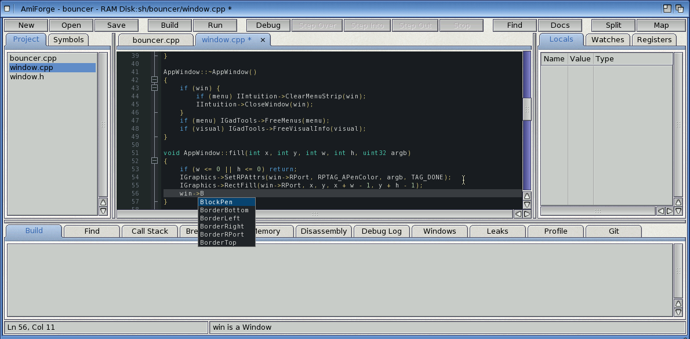
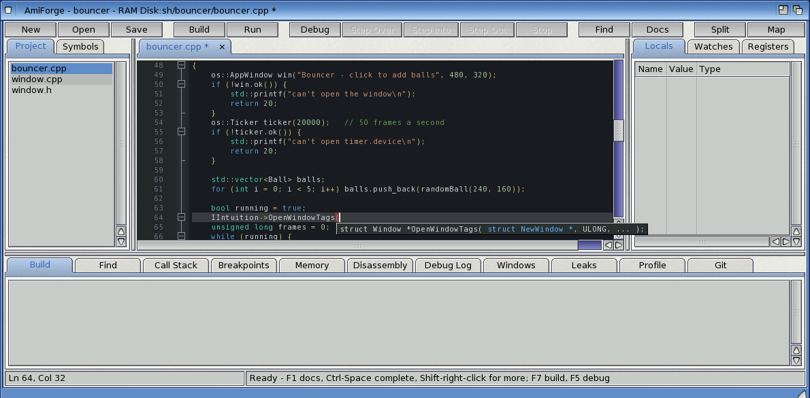
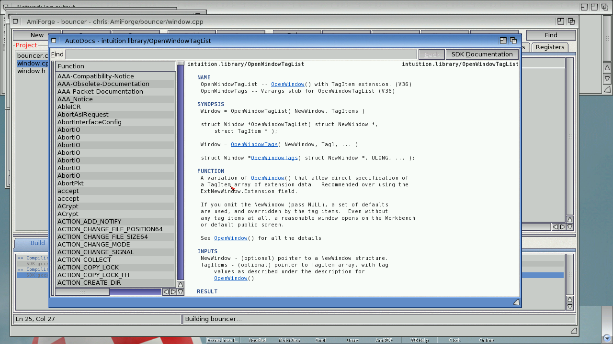
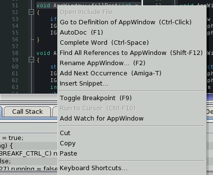
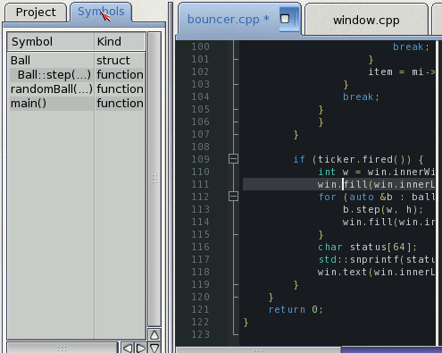
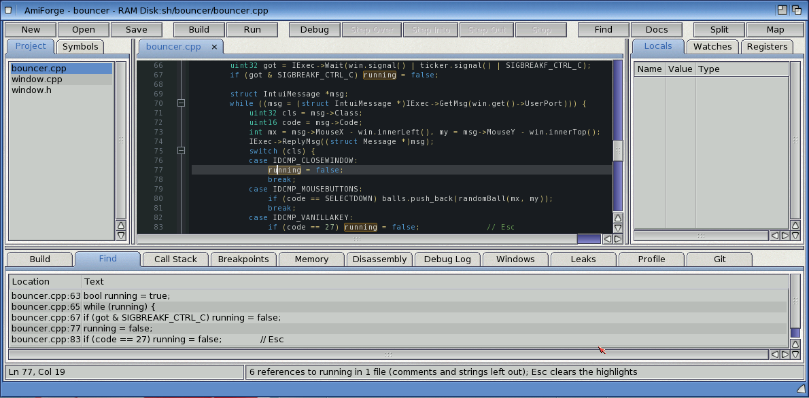
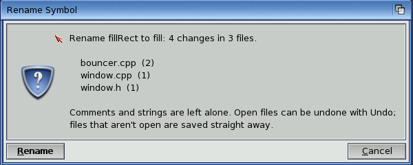

# Completion and navigation

AmiForge reads your sources, and the SDK's headers they include, as you type. This chapter
covers completion and call tips, the AutoDocs, going to headers and definitions, the context
menu, the symbol outline, and finding and renaming names.

## Completion

The completion list pops up by itself as you type:

| You type | You get |
|---|---|
| 3 letters of a name | Matching words from the open files and the project's files, the language's keywords, and every OS function in the AutoDocs |
| `IExec->`, `IIntuition->`, `IDOS->`... | That interface's functions |
| `os::`, `MyClass::`, `std::` | What's declared in that namespace or class |
| `win.` or `win->` | The members of `win`'s type: your own structs and classes, OS structures (`struct Window`), and `std::vector`, `std::string` and `std::map` |
| `(` after a function | A call tip with its parameters |
| **Ctrl-Space** | The list anywhere, even with nothing typed |

In the list, choose with the cursor keys, then **Return** or **Tab** to insert, or **Esc** to
close it.

*`win->` lists `struct Window`'s members, read from the SDK's headers*

Completion reads the current file, the project's files and the headers they `#include`
(following them into the SDK) without compiling anything. It works for declarations written in
the usual way; it doesn't follow `auto`, chains of typedefs, or expressions such as
`a.get()->b`. Ctrl-Space still gives the general list there.

In a call tip, the parameter you're typing is highlighted; a `,` moves to the next one and the
closing `)` ends the tip. For an OS function the tip is its prototype from the AutoDocs.

*The call tip for an OS function*

In Python, Lua and ARexx files, completion offers the language's keywords and built-in
functions and the words in the open files and the project's files. For Boing BASIC files it
also knows the forms' controls and the runtime's classes: see [Building and
running](06-building.md#boing-basic-projects).

## The AutoDocs

The SDK documents every library function in its AutoDocs (`SDK:Documentation/AutoDocs`), and
AmiForge reads them directly.

- **F1** (or the **Help** key, or the **Docs** button) on a function's name opens its entry.
  Interface calls such as `IIntuition->OpenWindowTags` work, and so do the `Tags`, `TagList`
  and `A` versions of a name.
- **Help > AutoDocs Browser...** lists every entry; type in **Find** to narrow the list.
- Names of other functions in an entry (`exec.library/AllocVec`, `OpenWindow()`) are links:
  click one to follow it, and **Back** returns. Double-clicking any word looks it up.
- **Help > SDK Documentation** opens the SDK's documentation drawer, with the SDK manual and
  the guides to the compiler and tools.

*The AutoDocs browser*

## Headers and definitions

| To... | Do this |
|---|---|
| Open a header named in an `#include` | **Ctrl-click** the line, or put the cursor on it and choose **Edit > Open Include File** |
| Go to where something is defined | **Ctrl-click** it, or **F12** (**Edit > Go to Definition**, **Amiga-J**) |

- **Headers:** `"quoted"` headers are looked for next to the file, then in the project;
  `<angled>` ones in the SDK's include drawers: the OS includes, newlib, the C++ library and
  GCC's own headers. SDK headers open read-only.
- **Definitions:** Go to Definition looks for, in this order:
  1. the nearest declaration above the cursor (local variables and parameters);
  2. a struct, class, union, enum, `#define` or typedef in the project;
  3. a function in the project;
  4. for an OS function, its AutoDoc.

## The context menu

Hold **Shift** (or **Ctrl**) and press the **right mouse button** over the editor for a menu of
what applies to the word or line under the pointer. The right mouse button on its own shows
the menu bar there, as on any Amiga window.

*Shift and the right mouse button: the context menu*

The context menu has:

- Open Include File, Go to Definition, the AutoDoc, and Complete Word;
- Find All References, Rename, Add Next Occurrence and Insert Snippet;
- Toggle Breakpoint, Run to Cursor and Add Watch;
- Cut, Copy and Paste;
- Keyboard Shortcuts.

Items that don't apply to the word under the pointer are ghosted.

## The symbol outline

The **Symbols** tab beside **Project** (or **View > Symbols**) lists what the current file
defines, in the order of the source:

- C and C++: functions (with `Class::method` names), structs, classes, unions, enums,
  namespaces, typedefs, `#define`s and global variables;
- assembler: labels (functions are the ones marked `.type ..., @function`), `.macro`,
  `.equ`/`.set` and `#define`;
- the other languages: see the table in [The window and editing](03-editing.md#the-other-languages).

Click an entry to go there. The list follows your typing about a second after you stop.

*The Symbols tab*

## Find All References

Put the cursor on a name and press **Shift-F12** (or **Edit > Find All References**). Every use
of the name as a whole word, outside comments and strings, is listed in the **Find** tab: in
the project's files and any other open files. Click a line to go there. The uses in open files
are highlighted; **Esc** clears the highlights.

*Every use of a name, in the Find tab*

## Rename Symbol

Put the cursor on a name and press **F2** (or **Edit > Rename Symbol...**), then type the new
name.

1. A requester says how many changes there will be in which files, and warns if the new name is
   already in use.
2. **Rename** changes every whole-word use outside comments and strings. Open files are
   changed in the editor, one undo step per file, so you can check them before saving; files
   that aren't open are written straight away.

The new name must be a valid name in the file's language and not one of its keywords. In
ARexx, AmigaDOS scripts and Boing BASIC, names are matched whatever their case.

*The requester before a rename*

## Limits

- Find All References and Rename Symbol work on the text, not on what the compiler knows.
  Different things with the same name (a local `i` in two functions, a member and a global both
  called `count`) are all included, so check the list or the requester before renaming.
- The outline reads declarations written in the usual way; heavy use of macros can hide a
  function.
- The minimap follows the left view only, and Alt-drag doesn't make a rectangular selection
  (Alt-click adds cursors instead).
