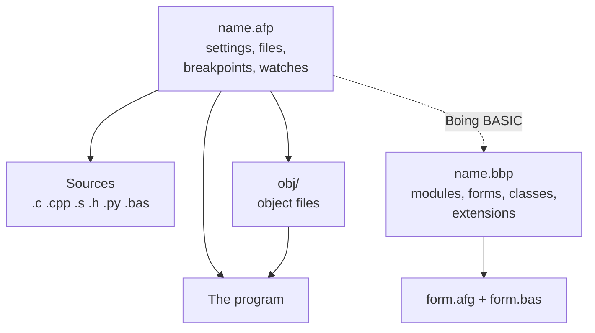
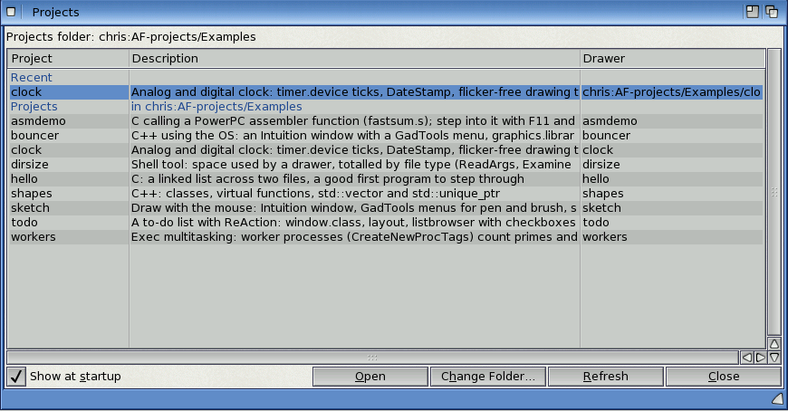
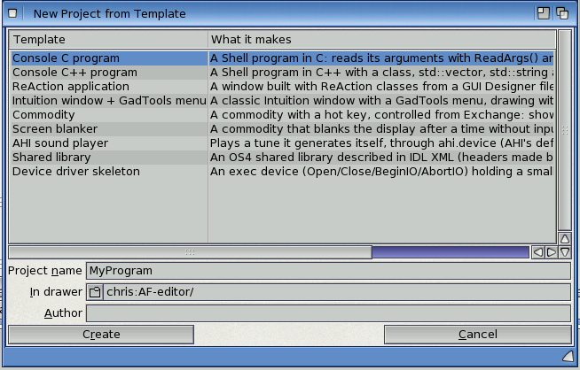
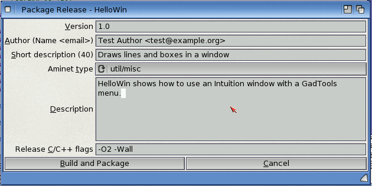

# Projects and templates

A project is a file, `name.afp`, in the drawer that holds your sources. It lists the files,
holds the build settings, and remembers your breakpoints and watches. This chapter covers
making and opening projects, the projects folder and the project browser, the templates, and
packing a finished program for Aminet.



*Figure: What a project holds*

## Making a project

- **Project > New Project...** asks where to save the `.afp`. It adds the C, C++, assembler,
  header and Python files already in that drawer, or writes a starter `main.c` if there are
  none.
- **Project > New Project from Template...** makes a new drawer with a working program in it;
  see [The templates](#the-templates).

Saved projects get an icon that opens them in AmiForge.

## Opening a project

- **Project > Open Project...** (**Amiga-P**). The requester starts in the projects folder; when
  the project that's open lives somewhere else, it starts in the drawer above that project, so
  its neighbours are one click away.
- **Project > Open Recent**: the last ten projects.
- **Project > Browse Projects...** (**Amiga-U**): see below.
- A Boing BASIC project (`.bbp`) opens too: AmiForge uses the `.afp` beside it, or makes one.

Opening another project asks about files with unsaved changes first. **Project > Close
Project** closes the project and its files.

### The projects folder and the project browser

The projects folder is the drawer where you keep your projects. It starts as AmiForge's
`Examples` drawer (`PROGDIR:Examples`); **Project > Set Projects Folder...** chooses another.
Open Project and New Project from Template start there.

**Project > Browse Projects...** lists:

- **Recent**: the projects on the Open Recent list that still exist;
- **Projects**: every drawer in the folder, or one drawer further down, that has an `.afp`
  file, sorted by name. AmiForge doesn't look inside a project's own drawer, so `obj/` and
  similar drawers are skipped.

The columns are the project's name, its description and its drawer. The description is the
first line of the `description=` in the `.afp` (the one Package Release uses), or else the
first line of a `README`, `README.txt` or `README.md` in the drawer.



*The project browser*

Double-click a project, or select it and click **Open**. **Change Folder** chooses the projects
folder; **Refresh** reads it again. The browser is an ordinary window: the main window keeps
working while it's open, and **Amiga-U** brings it back to the front if it got covered.
Opening a project closes it. When AmiForge starts with no project to open, it shows the
browser; **Show at startup** turns that off.

## The files of a project

**Project > Add Files...** and **Project > Remove File** change the file list. Removing a file
from the project doesn't delete it. **Project > Save Project** saves the `.afp` (AmiForge also
saves it when you change the settings).

Without a project, Build, Run and Debug work on the file being edited, as a project of one
file.

## Project settings

**Project > Settings...** holds the build settings:

| Setting | Default |
|---|---|
| Name | the `.afp`'s name |
| Program file | the project's name |
| C compiler / C++ compiler | `gcc` / `g++` (from `SDK:gcc/bin` if they aren't in the path) |
| C flags | `-O0 -gstabs -Wall` |
| C++ flags | `-O0 -gstabs+ -Wall` |
| Assembler flags | `-gstabs` |
| Linker flags / libraries | (none) / `-lauto` |
| Program arguments | (none) |
| Console | a new console window; or a file or console such as `CON:0/0/640/200/Out/CLOSE` |
| Run command | the program; something else to run instead, such as `Execute run-test` |
| Stop at main() when debugging | on |
| Track leaks when debugging | off (see [The debugger tools](10-debugger-tools.md#leaks)) |
| Python project, Main script, Python interpreter | see [Python projects](06-building.md#python-projects) |
| Boing BASIC command, Extensions, C sources | in a Boing BASIC project: see [Boing BASIC projects](06-building.md#boing-basic-projects) |

Keep `-gstabs` (C) and `-gstabs+` (C++) in the flags to debug at the source level: the
debugger reads stabs, the debug format of AmigaOS 4's own tools.

## The templates

**Project > New Project from Template...** lists the templates in `AmiForge/Templates`:

1. Choose a template.
2. Type the project's name (letters, digits, `-` and `_`) and the drawer to make it in.
3. Type the author: it goes into the comments and the version string, and is remembered.

AmiForge makes a drawer with the project's name, writes the files and the `.afp`, and opens
it. Every template builds with **F7** and runs with **Ctrl-F5**.



*New Project from Template*

| Template | What it makes |
|---|---|
| Console C program | A Shell program that reads its arguments with `ReadArgs()` |
| Console C++ program | A Shell program with a class, `std::vector`, `std::string` and algorithms |
| ReAction application | A window designed in a `.afg` file, with its code generated and the buttons already doing something |
| Intuition window + GadTools menu | A classic Intuition window with a GadTools menu, drawing with graphics.library |
| Commodity | A commodity with a hot key, controlled from Exchange; shows a window when the key is pressed |
| Screen blanker | A commodity that blanks the screen with a starfield after a time without input, or on a hot key; `TEST` blanks it for three seconds |
| AHI sound player | Makes notes and plays them through `ahi.device` |
| Shared library | A library described in IDL XML, with its headers and function table made by the SDK's `idltool`, and a test program |
| Device driver skeleton | An exec device (Open, Close, BeginIO, AbortIO) that keeps a small buffer, and a test program |
| Python script | A Python 3 script with `main()` and `argparse` arguments |
| Boing BASIC Form App | A form with a text field and two buttons, opened in the GUI designer |
| Boing BASIC Console App | `Sub Main` printing to its console window |

### The library and device templates

These build `<name>.library` or `<name>.device`, linked with `-nostartfiles`. Their Run
command is `Execute run-test`: the script flushes the old copy from memory, compiles
`test_<name>.c` and runs it against the library or device just built.

A library's functions are described in `<name>.xml`. To add one:

1. Describe it in the XML.
2. Run `SDK:C/idltool -i -p -n -c <name>.xml` to make `include/` and `<name>_vectors.c/.h`
   again.
3. Write the function in `<name>.c`.

### Making your own templates

A template is a drawer in `AmiForge/Templates` with a `template.def`:

```ini
[template]
name=My template
description=What it makes, in one line
order=90                          ; where it comes in the list
[project]                         ; .afp settings for the new project
output=${LOWER}
libs=-lauto
[files]
file=main.c -> ${LOWER}.c         ; copied, and added to the project
extra=ReadMe                      ; copied, but not part of the build
generated=include/x.h             ; made by a command below; added to the project
open=${LOWER}.c                   ; opened afterwards
[create]
command=SDK:C/idltool -i x.xml    ; run in the new drawer after copying
gui=${LOWER}.afg                  ; generate GUI code from this file
```

These are replaced in the files' contents and in their names:

| Write | For |
|---|---|
| `${NAME}` | the name as typed |
| `${IDENT}` | the name as a C identifier |
| `${UPPER}` | `${IDENT}` in capitals |
| `${LOWER}` | `${IDENT}` in lower case |
| `${AUTHOR}` | the author |
| `${DATE}` | the date, as d.m.yyyy |
| `${YEAR}` | the year |

Add `:upper`, `:lower` or `:ident` to any of them, as in `${NAME:upper}`; `$${` is a literal
`${`. For a `gui=` file, a file in the template with the same name as the generated `.c`
supplies code for its sections: that's how the ReAction template's buttons come working.

## Package Release

**Build > Package Release...** makes an archive ready to upload to Aminet.

1. **The release details.** A dialog asks for the version; the author, as `Name <email>`
   (Aminet needs the address); a short description (Aminet allows 40 characters); the Aminet
   category; a longer description; and the compiler flags for the release. By default these
   are the debug flags without `-g`/`-gstabs`, and with `-O2` for `-O0`. They're saved in the
   project. Problems that would get the upload rejected are listed before anything is built.
2. **The release build.** The project is built from scratch with the release flags, in
   `obj-release/`, so the debug build in `obj/` is left alone.
3. **The archive.** In the project's `release/` drawer, AmiForge puts the stripped program,
   its icon and `<Name>.readme` in a drawer with an icon, adds an `Install` script (with an
   icon; it copies the drawer to one chosen in a requester, or given on its command line), and
   packs it all into `release/<Name><version>.lha`, with the Aminet readme beside it as
   `release/<Name><version>.readme`.

The Build tab shows each step and ends with a listing of the archive.



*Package Release*

AmigaOS 4 has no LhA that can create archives, but it has `xad2lha`, which converts any archive
XAD can read into LhA. So AmiForge packs the drawer with the SDK's `tar`, then converts it.
