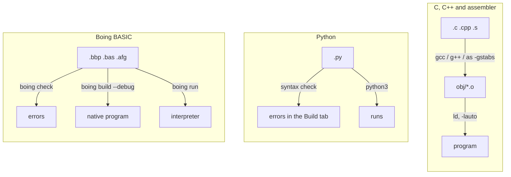
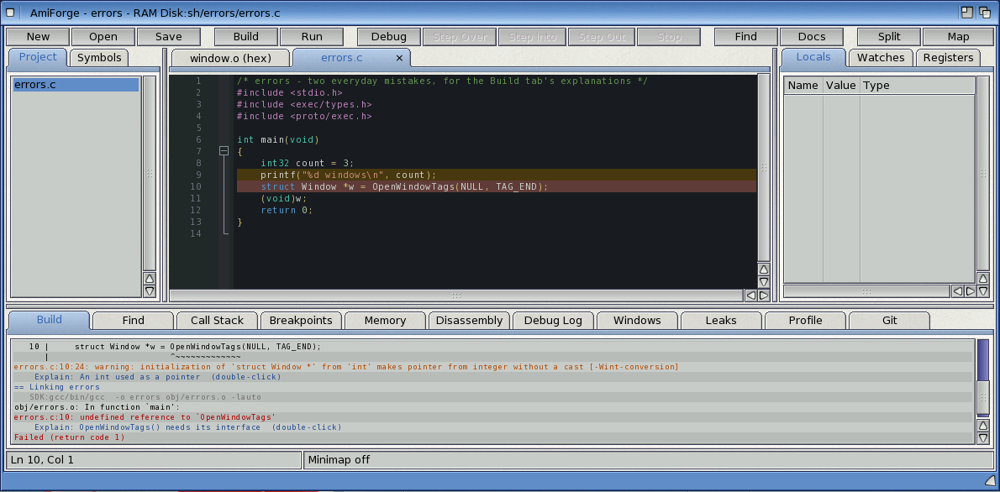
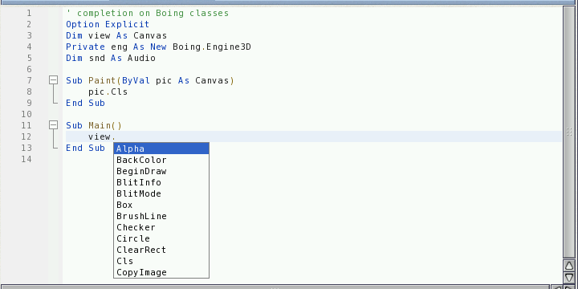
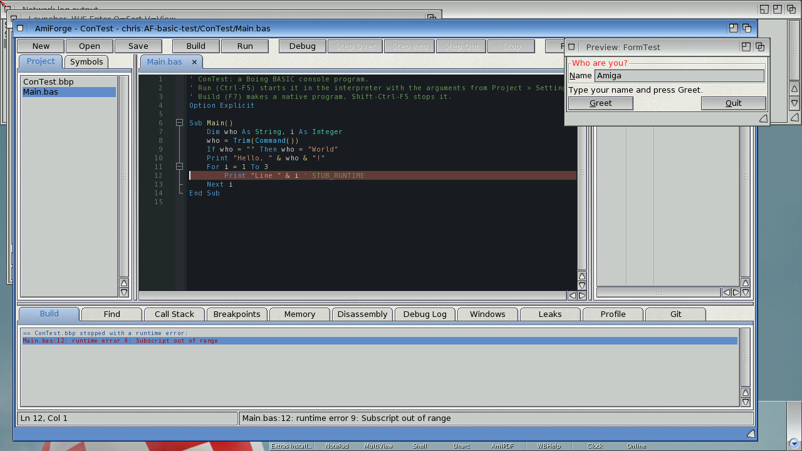
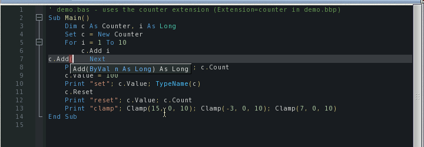

# Building and running

AmiForge builds C, C++ and assembler programs with the SDK's GCC, checks and runs Python
scripts, and checks, builds and runs Boing BASIC programs. Builds run in the background, so
you can keep editing; the program you run runs on its own, so the IDE stays usable even if it
hangs. This chapter covers each kind of project, stopping programs, distributed builds with
distcc, and the explanations AmiForge gives for errors.



*Figure: What Build and Run do for each kind of project*

## C, C++ and assembler

- **F7** (or **Build > Build**, **Amiga-B**) builds. Only the sources that changed, or whose
  headers changed, are compiled again. **Build > Rebuild All** builds everything, **Build >
  Clean** deletes the object files, and **Build > Compile File** (**Amiga-K**) compiles just
  the current file.
- Errors and warnings are listed in the **Build** tab and marked in the editor. Click one, or
  press **F4** / **Shift-F4**, to go to it.
- Object files go in `obj/` in the project's drawer.
- C++ programs are linked with `-athread=native`, which the C++ runtime needs.
- The compilers run with a 4 MB stack.
- **Build > Stop Build** stops a build.



*An error in the Build tab, with AmiForge's explanation under it*

## Running a program

**Ctrl-F5** (or **F6**, **Build > Run**, **Amiga-E**) builds if needed, then runs the program
in a console window in the project's drawer, with the program arguments from the project's
settings. With `/WAIT` in the console's description (the default), the console window stays
open after the program ends until you close it.

While the program runs, the status bar says so and the toolbar's **Stop** button is on.
**Build > Stop Program** (**Shift-Ctrl-F5**, or **Stop** when nothing is being debugged)
sends it Ctrl-C, and the status bar shows when it ended and its return code.

A program has to check for Ctrl-C itself (`SetSignal()` or `Wait()` with `SIGBREAKF_CTRL_C`;
newlib's `printf()` also checks). If it's still running a few seconds later, AmiForge asks
whether to send Ctrl-C again, send Ctrl-C, D, E and F (some programs use those), or leave it
running. AmigaOS has no safe way to force a program to quit (its memory, windows and files
would be left behind), so AmiForge never tries. If a program won't react, close its windows
yourself, or save your work and reboot. Quitting AmiForge while a program it started is
running asks first; the program can keep running after AmiForge has gone.

## Python projects

A project is a Python project when **Project > Settings > Python project** is on, which it is
by itself when every file in the project is a `.py` file. **New Project from Template >
Python script** makes one, and so does **New Project** in a drawer of `.py` files. Nothing is
compiled:

- **Build** (F7) checks the syntax of every `.py` file at once with the interpreter (compiling
  without running, and without writing `.pyc` files). Errors appear in the Build tab like a
  compiler's, `main.py:12:5: error: SyntaxError: expected ':'`, and are marked in the editor.
- **Run** (Ctrl-F5) runs the main script in a console window in the project's drawer, with the
  project's program arguments. The main script is **Main script** in the settings, else
  `main.py`, else the first `.py` file; its drawer comes first on `sys.path`. Scripts run with
  a 2 MB stack.
- If the script ends with an exception, the Build tab gets the traceback too: each
  `File "...", line N` line is clickable, and the editor goes to the line where the exception
  happened.
- **Stop Program** (Shift-Ctrl-F5) stops the script the next time it sleeps. The AmigaOS 4
  port of Python doesn't react to Ctrl-C, so AmiForge runs scripts through a small runner whose
  `time.sleep()` checks for Stop Program and raises `KeyboardInterrupt`; `try`/`finally` and
  `with` still clean up. Give long loops a `time.sleep()` now and then. (`SetEnv
  AMIFORGE_STOPWATCH 1` adds a thread that also stops loops that never sleep, but see the
  port's limits below.)
- **Debug** (F5): AmiForge's debugger works on compiled programs and can't step through
  Python. F5 offers to run the script under **pdb**, Python's own debugger, in a console
  window, with the project's Python breakpoints (F9 in a `.py` file) set, so it runs to the
  first one. In pdb `n` steps over, `s` into, `r` out of a function, `c` continues, `b 12`
  sets a breakpoint, `p x` prints, `l` lists and `q` quits. A breakpoint's condition is passed
  on as a Python expression.

Python takes a while to start under QEMU (about 20 seconds before the first line runs); the
status bar says so while it starts.

### Which Python

AmiForge uses the first of:

1. **Python interpreter** in **Project > Settings**;
2. the variable `AmiForge/Python`, for every project: `SetEnv SAVE AmiForge/Python DH1:python-os4`;
3. the first of `C:python3`, `SYS:Utilities/Python/python3`, `Python3:python3`,
   `Python:python3`, `DH1:python-os4`, `DH1:python3` and `Work:Python/python3` that exists.

AmigaOS 4.1 comes with Python 2.5 as `C:python`; AmiForge needs Python 3 and never chooses it.

The AmigaOS 4 port needs `PYTHONHOME` (and `PYTHONPATH`) to find its library; without them it
quits without a word. When they aren't set and the interpreter's drawer has a `lib` drawer
with the library, AmiForge sets them for the scripts it starts. Otherwise set them in
`S:User-Startup`:

```amigados
SetEnv PYTHONHOME DH1:
SetEnv PYTHONPATH DH1:lib
```

### Limits of the Python port

These belong to the AmigaOS 4 port of Python, not to AmiForge:

- It can't load compiled extension modules (`.so` files): only the modules built into the
  interpreter (`math`, `json`, `_socket`, `zlib`, `_amiga` and others) and modules written in
  Python work.
- A script that keeps the CPU busy while it has a second thread can starve every other program
  on the Amiga. Avoid threads in scripts that compute without sleeping.
- Older builds can't open paths that start with a volume name (`Work:...`), only device names
  (`DH1:...`) and assigns. AmiForge hands Python device names; in your own scripts use
  relative paths.

## Other scripts

ARexx, Lua, Perl, shell and AmigaDOS scripts are edited with highlighting, folding,
completion and an outline (see [The window and editing](03-editing.md#the-other-languages)),
but AmiForge doesn't build or run them. Run an ARexx script with `rx script.rexx` in a Shell;
the ones in the Macros menu run from there (see [ARexx and MCP control](13-arexx-mcp.md#macros)).

## Boing BASIC projects

[Boing BASIC](https://github.com/geekychris/boing-basic) is a structured BASIC for AmigaOS 4,
designed for programs with windows, controls and events. Its `boing` command interprets a
program (`boing run`, which starts straight away) or compiles it through C into a native
program (`boing build`). In AmiForge you draw a form in the GUI designer, double-click a
button, and write what happens when it is clicked; Boing BASIC's own manual teaches the
language.

### The files

| File | What it is |
|---|---|
| `Hello.bbp` | The Boing BASIC project: `Name=`, `Startup=Form main` or `Startup=Sub Main`, and a `Module=`, `Form=` or `Class=` line for each file |
| `Main.bas` | A module: Subs, Functions, `Dim`s, `Type`s... |
| `main.afg` + `main.bas` | A form: the window (the designer's `.afg`) and its code, the module of the same name beside it |
| `Counter.cls` | A class module |
| `Hello.afp` | AmiForge's project file beside the `.bbp` (`language=basic`, `bbp=Hello.bbp`): breakpoints and settings |

**New Project from Template** has **Boing BASIC Form App** and **Boing BASIC Console App**.
Adding files to the project or removing them updates the `.bbp`'s `Module=`, `Form=` and
`Class=` lines (a form's code module isn't listed separately); its other lines are left as
they are.

### Editing BASIC

`.bas`, `.cls` and `.bi` files have their own highlighter: keywords and type names in any case,
strings (`""` is a quote), `'` and `Rem` comments, numbers (`&HFF`, `12%`), dates
(`#1/2/2026#`), labels and line numbers, `#If` lines, and the name after `Sub` or `Function`.

- **Folding**: `Sub`, `Function`, `Property`, block `If`, `For`, `Do`, `While`, `Select Case`,
  `With`, `Type` and `Enum`. A one-line `If a Then b` doesn't fold.
- **Indenting**: Return after a line that opens a block indents the next line; `End If`,
  `Next`, `Loop`, `Else`, `Case` and `End Select` line up with the line that opened their
  block when you press Return after them.
- **Comment / Uncomment** (Amiga-/) puts `'` in front of the lines.
- **Completion** (Ctrl-Space, or by itself after three letters) offers the keywords and
  built-in functions with their usual capitals (`ElseIf`, `MsgBox`, `UBound`), the names in the
  project's files, and the forms' control names. After `ok.` it lists the properties and
  methods of the control called `ok` (`Text`, `Enabled`, `SetFocus`...); in a form's code
  `Me.` is the form.
- After `v.`, for a variable declared `As Canvas`, `As Engine3D` or `As Audio` (or `As
  Boing.Canvas`, `As New ...`, or a parameter `ByVal v As Canvas`), completion offers that
  class's methods and properties. AmiForge asks `boing members` for them once per session.
- Find All References and Rename Symbol ignore case, as BASIC does.



*Completion after `view.` for a variable declared `As Canvas`*

### Check, build, run and debug

- **Build** (F7) runs `boing check` and then `boing build --debug`, which makes the program
  (the project's output name) natively, with debug information. Errors arrive as
  `main.bas:12:5: error: ...` and are clickable like a compiler's.
- **Run** (Ctrl-F5) runs `boing check` and then `boing run`, the interpreter, in a console
  window, with the project's program arguments. **Stop Program** (Shift-Ctrl-F5) sends it
  Ctrl-C. If the program stops with a runtime error (`main.bas:12: runtime error 9: Subscript
  out of range`), the error goes into the Build tab and the editor goes to the line.
- **F5** checks and starts the project in the interpreter (the `Startup=` form or `Sub Main`).
  When the project's `.bas` files have breakpoints (F9), F5 makes a native debug build instead
  and starts the debugger, so they stop: see [Debugging](08-debugging.md#debugging-boing-basic).
- **Package Release** builds with `boing build` without `--debug` (optimised) and packs that
  program.



*A runtime error from `boing run`, in the Build tab and at its line*

AmiForge looks for the `boing` command in **Project > Settings > Boing BASIC command**, then
in the variable `AmiForge/Boing` (`SetEnv SAVE AmiForge/Boing Work:BoingBASIC/boing`), then
in `C:boing`, `SDK:C/boing`, `BoingBASIC:boing`, `Boing:boing` and AmiForge's own drawer.

### Extensions written in C

A Boing BASIC project can use classes and functions written in C or C++: an
`Extension=dir/name` line in the `.bbp` names `dir/name.c` (or `.cpp`) and its descriptor
`dir/name.bbx`, and a `CSource=file.c` line a C file for `Declare ... Lib "C"` functions.
**Project > Settings** has a field for each (names separated by spaces); AmiForge writes them
into the `.bbp`.

- **Run** interprets the program with an interpreter made for the project: `boing vm --project
  P.bbp -o T:boing-P`, shown in the build log after the check. It needs the SDK's GCC and
  takes tens of seconds (minutes on a slow machine). It's made again only when the `.bbp`, an
  extension's `.bbx`, `.c` or `.cpp`, a C source or `boing` itself is newer than it. The
  standard interpreter would stop such a program with "... is not linked into this
  interpreter".
- **Build** makes a native program with the extensions linked in.
- Completion after `c.` (for `Dim c As Counter`) lists the extension class's members, and
  `c.Add(` or `Clamp(` shows a call tip with the signature from the `.bbx`. Extension
  functions are in the completion list too.
- `boing vm` needs `libboingvm.a` beside `libboing.a` (in `lib/` next to `boing`) and the
  headers in `include/`.



*`c.Add(` shows the signature from the extension's `.bbx`*

[Exercise 5](exercises/05-basic-extension.md) builds a project with an extension.

## Distributed builds (distcc)

Compiling under emulation is slow. With **Build > Distributed Builds (distcc)...**, AmiForge
compiles C and C++ files with `SDK:C/distcc`: the preprocessor and the linker still run on the
Amiga, but the compiling, which takes most of the time, happens on another machine with a PPC
AmigaOS cross-compiler.

1. On the computer that runs QEMU (macOS or Linux, with Docker), run
   `tools/distcc-server.sh start` from AmiForge's source. It builds a small image from the same
   GCC 11 cross-compiler the SDK has, and runs `distccd` on port 3632 of `127.0.0.1`.
2. In AmiForge, choose **Build > Distributed Builds (distcc)...**, tick the box and type the
   host as the Amiga sees it. QEMU's user networking forwards the guest's gateway address to
   the host's `127.0.0.1`, so that's `10.0.2.2` by default (or `192.168.101.2` with
   `net=192.168.101.0/24`). Several hosts can be listed: `host[:port][/jobs]`.
3. Build. The build log says "Compiling x.cpp (distcc)". If the server can't be reached,
   distcc compiles on the Amiga as before.

The setting is saved in the project (`distcc=1`, `distcchosts=...`); tick **Use these hosts for
other projects too** to keep them for every project.

## Explanations

AmiForge knows the usual Amiga-specific causes of build errors and crashes.

- In the **Build** tab, an error or warning it recognises gets an extra line, `Explain: ...`.
  Double-click it (or choose **Build > Explain Error**) for the whole explanation. It covers,
  among others: OS functions called without their interface (`IIntuition->...`), missing
  `<proto/...>` headers and OS constants, Amiga types without `<exec/types.h>`, `%d` with
  32-bit Amiga types, `SysBase` or `IntuitionBase` declared again, interfaces that are never
  opened (`-lauto`), C++ without `-athread=native`, `__USE_INLINE__` macros clashing with C++
  names, `APTR` casts in C++, `STRPTR` and string literals, AmigaOS 3 headers and timer names,
  big stack frames, things defined twice, `-lm`, and small-data overflows.
- When the debugger catches a crash, the **Debug Log** explains it: see
  [Debugging](08-debugging.md#crashes).
