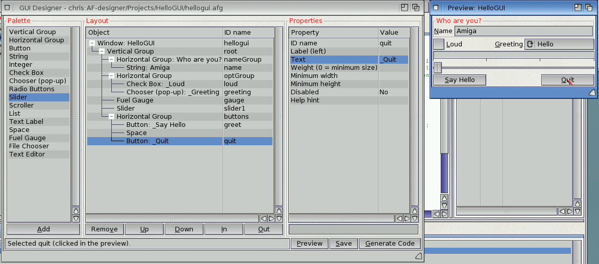
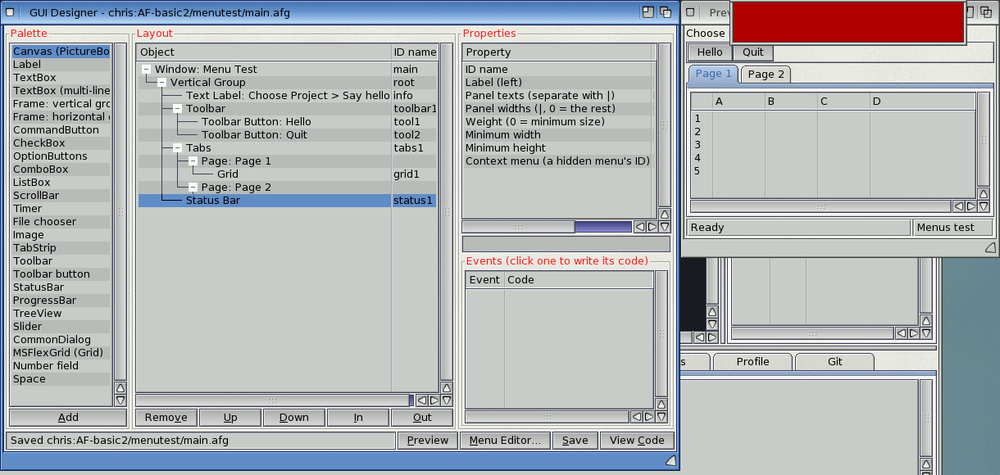
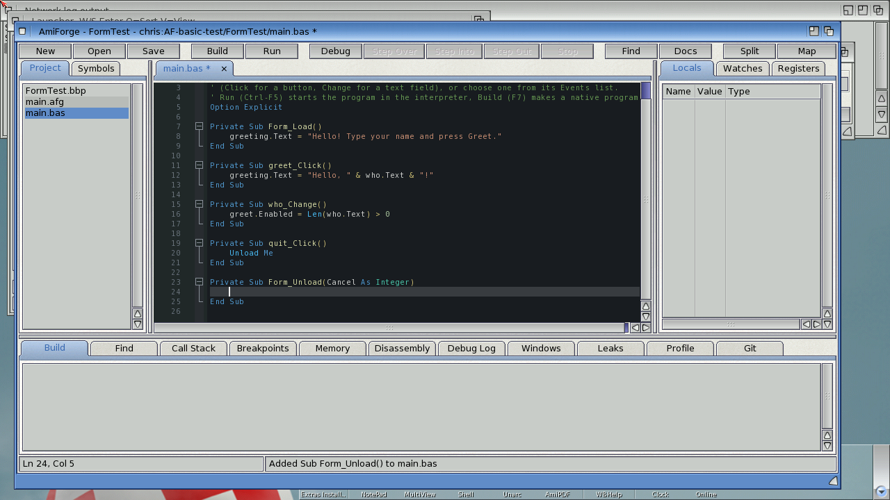
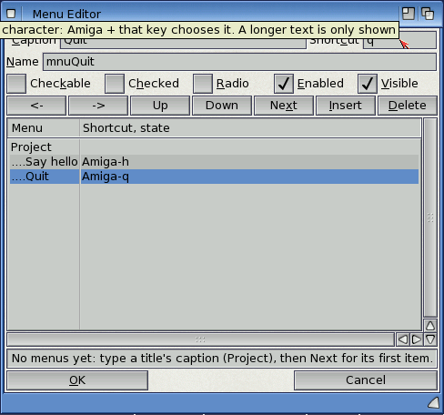
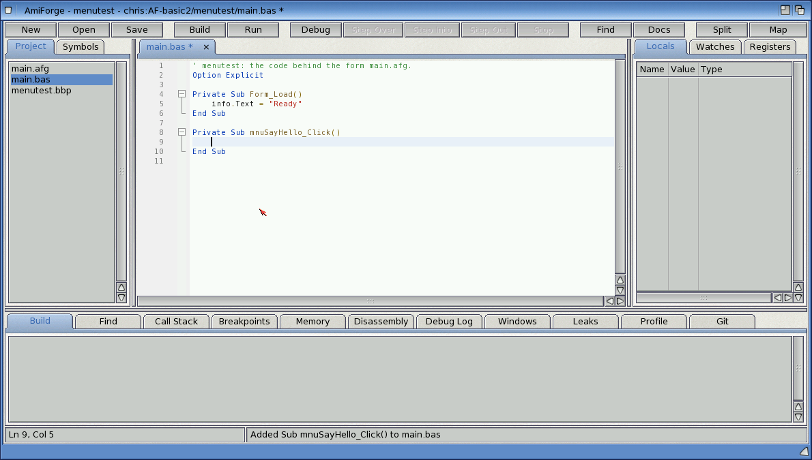

# The GUI designer and the Menu Editor

**Tools > GUI Designer...** builds a window from ReAction's classes: groups, buttons, text
fields, lists, sliders and the rest. In a C or C++ project it writes the C code that makes the
window; in a Boing BASIC project it is the form designer, where double-clicking a control takes
you to its event code, and the **Menu Editor** makes the form's menus.



*The GUI designer and the preview of the window*

## Opening the designer

- If the project has one `.afg` file, the designer opens it.
- Otherwise a file requester asks which one to open. Type a new name to start a new design: it
  starts with a vertical group holding one button.

The designer's window has three columns:

| Column | What it does |
|---|---|
| **Palette** | The objects you can add. Select one and click **Add**, or double-click it |
| **Layout** | The window and its objects as a tree. A new object goes into the selected group, or after the selected object. **Up** and **Down** move it among its neighbours, **In** moves it into the group above it, **Out** out of its group, and **Remove** deletes it |
| **Properties** | The selected object's properties. Click one, type the new value in the field below and press Return. Yes/no and choice properties (such as Frame) change each time you click them again |

The **preview** window is built from the real ReAction classes and is made again after every
change. Click a gadget in the preview to select it in the tree; **Preview** brings the window
back if you closed it. **Save** saves the `.afg`.

## Objects and their properties

In a C or C++ project the palette has vertical and horizontal groups, Button, String, Integer,
Check Box, Chooser, Radio Buttons, Slider, Scroller, List, Text Label, Space, Fuel Gauge, File
Chooser and Text Editor.

Every object has:

- **ID name**: its name in the code. In C, `ok` becomes `MAIN_OK`, and the object is
  `gui->obj[MAIN_OK]`.
- **Label (left)**: a label to the left of the object; `_` before a letter makes it the
  keyboard shortcut.
- **Weight**: its share of the spare space; 0 means its smallest size.
- **Minimum width** and **Minimum height**.

Gadgets also have **Disabled** and **Help hint** (the bubble shown when the pointer rests on
the gadget). Groups have **Frame** (none, group, button or field), **Frame title** (a title
makes a group frame) and **Even sizes**. Each kind has its own as well: a button's text, a
chooser's items (separated by `|`), a slider's range, and so on.

The **window** is the first row of the tree: its **Code name** (the generated functions are
called `<name>_gui_...`), **Title**, **Size** (0 means as small as the contents allow) and
**Resizable**.

## Generating C code

**Generate Code** saves the `.afg` and writes `<name>_gui.h` and `<name>_gui.c` beside it, and
adds them and the `.afg` to the project.

The header declares an `enum` of IDs; `struct <name>_gui`, holding the window object, the open
window, `obj[]` with every object, and a `quit` flag; and the functions `_create`, `_open`,
`_close`, `_dispose`, `_signal` (the signal to wait for) and `_handle`, which processes the
window's input and returns `FALSE` when the program should end. A program's main loop is then:

<!-- fragment -->
```c
static struct main_gui gui;
if (main_gui_create(&gui) && main_gui_open(&gui)) {
    uint32 sig = main_gui_signal(&gui);
    while (!(IExec->Wait(sig | SIGBREAKF_CTRL_C) & SIGBREAKF_CTRL_C))
        if (!main_gui_handle(&gui)) break;
}
main_gui_dispose(&gui);
```

**Your code goes in `<name>_gui.c`, between the `/* USER-BEGIN ... */` and `/* USER-END ... */`
lines.** There's one section per gadget, inside a `switch` on the gadget's ID (each starts with
a comment saying what `code` holds for that kind of gadget), one for includes and globals at
the top, and one for the close gadget, which sets `gui->quit` by default.

Generating the code again keeps everything between the markers and replaces the rest. A
section whose gadget you deleted is kept at the end of the file in an `#if 0` block, so nothing
you wrote is lost; add the gadget back and its code goes back in its place. The generated code
calls the interfaces explicitly (`IIntuition->NewObject(...)`), without `__USE_INLINE__`, and
builds with the project's default flags and `-lauto`.

[Exercise 2](exercises/02-form-app.md) makes a program this way.

## The .afg file

The design is plain text, one object a line, indented two spaces a level:

```text
# AmiForge GUI (edit with Tools > GUI Designer)
window name=main title="My Program" width=320
vlayout id=root
  hlayout id=opts title=Options
    checkbox id=fast text=_Fast checked=1
    chooser id=mode items="Low|Medium|High" label=_Mode
  button id=ok text=_OK weight=0
```

You can edit it by hand. Values with spaces go in quotes; inside quotes `\"`, `\\` and `\n`
work as in C.

## Boing BASIC forms

In a Boing BASIC project (or for any `.afg` with a `.bas` beside it) the designer makes no C
code. The form's code is the module of the same name, and every object with an **ID name** is
a control of that name in BASIC: `who.Text`, `greet.Enabled = False`, `names.AddItem "x"`. The
window is `Me` in its own code and is called by its **Code name** elsewhere (`main.Show`).



*A form with a toolbar, tabs holding a grid, and a status bar*

- **The palette** lists the controls under the names Boing BASIC uses for them: Canvas
  (PictureBox), Label, TextBox, multi-line TextBox, the frames (vertical and horizontal
  groups), CommandButton, CheckBox, OptionButtons, ComboBox, ListBox, ScrollBar, Timer, File
  chooser, Image, TabStrip, Toolbar, Toolbar button, StatusBar, ProgressBar, TreeView, Slider,
  CommonDialog, the grid (MSFlexGrid), Number field and Space. **Add** puts an object where it
  may go: a Toolbar button into the selected toolbar, a control into the first page of the
  selected tabs, a group into tabs as a new page. New tabs start with two pages, a new toolbar
  with one button.
- **Double-click a control** in the Layout tree, or click it twice in the preview, and the
  editor opens the form's `.bas` at its usual event's Sub: `Sub greet_Click()` for a button,
  `who_Change` for a text field, `Form_Load` for the window. A Sub that isn't there yet is
  added (empty, with the event's parameters, such as `Form_Unload(Cancel As Integer)`) and the
  cursor goes inside it. A control without events of its own (Label, ProgressBar, Image,
  StatusBar, Toolbar, CommonDialog) opens `Form_Load`.
- **The Events list** under the properties shows every event of the selected object: those
  with code are marked **code**, empty Subs **empty**. Click one to go to its Sub (it's made if
  it's missing).
- **Renaming a control** (its ID name) offers to rename its event Subs (`ok_Click` to
  `go_Click`) and the code's uses of the old name; comments and strings aren't touched.
- **View Code** (in place of Generate Code) saves the form and opens its code. **Tools > View
  Form / View Code** (**Alt-F7**) switches between a form and its code, from the editor or the
  designer.
- **The preview** shows the menus as its menu strip, a toolbar as a row of buttons, a status
  bar as its panels, tabs with their pages, a grid as a list with its columns, a tree view as a
  list with sample nodes, and an image as a box with the picture's name. Timers and
  CommonDialogs take no space.



*Choosing Unload in the Events list made `Form_Unload(Cancel As Integer)`*

The controls, their usual event and their events:

| Control | In BASIC | Usual event | Events |
|---|---|---|---|
| window | Form | Load | Load, Activate, Deactivate, Resize, KeyDown, KeyUp, KeyPress, QueryUnload, Unload, OLEDragDrop |
| button | CommandButton | Click | Click |
| string | TextBox | Change | Change, KeyPress |
| integer | number field | Change | Change |
| checkbox | CheckBox | Click | Click |
| chooser | ComboBox | Click | Click |
| radio | option buttons | Click | Click |
| slider | Slider | Change | Change, Scroll |
| scroller | ScrollBar | Change | Change, Scroll |
| listbrowser | ListBox | Click | Click, DblClick, ColumnClick |
| getfile | file chooser | Change | Change |
| texteditor | multi-line TextBox | Change | Change, CursorMove |
| timer | Timer | Timer | Timer |
| canvas | PictureBox | MouseDown | MouseDown, MouseUp, MouseMove, DblClick, MouseWheel, Resize, OLEDragDrop |
| menu | Menu | Click | Click |
| tool | Toolbar button | Click | Click |
| tabs | TabStrip | Click | Click |
| treeview | TreeView | NodeClick | NodeClick, DblClick, Expand, Collapse |
| grid | MSFlexGrid | AfterEdit | EnterCell, LeaveCell, BeforeEdit, AfterEdit, Click, DblClick, KeyDown, Scroll |
| label, space, fuelgauge, toolbar, statusbar, image, commondialog | | (none) | (none) |

The table, and each control's properties and methods (which completion offers after `ok.`),
come from Boing BASIC's `docs/forms-events.md`, the agreement between its forms and the
designer. AmiForge has a copy built in and reads a newer one when it finds it: in the drawer
named by the variable `AmiForge/BoingDocs`, in `docs/` beside the `boing` command (or one
drawer up), or in `PROGDIR:Docs`. The ARexx command `BASICCONTROLS` says which one is in use.

The properties include Boing BASIC's newer settings: the window's Remember, Iconify, Tool
window and Accept dropped icons; Splitter bars on groups; picture files on buttons; columns,
widths, multiple selection and sorting on lists; a fixed-width font on text editors; a
Context menu on every control; a canvas's Scale, Right button paints and Fill; and the grid's
rows, columns, title rows and columns, headers, column width and Editable.

## The Menu Editor

In a Boing BASIC form, the **Menu Editor...** button makes the form's menus.



*The Menu Editor: Project with Say hello (Amiga-H) and Quit (Amiga-Q)*

- The list shows every menu: titles at the left, their items indented under them, and
  sub-items once more.
- For the selected menu: its **Caption** (`-` is a separator bar); its **Name** (made from the
  caption if you leave it empty: `Say hello` becomes `mnuSayHello`, and its event Sub
  `mnuSayHello_Click`); its **Shortcut** (one character: Amiga with that key); and
  **Checkable**, **Checked**, **Radio**, **Enabled** and **Visible**. A hidden title is a
  context menu, for a control's **Context menu** property or `Me.PopupMenu`.
- The arrows move the menu out a level, in a level, up and down. **Next** goes to the next
  menu, making a new item at the end; **Insert** adds one before the selected one; **Delete**
  removes it.
- **OK** puts the menus into the form; **Cancel** leaves them as they were.

The menus are rows of the Layout tree too: double-click one there, or choose it from the
preview's menu strip, to write its `Click` Sub.



*Double-clicking Say hello in the tree made `mnuSayHello_Click()`*

## Scripting the designer

ARexx and MCP commands drive the designer: `DESIGN` opens a form, `DESIGNSELECT` selects an
object, `DESIGNADD` adds one, `DESIGNSET` sets a property, `DESIGNEVENTS` lists the events,
`GOTOEVENT` opens an event's Sub, `DESIGNMENUS` opens the Menu Editor and `DESIGNSAVE` saves.
See [the command reference](appendix-b-commands.md#boing-basic-projects-and-forms).
