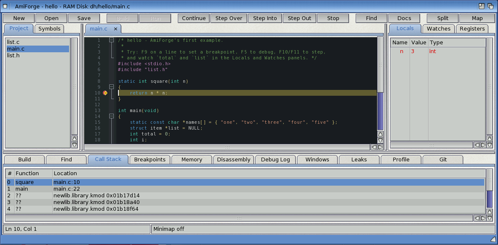
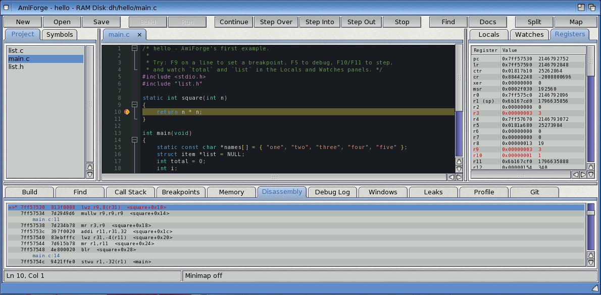
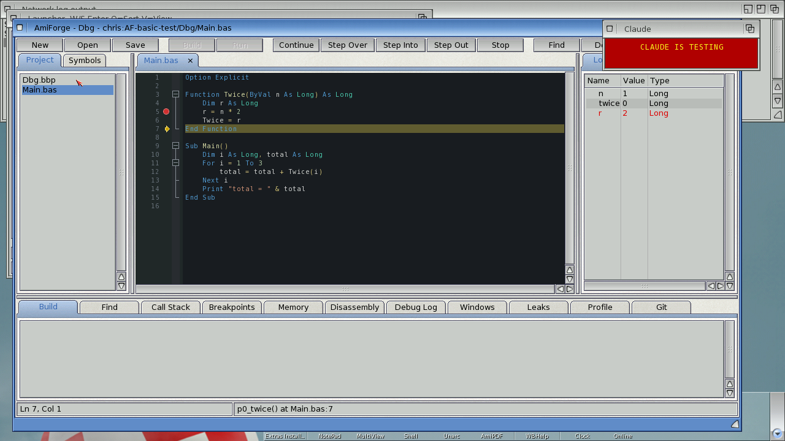
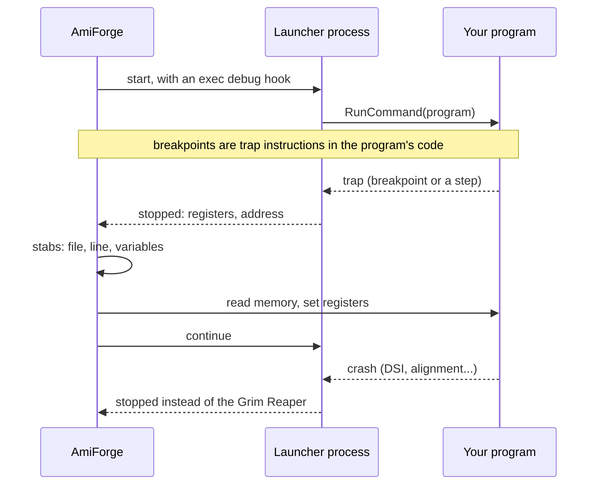

# Debugging

AmiForge has its own source-level debugger. It stops your program at breakpoints, steps
through it line by line, and shows its variables, call stack, memory, registers and machine
code. When the program crashes, the debugger catches it before the Grim Reaper does and shows
you the line. This chapter covers starting and stepping, breakpoints, the panels, crashes,
assembler and Boing BASIC programs, and how the debugger works.

*Stopped at a breakpoint: the yellow arrow, the Locals, the call stack*

## Starting and stepping

**F5** builds if needed and starts the program under the debugger. If **Stop at main() when
debugging** is on in the project's settings, it stops at the start of `main()`.

| Action | Keys |
|---|---|
| Start / continue | F5 |
| Stop | Shift-F5 |
| Step over (the next line; calls run at full speed) | F10 |
| Step into (into functions that have source) | F11 |
| Step out (until the current function returns) | Shift-F11 |
| Run to the line with the cursor | Ctrl-F10 |
| Run until a function is called (asks for its name; the word at the cursor is suggested) | Alt-F10 |
| Set Next Statement: go on from the cursor's line, in the same function | Shift-Ctrl-F10 |
| Step one machine instruction | F8 |
| Pause the running program | Alt-F5, or Break (Pause/Break on a PC keyboard) |
| Restart: stop, build what changed and start again | Shift-Alt-F5 |
| Toggle a breakpoint | F9, or click the margin |
| Enable / disable the breakpoint on the line | Alt-F9, or its check box in the Breakpoints tab |
| Breakpoint condition for the line (sets a breakpoint if there is none) | Shift-Ctrl-F9, or double-click it in the Breakpoints tab |
| Quick watch: watch the word or selection at the cursor (its value goes in the status bar) | Shift-F9 |

Every one is also on the **Debug** menu.

- A **breakpoint condition** is an expression such as `i == 10` or `p->next != 0`; the program
  only stops there when it's true (not zero).
- **Set Next Statement** moves the program counter without running anything in between:
  variables keep their values, so skipping the line that sets one leaves it as it was. It only
  moves within the function the program is stopped in.
- **Pause** stops the program in its own code, never inside an AmigaOS call: a call can hold a
  lock the rest of the system needs (writing to the console, drawing, Intuition), and a program
  stopped there would freeze every window. If the program is in a call when you pause, it
  carries on until the call returns, and stops there. The status bar says **Pausing... (in
  AmigaOS call)** meanwhile. A program waiting for input (in `Wait()` on its window, say) only
  stops once something wakes it up; Pause again, Continue (F5) or Stop cancels a pause that's
  waiting.

## The panels

- **Locals**: the parameters and local variables of the selected frame. Structures, arrays and
  pointers open with their arrow. Values that changed since the last stop are red.
- **Watches**: expressions worked out at every stop. Add one in the field under the list, with
  **Debug > Add Watch...** (which uses the selection), or with the context menu's **Add Watch**.
  Expressions can use variables, `.`, `->`, `[i]`, `*`, `&` and casts, arithmetic and
  comparisons, and the registers (`$r3`, `$pc`, `$lr`).
- **Registers**: the PowerPC registers; changed ones are red.
- **Call Stack**: click a frame to see its source line (with a green arrow), its locals and
  the watches in it.
- **Breakpoints**: the check box enables or disables a breakpoint, **Delete** removes it, and a
  click goes to it. A breakpoint on a line without code moves to the next line that has some.
- **Memory**: type an address (`0x1234ABCD`) or an expression (`p`, `&buf`, `list->next`). A
  pointer shows the memory it points to.
- **Disassembly**: the code around the program counter, with the source lines in between.
  `=>` marks the current instruction and `*` a breakpoint.
- **Debug Log**: what the debugger did and why the program stopped.

*The Registers and Disassembly tabs*

## Crashes

If the program crashes (a DSI, an alignment error, an illegal instruction...), the debugger
stops it instead of the Grim Reaper. You see the source line, the call stack and the
registers; for a DSI, the `DAR` register holds the bad address. **Shift-F5** ends the program.

The **Debug Log** explains the crash from the registers and the call stack: a NULL pointer
(and which field, from the faulting instruction's offset), a NULL interface when the line calls
`IXxx->`, freed or uninitialised memory (MungWall's `0xDEADBEEF` and `0xABADCAFE`), a crash
inside an OS function from a bad argument, a stack overflow (with the `$STACK:` cookie that
fixes it), calling a NULL function pointer, jumping into data, misaligned access, and the
traps of `assert()` and `abort()`. **Debug > Explain Crash** shows it again.

[Exercise 3](exercises/03-debugging.md) finds a crash this way.

## Assembler

Assembler sources built with `-gstabs` step line by line like C. **F8** steps single
instructions anywhere, and the Disassembly tab shows where you are. The `asmdemo` example has
C calling a PowerPC assembler function: step into it with F11, then use F8.

## Debugging Boing BASIC

The debugger works on the native program that Build makes from a Boing BASIC project.
`boing build --debug` writes C with `#line` directives that point at the `.bas` files;
AmiForge compiles it with stabs and keeps the C file beside the program. Then:

- breakpoints set with F9 in a `.bas` file stop on that BASIC line;
- **Step Over** (F10) and **Step Into** (F11) go from BASIC line to BASIC line: a step that
  lands in the generated C, in one of the runtime's helpers or in the runtime itself carries on
  until it's back on a BASIC line;
- **Locals** in a BASIC procedure show the BASIC names and types (`total`, `Long`, `String`)
  and leave out the compiler's temporaries; the **Call Stack** shows the procedures (in lower
  case, as the compiler writes them);
- a String shows as the runtime's `bb_str` structure: open it for `len` and `data`;
- a BASIC project doesn't stop at `main()` (that's the generated C's): set a breakpoint.

F5 in a Boing BASIC project starts the debugger only when a `.bas` file has a breakpoint;
otherwise it runs the program in the interpreter, which can't be stepped through.

*Stopped in a BASIC function: the Locals show its variables as BASIC types*

## How the debugger works

The debugger is AmiForge's own and doesn't use GDB.

*Figure: The debugger and the program it debugs*

- It starts the program from a process with an exec debug hook, so traps and crashes come to
  AmiForge.
- Breakpoints are `trap` instructions planted in the program's code; steps are worked out in
  software by decoding the branch at the program counter.
- It reads the program's stabs for the lines, functions, types and variables.
- Traps only ever go into the program's own code, never into the OS.

Each breakpoint hit or step costs 10 to 30 milliseconds under QEMU.
