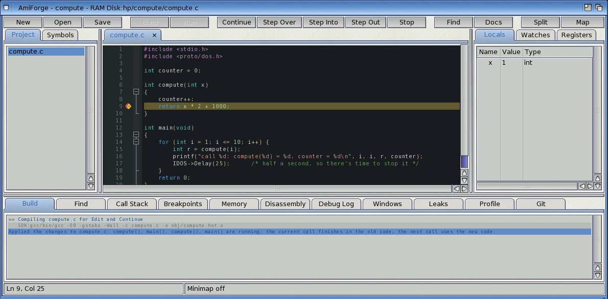
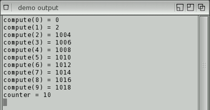

# Edit and Continue

Change your code while the program is stopped in the debugger, press **Ctrl-F9**, and carry
on. AmiForge compiles the changed file and patches the new code into the running program. The
program keeps its state: its variables, open windows, files and memory stay as they were.



*The changes applied while the program is stopped*

## Using it

1. Debug the program (**F5**) and stop it: at a breakpoint, after a step, or with Pause.
2. Change one or more C or C++ files of the project.
3. Press **Ctrl-F9**, or choose **Debug > Apply Code Changes**.

AmiForge saves the files, compiles each source that changed since the program was built (or
since the last time you applied changes) with the project's flags, and applies it. The Build
tab shows the compile and a summary that lists every function of the file (each one is
replaced), such as:

```text
Applied the changes to compute.c: compute(), main(). compute(), main() are running: the
current call finishes in the old code, the next call uses the new code.
```

Then continue (**F5**) or step as usual. Breakpoints in the file move to the new code, and
stepping, the locals, the watches and the call stack work in it. You can apply changes to the
same file as often as you like.



*Call 1 ran the old code, the later calls the new code, and the counter kept counting*

In this example `compute()` was changed from `x * 2` to `x * 2 + 1000` while the program was
stopped inside the call for 1: that call finished with the old formula, every later call used
the new one, and the global `counter` carried on from where it was.

[Exercise 4](exercises/04-edit-and-continue.md) walks through it.

## What happens to code that's running

- A function that is **running** when you apply (the one you're stopped in, or one further up
  the call stack) finishes its current call in the old code; its **next** call runs the new
  code. To see the new version straight away, step out and call it again.
- Everything else (other files, the C library, the OS) is untouched.
- The patch lasts until the program ends. The next run builds the project normally and runs
  the new code from the file.

## What you can change

| Change | Works? |
|---|---|
| Function bodies: statements, expressions, control flow | Yes |
| Calls to functions the program already has (your own, the C library, OS interfaces) | Yes |
| New functions, `static` or not, in the changed file | Yes |
| New string literals and constant data | Yes |
| C++ methods, constructors, destructors, virtual functions | Yes (objects keep their vtables, which lead to the new code) |
| Several files at once | Yes: each changed file is applied in turn |
| A new global or `static` variable | No: restart the program |
| A different size or type for a variable (`buf[64]` to `buf[128]`) | No: restart the program |
| Calling a C library function the program didn't use before (it isn't linked in) | No: build and restart |
| Changed `struct` or class layouts that existing data uses | Not detected; existing objects keep the old layout. Restart |
| Assembler files | No |
| C++ exceptions thrown through a changed function | Not caught (the new code has no unwind tables); AmiForge says so when it applies a file that uses them |

When a change can't be applied, nothing is changed and the Build tab says why:

```text
Can't apply the changes to compute.c: extra is a new static variable: restart the
program to use it.
```

A patch is also refused if the first instructions of a function are being run by a frame
(only possible right after a single-instruction step at a function's entry): step once more
and apply again.

## How it works

1. The file is compiled to `obj/<name>.hot.o` with the project's flags.
2. AmiForge's debugger links the object itself, against the running program (it reads the
   program's symbol table):
   - its code and constant data go into newly allocated executable memory;
   - its global and static variables are placed over the program's **existing** copies, found
     by name (static ones by name within the same source file), so the new code works on the
     program's data. A new or resized variable, or data that can't be matched, stops the
     patch;
   - references to other files, the C library and the interfaces are bound to the program's
     addresses; calls too far for a relative branch go through small stubs;
   - C++ vtables and type information stay the program's.
3. The first instructions of each old function are replaced with a branch to the new version;
   earlier patches of the same function are redirected too.
4. The new code's stabs are added to the debugger's, so breakpoints, stepping and variables
   work in it.
