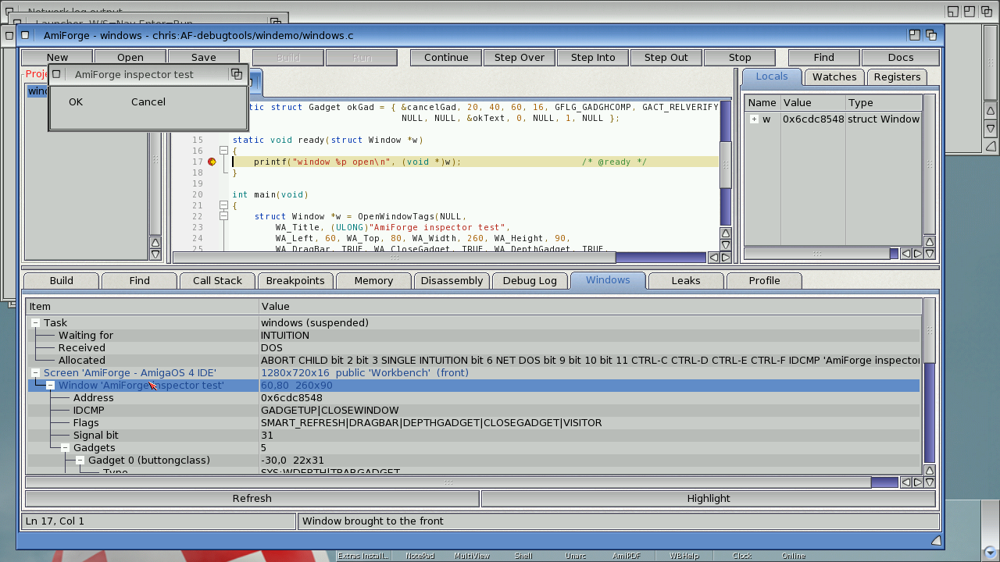
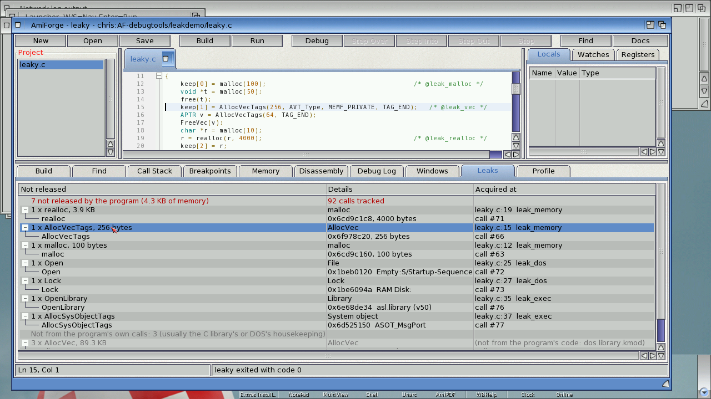
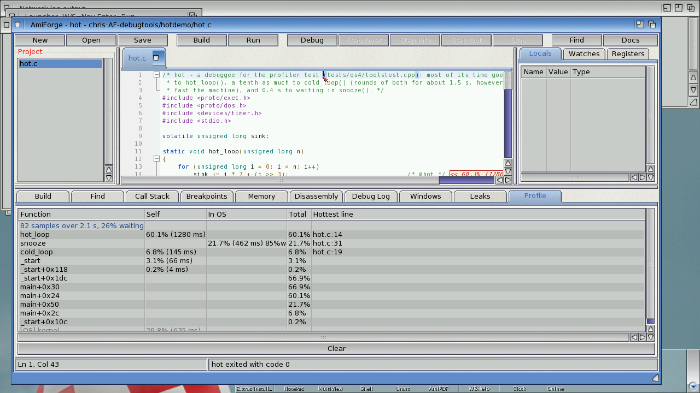

# The debugger tools

Three tools build on AmiForge's debugger, each with a tab in the bottom panel: **Windows**, a
live view of the program's screens, windows and gadgets; **Leaks**, what the program acquired
and never gave back; and **Profile**, where its time goes.

## Windows

**Debug > Inspect Windows** shows the program's screens, windows and gadgets as a tree. The
**Windows** tab refreshes itself every time the program stops; while it runs, press
**Refresh**.

*The Windows tab: the program's task, screen, window and gadgets*

- **Task**: the program's state (running, waiting...) and its signals by name: what it is
  **waiting for**, what it has **received**, and the signals it has **allocated**. A window's
  IDCMP port appears as `IDCMP 'title'`, so you can see straight away whether a program is
  waiting for input on its window, or for Ctrl-C.
- **Screens**: the ones the program's windows are on, and any opened since debugging started.
  Each shows its size, depth and public name.
- **Windows**: every window whose IDCMP port signals the program's task, with its position and
  size, its IDCMP flags and window flags decoded (`CLOSEWINDOW|GADGETUP`,
  `SMART_REFRESH|DRAGBAR|...`), and its port's signal.
- **Gadgets**: each with its ID, type (`BOOLGADGET`, `SYS:CLOSE`, or the BOOPSI class such as
  `layout.gadget`), position, size, flags and activation flags, and its text or label.

**Click a window or gadget** (or select it and press **Highlight**) to bring the window to the
front and flash a frame around it on the screen.

- ReAction windows show their root `layout.gadget`; gadgets inside layouts aren't listed
  (layout.gadget has no public way to list its children).
- Only windows whose port signals the program's own task are shown, not those of other tasks
  it starts.

## Leaks

Turn on **Debug > Track Leaks**, or **Track leaks when debugging** in **Project > Settings**
(the project remembers it), and debug as usual (F5). When the program ends, the **Leaks** tab
lists everything it acquired and didn't give back, grouped by the line that acquired it.

*The Leaks tab: a lock and some memory never released*

| Tracked | Given back with |
|---|---|
| `AllocVec()`, `AllocVecTagList()`, `AllocVecTags()` | `FreeVec()` |
| `AllocMem()` | `FreeMem()` (the size is checked) |
| `AllocSysObject()`, `AllocSysObjectTags()` | `FreeSysObject()` |
| `CreatePool()` | `DeletePool()` |
| `OpenLibrary()` | `CloseLibrary()` (opens are counted) |
| `GetInterface()` | `DropInterface()` |
| `Open()`, `FOpen()`, `OpenFromLock()` | `Close()` |
| `Lock()`, `DupLock()`, `ParentDir()`, `CreateDir()`, `DupLockFromFH()`, `ParentOfFH()` | `UnLock()` (`OpenFromLock()` takes the lock over) |
| `malloc()`, `calloc()`, `realloc()` (and so C++ `new`) | `free()` |

- Each group shows how many items and bytes, and the source line and function that acquired
  them; **click it** to go to the line. Under each group are the items: address and size, and
  for files and locks the file's name, for libraries the name and version, for system objects
  the `ASOT_` type.
- **Problems** are listed at the top: memory freed twice, memory freed with the wrong function
  (`FreeVec()` of memory from `malloc()`), and `FreeMem()` with a different size from the
  `AllocMem()`.
- Only the program's own calls count. What an OS function allocates for itself while the
  program calls it isn't recorded; when a library function allocates on the program's behalf,
  the leak is shown at the program's line that called it.
- If more than 8192 calls arrive between two looks (10 ms apart), some are lost, and the
  summary says so.

While the program runs, exec's and dos's functions are patched with `SetMethod()`. Each patch
checks first whether the caller is the program's task; every other task goes straight through.
`malloc()` and `free()` go through the program's own newlib interface, which is patched when
the program reaches `main()`. All patches are removed when the program ends, and when AmiForge
stops debugging or quits.

Limits: `malloc()` calls made before `main()` (C++ static constructors) aren't tracked, nor are
resources acquired by other tasks the program starts. The tracker reports leaks; it doesn't
free them.

The examples that come with AmiForge give back everything they use: with Track Leaks on, the
only entries left are the C and C++ runtime's own start-up allocations, made before `main()`.

## Profile

**Debug > Profile** (**Shift-F7**, **Amiga-I**) builds the program if needed and runs it under
the profiler, which doesn't stop at `main()` or at breakpoints. A sampler at priority 10 reads
the program's registers about every millisecond. When the program ends (or you press Stop),
the **Profile** tab lists its functions, and the editor marks its hot lines.

*The Profile tab, and the time noted at the end of the hot lines*

| Column | Meaning |
|---|---|
| **Self** | Time with the program counter in the function, as a percentage and in milliseconds |
| **In OS** | Time in the OS (a library, the kernel, or waiting) when this function was the nearest of the program's on the call chain; `w` is the waiting share |
| **Total** | Time with the function anywhere on the call chain (itself or what it calls) |
| **Hottest line** | Click the row to go there |

- Rows starting **[OS]** are OS functions themselves (`newlib.library: memcpy`,
  `kernel: ...`), named from the system's debug symbols.
- Lines with samples get a note at their end: `<< 23.4% (117)` is time on that line, `<< 30.1%
  in OS (151)` time in calls made from it. **Debug > Clear Profile** removes the notes.
- The header shows the number of samples and how much of the time the program was waiting.
- Each sample stands for the time since the previous one, measured with the EClock. Under QEMU
  the sampler wakes late while the CPU is busy (every 15 to 25 ms instead of every 1 ms), but
  the percentages and milliseconds still add up to the real time. Run the program for a second
  or more for detail.
