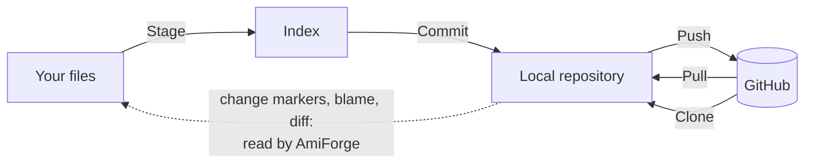
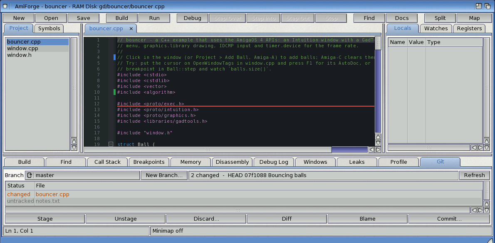
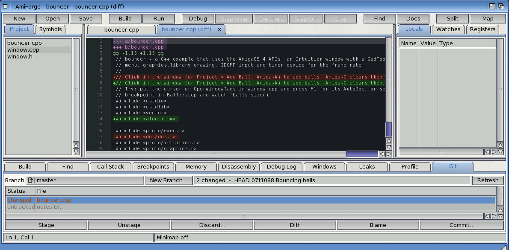
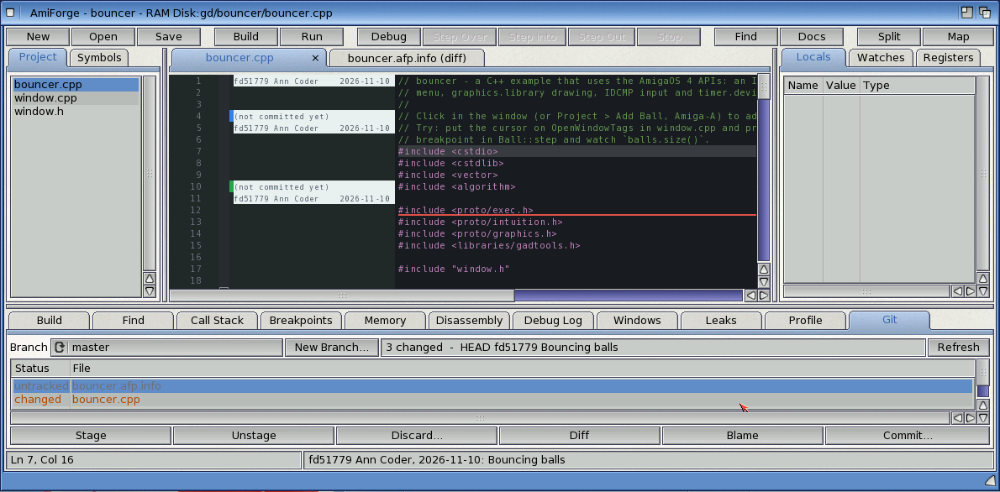

# Git and GitHub

AmiForge works with Git repositories. It reads them itself (objects, packs, the index), so
everything that only looks at the repository is instant: the changed lines in the editor,
blame, the diff view and the Git panel. Commands that change the repository go through
SimpleGit (`SDK:C/sgit`), which also talks to GitHub.

The **Git** menu works on the repository that holds the project: the nearest drawer above it
with a `.git` drawer. What SimpleGit prints appears in the **Build** tab.

## Getting set up

1. **Git > GitHub Setup...**: type your name and e-mail address for commits. For pushing, also
   type your GitHub user name and a personal access token (on github.com: Settings, Developer
   settings, Personal access tokens, with access to your repositories).
2. **Git > Clone Repository...**: type the address (`https://github.com/user/project`) and
   choose a drawer on a disk with long file names. AmiForge clones it, then opens its `.afp` or
   offers to make a project.

- **Long file names:** Git's object and pack files have names of 38 characters or more.
  Classic FFS (`DOS\1` to `DOS\5`) cuts names at 30 characters, which breaks a repository:
  cloning fails with "target OID for the reference doesn't exist". Keep repositories on
  long-name FFS (`DOS\7`), SFS/02 or NGFS. `RAM:` is fine for a quick try.
- **Networking:** check with `ShowNetStatus` that there is a default gateway.
- **Certificates:** SimpleGit's list of certificates is older than GitHub's current ones, so
  AmiForge sets `GIT_SSL_NO_VERIFY`. The connection is still encrypted, but the server's
  certificate isn't checked.
- Without a token, Push and Pull open a console window where SimpleGit asks for your user name
  and token.

## The Git menu

| Item | What it does |
|---|---|
| Git Panel | Shows the Git tab |
| Blame (toggle) | The blame margin on or off |
| New Branch... | A branch at the current commit, which it switches to |
| Status, Diff, Log | The repository's state in the Build tab |
| Commit... | Saves everything, stages the project's files and the `.afp`, and commits with your message |
| Pull, Push | Pull or push the current branch from or to `origin` |
| Clone Repository... | See above |
| GitHub Setup... | See above |

*Figure: Git in AmiForge: what SimpleGit does, and what AmiForge reads itself*

## Change markers

A thin bar beside the text shows how the file differs from the last commit (HEAD):

| Bar | Meaning |
|---|---|
| green | lines you added |
| blue | lines you changed |
| red line | lines were deleted here |

The markers follow your typing and are brought up to date when you save. **Click a bar** to
see what the lines were in HEAD.

## The Git panel

*The Git tab, and change markers in the editor*

**Git > Git Panel** (or the **Git** tab at the bottom) shows the project's repository:

- **Branch**: the current branch. Choose another one to switch to it. AmiForge asks first if
  there are changes that aren't committed, and reads open files again that changed. Switching
  to a branch at another commit uses SimpleGit's checkout, which resets changed files and
  deletes untracked ones; AmiForge lists what would be lost before it goes ahead. Switching to
  a branch at the same commit, and **New Branch...**, keep your changes.
- The changed files, with their state: *changed*, *staged*, *staged, changed*, *added*,
  *deleted*, *untracked*. Files matched by `.gitignore` aren't listed.
- **Stage** (`git add`), **Unstage**, **Discard...** (throws away the file's unstaged changes;
  an untracked file is deleted), and **Diff** (or double-click a file): the file's changes in a
  read-only tab, as a unified diff.
- **Blame** and **Commit...** (the same as **Git > Commit...**: it stages every project file
  first, including any you unstaged).

*A file's changes in a diff tab*

## Blame

*The blame margin, and the line's commit in the status bar*

**Git > Blame (toggle)** adds a margin with the commit, author and date of each line (shown on
the first line of each block from the same commit); lines you haven't committed say so.
Moving the cursor shows the line's commit in the status bar, and **clicking the margin** shows
the whole commit message. AmiForge follows the file's history back through up to 60 commits
that changed it.

[Exercise 6](exercises/06-git.md) goes through a round trip to GitHub.
