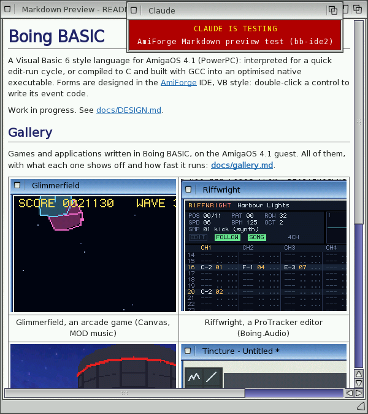

# The Markdown preview

Markdown is the plain-text format of README files and of documentation on GitHub, this manual
included. **View > Markdown Preview** (**Amiga-M**) shows the current `.md` file rendered in a
window beside the editor, the way it will look on GitHub; opening a `.md` file shows it too.
The preview follows what you type (0.3 seconds after you stop) and the Markdown file you
switch to.

*Boing BASIC's README in the preview: headings, links and a table of screenshots*

## What it shows

- Headings (`#` lines, and text underlined with `===` or `---`) in bigger, bold sizes of the
  screen font; paragraphs wrapped to the window's width.
- **Bold**, *italic*, ~~strikethrough~~, and `code` in a fixed-width font on a shaded
  background.
- Code blocks, which aren't wrapped: the scroller at the bottom moves sideways.
- Block quotes, bullet lists, numbered lists and task lists (`- [x] done`), nested.
- Rules, and GitHub's tables with their column alignment; a wide table's cells wrap.
- Pictures: `` and the HTML `` that READMEs use.
  They load through picture.datatype and are scaled down to fit. A picture that can't be loaded
  (or one on the web) shows its alt text in a frame. HTML tables of pictures, as on GitHub, are
  tables.

The headings use the screen font at bigger sizes, and code DejaVu Sans Mono (or the system's
fixed-width font).

## Links

Click a link:

- a file next to the document (`docs/ui.md`, `../README.md`) opens in the editor;
- `#a-heading` scrolls to that heading;
- a web address goes to your web browser through openurl.library's `OpenURL`. Without
  openurl.library the status bar shows the address.

## Moving around

Scroll with the scrollers, the mouse wheel, the cursor keys, Page Up and Page Down (or Space),
Home and End.

## Text and limits

- The file is read as UTF-8. Characters outside Latin-1 that the Amiga's fonts can't show are
  replaced: dashes and quotes by their ASCII forms, arrows by `->`, the rest by `?`.
- Raw HTML other than pictures, links, line breaks, emphasis and tables isn't shown, nor are
  footnotes, maths or pictures from the web.
- At most 96 pictures (or 24 million pixels) are loaded; the rest show their alt text. Very
  big or very deeply nested documents are cut short rather than slowing the Amiga down.

The parser is md4c 0.5.2 (MIT licence, in `third_party/md4c` of AmiForge's source).
