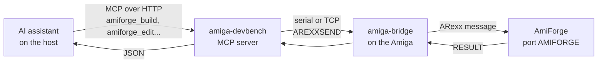

# ARexx and MCP control

Everything AmiForge does can be driven from outside: from ARexx scripts and macros on the
Amiga, and from an AI coding assistant on another computer through the Model Context Protocol
(MCP). This chapter describes AmiForge's ARexx port, the Macros menu, the commands for scripts
and assistants and their format, and setting up an assistant.

## The ARexx port

AmiForge's ARexx port is called **AMIFORGE** (**AMIFORGE.1** for a second copy). Start
AmiForge from a Shell with `AmiForge REXXPORT=NAME` to choose the name. Commands return their
results in `RESULT`; `RC` is 5 when, for example, `FIND` finds nothing, and 10 for a bad
argument. Arguments can be given in order or by name (`GOTO LINE=12 COL=5`).

The classic commands:

| Command | What it does |
|---|---|
| `OPEN`, `SAVE`, `SAVEAS`, `CLOSE` | Open, save or close a file |
| `GOTO`, `GETLINE`, `GETCOL`, `GETFILE`, `GETWORD` | Move the cursor; where it is; the file; the word at the cursor |
| `GETTEXT`, `GETLINETEXT`, `INSERT`, `REPLACE`, `SELECT`, `FIND` | Read, add, replace, select and find text |
| `BUILD`, `RUN`, `DEBUG`, `STOP` | Build, run, debug, stop debugging |
| `PROJECT`, `GETPROJECT` | Open a project; the project's file |
| `STATUS`, `REQUEST` | A message in the status bar; a requester |
| `QUIT`, `HELP` | Quit; the list of commands, or one command's template |

The [command reference](appendix-b-commands.md) lists every command with its template.

A short example, which puts a comment at the top of the current file and builds:

```rexx
/* comment-and-build.rexx */
OPTIONS RESULTS
IF ADDRESS() = 'REXX' THEN ADDRESS AMIFORGE
'GETFILE'
file = RESULT
'GOTO 1'
'INSERT /* 'file' */\n'
'BUILD'
```

## Macros

`.rexx` files in **PROGDIR:Rexx/** (AmiForge's own `Rexx` drawer) and in the project's
**Rexx/** drawer appear in the **Macros** menu, and run with AMIFORGE as their host. **Rescan
Macros** picks up new ones, **Open Macros Drawer** opens the drawer, and **ARexx Commands...**
lists the commands. Three macros come with AmiForge:

- **HeaderComment**: a comment with the file's name and today's date at the top.
- **SortLines**: sorts the selected lines.
- **IfZero**: puts the selection (or the cursor's line) between `#if 0` and `#endif`.

A macro you also start from a Shell (`rx MyMacro.rexx`) should begin with
`IF ADDRESS() = 'REXX' THEN ADDRESS AMIFORGE`, like these.

[Exercise 7](exercises/07-arexx.md) writes a macro.

## Commands for scripts and assistants

A second set of commands is made for programs: they never open a requester (where AmiForge
would ask something, the command fails and says what), they return at once (a build or a
debugger step is started, and `GETSTATE` says when it has finished), and their results are
easy to read by a program: lists are one record a line with fields separated by tabs, and
states are `key=value` lines. A relative file name is in the project's drawer; without FILE,
the current file is meant.

They cover the project (`PROJECTINFO`, `PROJECTFILES`, `OPENPROJECT`, `NEWPROJECT`,
`TEMPLATES`, `PROJECTS`), the files (`DOCUMENTS`, `READ`, `EDITLINES`, `SUBST`, `SAVEALL`,
`REVERT`, `ACTIVATE`), building and running (`STARTBUILD`, `ERRORS`, `BUILDLOG`, `RUNPROGRAM`,
`RUNOUTPUT`, `STOPPROGRAM`), the debugger (`DEBUGSTART`, `CONTINUE`, `STEP`, `NEXT`,
`STEPOUT`, `PAUSE`, `RUNTO`, `BREAK`, `UNBREAK`, `BREAKS`, `LOCALS`, `STACK`, `FRAME`, `EVAL`,
`REGS`, `CRASH`), the code (`SYMBOLS`, `REFERENCES`), Git (`GITSTATUS`), the designer and
Boing BASIC (`DESIGN...`, `GOTOEVENT`, `BASICSUBS`, `BASICMEMBERS`...), and the Markdown
preview (`PREVIEWMARKDOWN`, `MDBLOCKS`, `MDLINKS`, `MDSTATE`, `MDCLICK`, `MDSCROLL`). They're
all in [the command reference](appendix-b-commands.md).

### The format

Send each command wrapped as `MCP <command>`. That always returns RC 0 and a RESULT of

```text
AF1 <rc> <more> <length> <payload>
```

- `rc`: the command's own return code: 0 OK, 5 not found or nothing to do, 10 error, 20
  unknown command.
- `more`: how many characters of the payload are still to come; `MCPMORE` returns the next
  part in the same format.
- `length`: the length of this part's payload.
- `payload`: the RESULT, or the error message when `rc` isn't 0, escaped: `\\` backslash, `\n`
  new line, `\t` tab, `\r` carriage return, `\p` `|`, `\q` `"`, `\xHH` any other control
  character or byte from 0x7F.

Text arguments are escaped the same way, with `\s` for a space too, so that every value is one
word: `MCP SUBST FILE=main.c OLD=return\s0; NEW=return\s1;`. Text too long for one line (about
8 KB) goes in pieces with `MCPBUF SLOT=1 CLEAR TEXT=...` and `MCPBUF SLOT=1 TEXT=...`, and is
then given as `\@1`: `MCP EDITLINES FILE=main.c FROMLINE=10 TOLINE=12 TEXT=\@1`.

## AI assistants (MCP)

An AI coding assistant on your computer, such as Claude Code, can drive AmiForge on the Amiga:
open a project, read and change its files, build it and read the errors (with AmiForge's
explanations), run the program and read its output, set breakpoints, debug, and look at the
variables, the call stack and any expression. You keep working in AmiForge and see everything
the assistant does.



*Figure: How an assistant reaches AmiForge*

- **amiga-devbench** (the host side of the amiga_mcp project) is the MCP server. Its
  `amiforge_*` tools turn each request into ARexx commands for AmiForge, and the answers into
  JSON.
- **amiga-bridge** is the small program on the Amiga that the devbench talks to over a serial
  line or TCP. It passes each command to the ARexx port and brings the result back.
- **AmiForge** answers on its ARexx port with the commands above.

### Setting it up

1. **The devbench**, running and connected to the Amiga's bridge. In the amiga_mcp checkout,
   `scripts/start.sh os4` starts it with QEMU (or `python3 -m amiga_devbench --profile
   qemu-os4 --no-emulator` with QEMU already running). On the Amiga, `amiga-bridge` must be
   running; the devbench's web page shows a green light when it is.
2. **The assistant**, told where the MCP server is. For Claude Code, in the project's
   `.mcp.json`:

   ```json
   {
     "mcpServers": {
       "amiga-dev": { "type": "http", "url": "http://localhost:3000/mcp" }
     }
   }
   ```

   or from a shell: `claude mcp add --transport http amiga-dev http://localhost:3000/mcp`.
3. **AmiForge**, running on the Amiga: start it yourself, or let the assistant start it with
   `amiforge_launch`. Give it a project to open; without one, AmiForge reopens your last
   project or shows the project browser.

Nothing needs to be set in AmiForge: the port is always open. A second AmiForge gets the port
`AMIFORGE.1`, or `AmiForge REXXPORT=MYFORGE` gives it a name of your own; every `amiforge_*`
tool takes a `port` argument. That way an assistant can work in its own copy while you work
in yours.

### The tools

| Tool | What it does |
|---|---|
| `amiforge_status` | The state: project, current file, cursor, open files, build state, debugger state, whether a run is going |
| `amiforge_launch` | Starts AmiForge (if its port isn't there) and waits for the port |
| `amiforge_projects`, `amiforge_open_project`, `amiforge_new_project`, `amiforge_project_info` | Projects and templates |
| `amiforge_open_file`, `amiforge_read_file`, `amiforge_edit`, `amiforge_edit_lines`, `amiforge_save`, `amiforge_revert` | Files: reading (the editor's text when the file is open), changing (like typing: undoable, not saved), saving |
| `amiforge_build`, `amiforge_errors`, `amiforge_build_log` | Building (saving first), with the diagnostics and their explanations |
| `amiforge_run`, `amiforge_run_output`, `amiforge_stop_program` | Running, with the output captured |
| `amiforge_debug`, `amiforge_breakpoint`, `amiforge_locals`, `amiforge_stack`, `amiforge_eval`, `amiforge_registers` | The debugger: each step waits until the program stops and returns where, why, the source around it and the locals |
| `amiforge_symbols`, `amiforge_references`, `amiforge_git_status` | The code and the repository |
| `amiforge_screenshot` | A picture of the Amiga's screen or a window |
| `amiforge_command` | Any ARexx command, wrapped as above |

### What to keep in mind

- **Nothing is confirmed.** An edit is applied, and a build or run starts, at once. Requesters
  that would appear are answered with their last button (Cancel) and their text comes back as
  the error, so nothing is discarded without asking: opening another project with unsaved
  changes fails until the assistant saves or reverts them.
- **Edits aren't saved until asked**, like typing; the file changes on disk only with a save
  or a build.
- **You share the IDE.** If you type in a file while the assistant changes it, both changes go
  in; an edit whose text you changed fails rather than going in the wrong place.
- **While a window of AmiForge's own is open** (a requester, Project Settings, the project
  browser, the template chooser, the Menu Editor), the port doesn't answer, and the tools say
  so after 10 seconds. Close the window.
- **The program is real.** It runs on the Amiga with no memory protection, as from the Run
  menu.
- Each command is a round trip through the bridge (about a third of a second on QEMU), and
  long results come in parts of about 3.5 KB.
