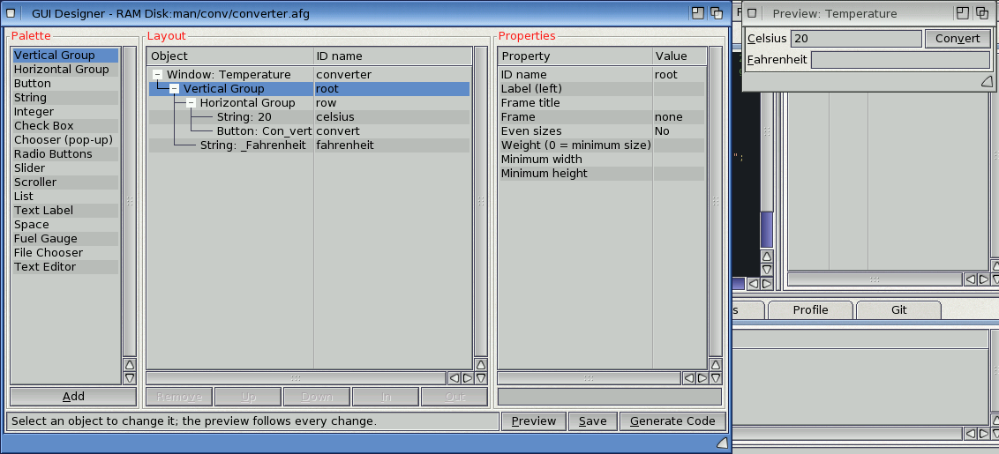

# Exercise 2: A window made with the GUI designer

You design a small ReAction window that converts Celsius to Fahrenheit, let the GUI designer
write its C code, and fill in what happens when the button is clicked. You'll use the
designer's palette, layout tree and properties, Generate Code, and the USER sections.

The finished project is in `examples/manual/ex02-converter/`.

## 1. A project with a main program

Make a drawer `Work:converter`, choose **Project > New Project...** and save `converter.afp`
in it. AmiForge writes a starter `main.c`. Replace it with:

<!-- project: examples/manual/ex02-converter -->
```c
#include <proto/exec.h>
#include <dos/dos.h>

#include "converter_gui.h"

int main(void)
{
    static struct converter_gui gui;
    if (converter_gui_create(&gui) && converter_gui_open(&gui)) {
        uint32 sig = converter_gui_signal(&gui);
        while (!(IExec->Wait(sig | SIGBREAKF_CTRL_C) & SIGBREAKF_CTRL_C))
            if (!converter_gui_handle(&gui)) break;
    }
    converter_gui_dispose(&gui);
    return 0;
}
```

## 2. Design the window

Choose **Tools > GUI Designer...** and type `converter.afg` as the name of a new design. It
starts with a vertical group holding a button.

1. Select the **Window** row and set **Code name** to `converter`, **Title** to `Temperature`
   and **Width** to `280`.
2. Select the vertical group (its ID name is `root`). Select **Horizontal Group** in the
   palette and click **Add**: the new group goes inside the root. Give it the ID name `row`.
3. With `row` selected, add a **String**: ID name `celsius`, **Label (left)** `_Celsius`,
   **Text** `20`.
4. Select the button the design started with (it's above `row`), click **Down** to move it
   below `row`, then **In** to move it into `row`, after the string. Set its ID name to `convert`, its **Text** to `Con_vert` and its
   **Weight** to `0`, so that it keeps its smallest width.
5. Select the root group again and add another **String**: it goes at the end of the root,
   under `row`. ID name `fahrenheit`, label `_Fahrenheit`.

The preview follows every change. Click **Save**.



*The converter's window in the designer, with the preview*

## 3. Generate the code

Click **Generate Code**. AmiForge writes `converter_gui.h` and `converter_gui.c` and adds them
and `converter.afg` to the project. Press **F7**: it builds, and **Ctrl-F5** shows the window,
which does nothing yet.

## 4. Make Convert work

Open `converter_gui.c`. Your code goes between the `USER-BEGIN` and `USER-END` lines; the
designer keeps it when it writes the file again. In the `includes` section, add a function that
reads the Celsius field and fills in the Fahrenheit one:

<!-- fragment -->
```c
#include <stdio.h>
#include <stdlib.h>

static void convert(struct converter_gui *gui)
{
    STRPTR text = NULL;
    static char out[32];
    IIntuition->GetAttr(STRINGA_TextVal, gui->obj[CONVERTER_CELSIUS], (uint32 *)&text);
    double c = text ? atof((const char *)text) : 0.0;
    snprintf(out, sizeof out, "%.1f", c * 9.0 / 5.0 + 32.0);
    IIntuition->SetGadgetAttrs((struct Gadget *)gui->obj[CONVERTER_FAHRENHEIT], gui->win, NULL,
                               STRINGA_TextVal, out, TAG_DONE);
}
```

Then call `convert(gui);` in the `CONVERTER_CONVERT` section (the button), and in the
`CONVERTER_CELSIUS` section too, so that Return in the field converts as well. Build and run:
type `100` and click **Convert**: `212.0`.

## 5. Change the design, keep the code

Back in the designer, give the window a minimum height or add a **Text Label** at the bottom,
and click **Generate Code** again. Your `convert()` and the two calls are still there.

## Try this

- Add a **Chooser** with the items `Celsius|Fahrenheit` and convert in the direction it shows.
- Disable **Convert** while the field is empty (`GA_Disabled`).
- Add a **Fuel Gauge** that shows the temperature between -20 and 40 degrees.
