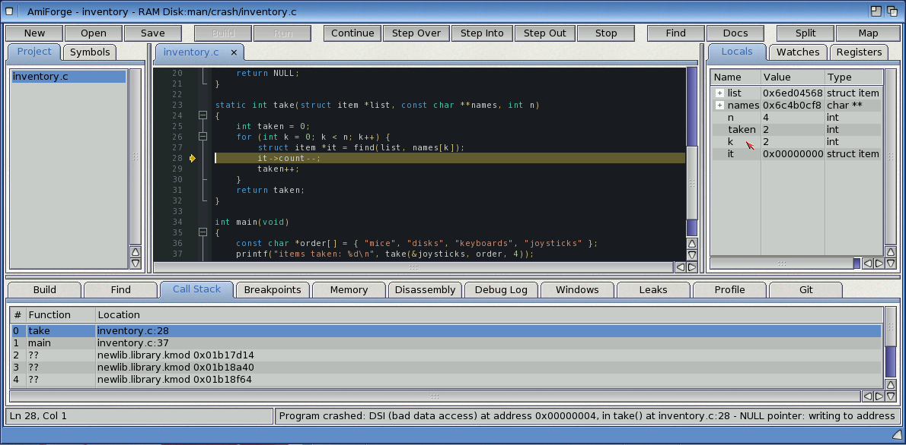

# Exercise 3: Finding a crash

A program that crashes on AmigaOS usually brings up the Grim Reaper, and often takes the
system with it. Under AmiForge's debugger the crash stops the program at the line that caused
it instead. You'll catch a crash, read the variables and the call stack, use a conditional
breakpoint and a watch, and fix the bug.

The project is in `examples/manual/ex03-inventory/`: `inventory-crash.c` has the bug and
`inventory.c` is fixed.

## 1. The program

Make a project in a new drawer with this program as `inventory.c` (or copy
`inventory-crash.c`):

```c
#include <stdio.h>
#include <string.h>

struct item {
    const char *name;
    int count;
    struct item *next;
};

static struct item disks = { "disks", 12, NULL };
static struct item mice = { "mice", 3, &disks };
static struct item joysticks = { "joysticks", 5, &mice };

static struct item *find(struct item *list, const char *name)
{
    for (struct item *i = list; i; i = i->next)
        if (strcmp(i->name, name) == 0) return i;
    return NULL;
}

static int take(struct item *list, const char **names, int n)
{
    int taken = 0;
    for (int k = 0; k < n; k++) {
        struct item *it = find(list, names[k]);
        it->count--;
        taken++;
    }
    return taken;
}

int main(void)
{
    const char *order[] = { "mice", "disks", "keyboards", "joysticks" };
    printf("items taken: %d\n", take(&joysticks, order, 4));
    printf("mice left: %d\n", mice.count);
    return 0;
}
```

There are no keyboards in stock, so `find()` returns NULL for them, and `take()` writes
`it->count` through a NULL pointer.

## 2. Catch the crash

Press **F5** (and **F5** again if it stops at `main()`). The program runs until the crash, and
the debugger stops it at `it->count--;`, marked with the yellow arrow, and shows the **Call
Stack** tab. The status bar says what happened: *Program crashed: DSI (bad data access) at
address 0x00000004, in take()*, and the explanation, *NULL pointer: writing to address
0x00000004*. `it` is NULL, and `count` is at offset 4 in the structure. **Debug > Explain
Crash** shows the whole explanation.



*The debugger stopped at the crash: `it` is NULL*

## 3. Look around

- **Locals**: `it` is `0x00000000`; `k` is `2`; `taken` is `2`, the mice and the disks.
  Open `names` to see the order.
- **Call Stack**: `take` called from `main`. Click `main` to see its line and its locals,
  then click `take` again.
- **Registers**: `DAR` holds the address the program tried to write to, `0x4`.

Press **Shift-F5** to stop the program.

## 4. Stop just before it

Put the cursor on the line `it->count--;` and press **Shift-Ctrl-F9** to give it a
breakpoint with a condition. Type `it == 0`. The breakpoint now only stops when the next
access would crash.

Add a watch: type `names[k]` in the field under the **Watches** tab and press Return.

Press **F5**: the program stops at the breakpoint with `k` at 2, and the watch shows
`"keyboards"`.

## 5. Fix it

Stop the program and change the loop's body:

<!-- fragment -->
```c
struct item *it = find(list, names[k]);
if (!it) {
    printf("no %s in stock\n", names[k]);
    continue;
}
it->count--;
taken++;
```

Press **Ctrl-F5**:

```output
no keyboards in stock
items taken: 3
mice left: 2
```

## Try this

- Watch `mice.count` and step through `take()` with **F10**: the watch turns red when the
  count drops to 2.
- Turn on **Debug > Track Leaks**, allocate the items with `AllocVec()`, forget to free one,
  and look at the **Leaks** tab when the program ends.
- Step through `find()` with **F11** and watch `i` change in the Locals.
