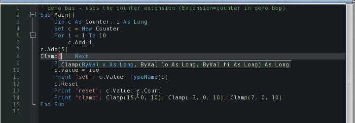

# Exercise 5: Boing BASIC with an extension in C

Boing BASIC programs can use classes and functions written in C. You make a Boing BASIC
console program that rolls a die with a `Dice` class written in C, and see AmiForge link the
extension into an interpreter for Run, complete its members and show its call tips.

You need Boing BASIC with its `lib/` and `include/` drawers beside the `boing` command (see
[Building and running](../06-building.md#extensions-written-in-c)). The finished project is in
`examples/manual/ex05-dice/`.

## 1. The project

Choose **Project > New Project from Template...**, **Boing BASIC Console App**, and call it
`Dice`. AmiForge makes `Dice.bbp`, `Main.bas` and `Dice.afp`.

## 2. The extension

An extension is two files with the same name: the C source, and a descriptor, `name.bbx`,
that tells Boing BASIC what it registers. In the project's drawer, make `dice.bbx`:

```text
class Dice
  method Roll() As Long
  property Sides As Long
  property Rolls As Long ReadOnly
  property Seed As Long
function Percent(ByVal part As Long, ByVal whole As Long) As Long
```

and `dice.c`. A class is a structure that starts with the object header, a table of its
members, and a function that carries out a call to one of them; `BB_EXTENSION` registers the
class and the function when the program starts. The whole file is in the solution; its core:

<!-- project: examples/manual/ex05-dice -->
```c
typedef struct dice { bb_obj hdr; long sides, rolls; uint32_t seed; } dice;

static void dice_invoke(bb_obj *self, int32_t id, int kind, int argc, bb_value *argv, bb_value *ret)
{
    dice *d = (dice *)self;
    switch (id) {
    case M_ROLL:
        d->seed = d->seed * 1103515245u + 12345u;
        d->rolls++;
        *ret = bb_ret_long((long)((d->seed >> 16) % (uint32_t)d->sides) + 1);
        return;
    /* ... Sides, Rolls and Seed ... */
    }
    bb_raise(438, NULL);
}

BB_EXTENSION(dice)
{
    bb_register_class("Dice", &dice_class, new_dice);
    bb_register_function("Percent", percent);
}
```

## 3. Link it into the project

Choose **Project > Settings...** and type `dice` in **Extensions**. AmiForge adds
`Extension=dice` to `Dice.bbp`.

## 4. The program

Replace `Main.bas` with:

<!-- project: examples/manual/ex05-dice/Dice.bbp -->
```basic
Sub Main()
    Dim d As New Dice, counts(1 To 6) As Long, i As Long, face As Long
    d.Seed = 42
    For i = 1 To 600
        face = d.Roll()
        counts(face) = counts(face) + 1
    Next
    For face = 1 To 6
        Print face; ":"; counts(face); "("; Percent(counts(face), d.Rolls); "%)"
    Next
    Print "rolls:"; d.Rolls
End Sub
```

While you type, completion knows the extension: after `d.` the list shows `Roll`, `Rolls`,
`Seed` and `Sides`, and typing `Percent(` shows its parameters from `dice.bbx`.



*A call tip from the extension's descriptor*

## 5. Run it

Press **Ctrl-F5**. The Build tab shows `boing check`, then *Linking the extensions into an
interpreter (T:boing-Dice)*: AmiForge runs `boing vm --project Dice.bbp`, which compiles
`dice.c` with the SDK's GCC and links an interpreter that has the class built in. That takes a
while the first time; the next Run uses it straight away, until you change `dice.c`, `dice.bbx`
or the project. The console shows:

```output
 1 : 107 ( 18 %)
 2 : 106 ( 18 %)
 3 : 104 ( 17 %)
 4 : 92 ( 15 %)
 5 : 83 ( 14 %)
 6 : 108 ( 18 %)
rolls: 600
```

Press **F7** for a native program with the extension linked in.

## Try this

- Make `Sides` refuse a value below 2 from BASIC (`d.Sides = 1`): what does the program say?
  The solution raises error 5.
- Add a method `Reset()` that sets `Rolls` back to 0. Remember the `.bbx`.
- Use the class in a form: a button that rolls, and a label that shows the face.
