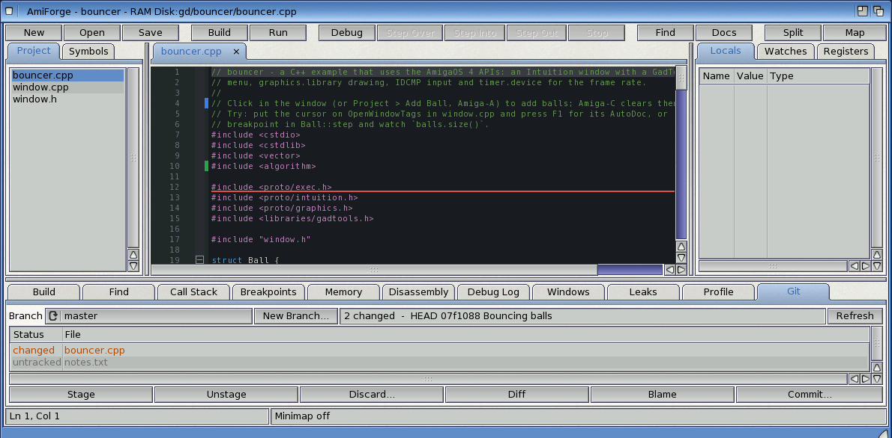

# Exercise 6: A round trip to GitHub

You put a project on GitHub, clone it into AmiForge, change it, look at the change markers and
the diff, commit, push, and pull a change made elsewhere. You need networking with a default
gateway, SimpleGit (`SDK:C/sgit`), a disk with long file names, and a GitHub account.

A `.gitignore` and a README for the project are in `examples/manual/ex06-git/`.

## 1. Set up

1. On github.com, make a new repository called `wordcount` with a README.
2. In AmiForge, choose **Git > GitHub Setup...**. Type your name and e-mail address (they go
   into your commits), your GitHub user name, and a personal access token with access to your
   repositories (github.com: Settings, Developer settings, Personal access tokens).

## 2. Clone it

Choose **Git > Clone Repository...**, type `https://github.com/<you>/wordcount`, and choose a
drawer on a disk with long file names, such as `Work:`. When it has been cloned, AmiForge
offers to make a project there: say yes.

## 3. Add the program

Copy `wordcount.c` from exercise 1 (or `examples/manual/ex01-wordcount/`) into the drawer,
and add it with **Project > Add Files...**. Copy the `.gitignore` from
`examples/manual/ex06-git/` too, so that the object files and the program aren't committed.
Build with **F7** to check.

## 4. Look before you commit

Open the **Git** tab (or **Git > Git Panel**). It lists `wordcount.c`, `wordcount.afp` and
`.gitignore` as *untracked*. Click **Commit...**, type a message such as `Add wordcount`, and
commit: AmiForge stages the project's files and commits them.

Now change a line of `wordcount.c`: a green or blue bar appears beside it in the editor. Click
the bar to see what the line was. In the Git tab, double-click `wordcount.c` for its diff.

*The Git tab and the change markers*

## 5. Push

Commit again, then choose **Git > Push**. The Build tab shows SimpleGit's output; on github.com
the repository now has your two commits.

## 6. Pull a change

On github.com, edit `README.md` (the pencil icon) and commit the change there. In AmiForge,
choose **Git > Pull**. Open `README.md`: it has the change, and the Markdown preview shows it.
Choose **Git > Blame (toggle)**: the margin shows which commit each line came from.

## Try this

- Make a branch with **New Branch...** in the Git tab, commit to it, and switch back to `main`
  with the **Branch** chooser.
- Change a file, then use **Discard...** to throw the change away.
- Clone a repository onto `RAM:`, which has long file names too.
