# AmiForge user guide

AmiForge is an integrated development environment for AmigaOS 4.1 on PowerPC. It runs on the
Amiga itself: you edit, build with the SDK's GCC, debug at the source level, read the AutoDocs
and use Git without leaving it.


## Contents

1. [Requirements](#requirements)
2. [Installing](#installing)
3. [A five-minute tour](#a-five-minute-tour)
4. [The window](#the-window)
5. [Editing](#editing)
6. [Completion and finding your way around](#completion-and-finding-your-way-around)
7. [Editor features](#editor-features)
8. [AutoDocs](#autodocs)
9. [Projects](#projects)
10. [GUI designer, project templates and release packaging](#gui-designer-project-templates-and-release-packaging)
11. [Building and running](#building-and-running)
12. [Debugging](#debugging)
13. [Edit and Continue](#edit-and-continue)
14. [Debugger tools: Windows inspector, leak tracker, profiler](#debugger-tools-windows-inspector-leak-tracker-profiler)
15. [Git and GitHub](#git-and-github)
16. [Git panel, resource editors, ARexx, distributed builds and explanations](#git-panel-resource-editors-arexx-distributed-builds-and-explanations)
17. [The examples](#the-examples)
18. [Running under QEMU](#running-under-qemu)
19. [Troubleshooting](#troubleshooting)
20. [Keyboard reference](#keyboard-reference)
21. [Files and settings](#files-and-settings)

---

## Requirements

| What | Why |
|---|---|
| AmigaOS 4.1 Final Edition (exec 53.70 or newer) | AmiForge uses ReAction, and the exec debug interface for the debugger |
| A true-colour or high-colour Workbench screen | The editor works on 8-bit screens too, but looks best in 16/32-bit |
| **The AmigaOS 4.1 SDK (54.x) with GCC 11**, installed as `SDK:` | The compilers (`gcc`, `g++`, `as`, `ld`), the headers, and the AutoDocs |
| SimpleGit (`sgit`, in the SDK's `sgit.lha`) | Only for the Git menu |
| Networking with a default gateway | Only for cloning, pulling and pushing |
| A disk with long file names (FFS `DOS\7`, SFS/02, NGFS) | Only for Git repositories (see [Git and GitHub](#git-and-github)) |

## Installing

1. **Install the SDK.** Use the SDK's own installer and include GCC 11, or see
   [Installing the SDK without its GUI](#installing-the-sdk-without-its-gui). Afterwards `SDK:` is
   assigned at boot, and `gcc -v` works in a Shell.
2. **Install AmiForge.** Unpack `AmiForge.lha` and double-click **Install-AmiForge**, or run it
   from a Shell with the destination: `Install-AmiForge Work:Development`. You can also just copy
   the `AmiForge` drawer anywhere.
3. **Under QEMU only:** copy `AmiForge/Tools/QEMUCopyFix` to `C:` and add
   `Run >NIL: C:QEMUCopyFix` to `S:User-Startup` (see [Running under QEMU](#running-under-qemu)).
4. **Start AmiForge**: double-click its icon, or a project's `.afp` icon, or from a Shell run
   `AmiForge [project.afp | file.c ...]`. Started without arguments, it reopens the last project.

### Installing the SDK without its GUI

`tools/sdk/make-install-script.py` (in the source repository) reads the SDK's `package.xml`.
It writes an AmigaDOS script that unpacks base, GCC 11, the binutils, newlib, pthreads and the
Unix tools, and runs their post-install steps, as the SDK installer would:

```
tools/sdk/make-install-script.py SDK_Install/package.xml DH1:SDK-Install DH0:SDK > install-sdk
```

Copy the SDK's `.lha` files and `install-sdk` to `DH1:SDK-Install` on the Amiga, then:

```
execute DH1:SDK-Install/install-sdk
```

Add these lines to `S:User-Startup`:

```
assign SDK: DH0:SDK
execute SDK:S/sdk-startup
```

## A five-minute tour

1. Open **Examples/hello/hello.afp** (Project > Open Project, or double-click it).
2. Press **F7**. The Build tab shows the compile and link commands and then "Build succeeded".
3. Press **Ctrl-F5**. The program runs in a console window.
4. Click in the margin next to line 22 (the `list = list_push(...)` line) to set a breakpoint
   (a red circle).
5. Press **F5**. The program starts under the debugger and stops at `main()`. Press **F5** again
   to run on to the breakpoint. The yellow arrow shows where it stopped.
6. Look at **Locals** on the right: `total`, `i`, and the `names` array (click its arrow).
   Press **F10** to step over a line and **F11** to step into `square()`. Changed values turn
   red.
7. Put the cursor on `printf` and press **F1** to read its AutoDoc. Close the AutoDocs window.
8. On an empty line type `list_` and pick from the list that pops up.
9. Press **Shift-F5** to stop.

## The window

- **Toolbar**: New, Open and Save; Build and Run; Debug/Continue, Step Over, Step Into, Step Out
  and Stop; Find; Docs.
- **Project**: the project's files, sources first. Click one to open it.
- **Editor**: one tab per file. A tab's close gadget closes that file, and a `*` means unsaved
  changes. The margins hold:
  - line numbers;
  - markers: a red circle for a breakpoint (hollow if disabled), a yellow arrow and highlight
    where the program is stopped, a green arrow for the selected stack frame, and a red or amber
    background on lines with compiler errors or warnings;
  - fold boxes, which collapse and expand blocks.
- **Right panel**: **Locals**, **Watches** and **Registers**, filled in while debugging.
- **Bottom panel**:
  - **Build**: compiler and Git output. Click an error to go to it.
  - **Find**: the results of Find in Files.
  - **Call Stack**, **Breakpoints**, **Memory** and **Disassembly**.
  - **Debug Log**: what the debugger did and why it stopped.
- **Status bar**: the cursor position on the left, and messages on the right.

Drag the bars between the panes to resize them.

## Editing

The editor is a port of [Scintilla](https://www.scintilla.org/). It highlights C, C++,
PowerPC assembler (`.s`, `.S`, `.asm`, `.i`; GNU `as` syntax with registers, directives and
labels), makefiles and diffs. It also matches braces and auto-indents (after `{`, and a `}`
lines up with its opening line). Files are Latin-1, the Amiga's character set.

| Action | Keys |
|---|---|
| Undo / redo | Amiga-Z / Amiga-Y (or Ctrl-Z / Ctrl-Y) |
| Cut / copy / paste (system clipboard) | Amiga-X / Amiga-C / Amiga-V |
| Select all | Edit > Select All |
| Find / replace | Amiga-F / Amiga-R |
| Find next / previous | F3 / Shift-F3 |
| Find in Files (the whole project) | Amiga-H |
| Go to line | Amiga-L |
| Comment or uncomment the selected lines | Amiga-/ |
| Indent / unindent | Amiga-] / Amiga-[, or Tab / Shift-Tab with a selection |
| Bigger / smaller / normal text | Amiga-+ / Amiga-- / Amiga-0 |
| Wrap long lines, show whitespace, fold all | View menu |

The Find window has Match case, Whole word and Regular expression options, plus Replace and
Replace All. A Replace All can be undone in one step.

## Completion and finding your way around

### Completion

Completion pops up by itself as you type:

| You type | You get |
|---|---|
| 3 letters of a name | Matching words from the open files and project files, C/C++ keywords, and every OS function in the AutoDocs |
| `IExec->`, `IIntuition->`, `IDOS->`... | That library's functions |
| `os::`, `MyClass::`, `std::` | What's declared inside that namespace or class |
| `win.` or `win->` | The members of `win`'s type: your own classes, OS structs (`struct Window`), and `std::vector`, `std::string` and `std::map` |
| `(` after an OS function | A calltip with its prototype |
| **Ctrl-Space** | The list at any point, even with no letters typed |

In the list, use Up and Down, then Return or Tab to insert, or Esc to close it.


Completion reads the current file, the project's files and the headers they `#include`
(following them into the SDK) without compiling anything. It works for declarations written in
the usual way. It doesn't follow `auto`, typedef chains or expressions such as `a.get()->b`;
Ctrl-Space still gives the general list there.

### Headers and definitions

| To... | Do this |
|---|---|
| Open a header named in an `#include` | **Ctrl-click** the line, or put the cursor on it and press **F12** (or Amiga-D) |
| Go to where something is defined | **Ctrl-click** it, or **F12** (or Amiga-J) |

- **Headers:** `"quoted"` headers are looked for next to the file, then in the project.
  `<angled>` headers are looked for in the SDK's include drawers: the OS includes, newlib, the
  C++ library and GCC's own headers. SDK headers open read-only.
- **Definitions:** Go to Definition looks for, in order:
  1. the nearest declaration above the cursor (local variables and parameters);
  2. a struct, class, union, enum, `#define` or typedef in the project;
  3. a function in the project;
  4. for an OS function, its AutoDoc.

### The context menu

Click the **right mouse button** in the editor for a menu of what applies to the word or line
under the pointer:
- open the `#include`d header, go to the definition, its AutoDoc, or complete the word;
- toggle a breakpoint, run to the cursor, or add a watch for the word;
- cut, copy and paste;
- Keyboard Shortcuts.


## Editor features

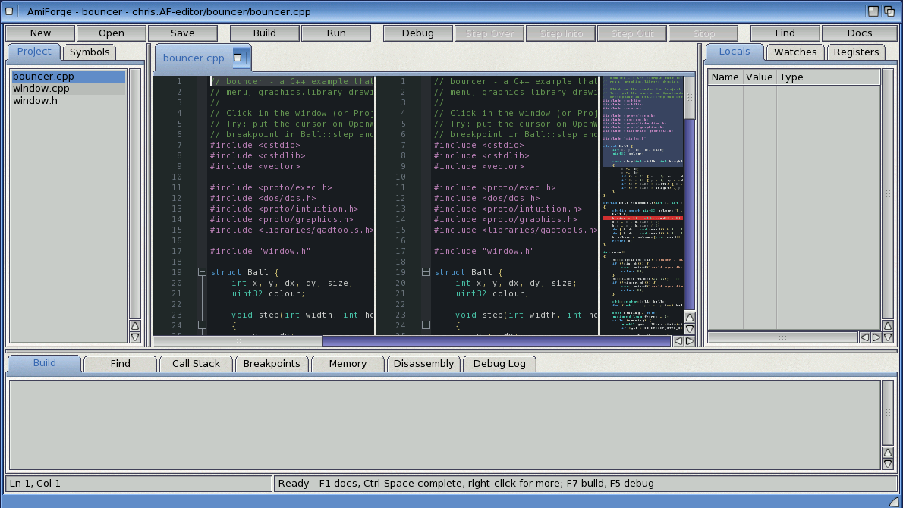

### Themes

**View > Theme** chooses **Light** (the original colours) or **Dark**. The theme colours the
whole editor:
- the syntax highlighting of every language (C, C++, assembler, makefiles, diffs);
- the margins, fold markers and breakpoint/execution markers;
- the selection, caret and caret line;
- calltips and the completion list;
- the AutoDocs viewer.

AmiForge remembers the choice in `ENVARC:AmiForge/Theme`, which holds `Light` or `Dark`.

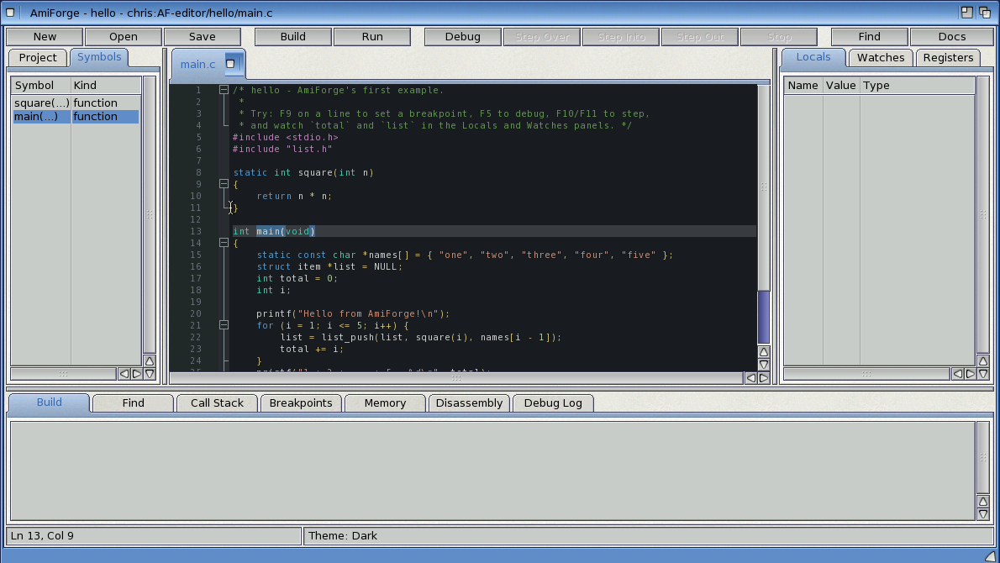

### Split view

**View > Split Editor** shows a second view of the current file beside the first. Each view
scrolls on its own, but they show the same text, so an edit in one appears in the other at once.
Click in a view to work in it: Find, Go to Definition, F1, completion and the other commands act
on the view you clicked last. The scrollers belong to the left view. Choose the menu item again
to close the second view. AmiForge remembers whether the split is on (`ENVARC:AmiForge/SplitView`).

### Minimap

**View > Minimap** shows the whole file in tiny print on the editor's right, with the part that's
in the (left) view highlighted.
- Click the minimap, or drag in it, to jump there.
- The mouse wheel over the minimap scrolls the editor.

AmiForge remembers whether it's on (`ENVARC:AmiForge/Minimap`).

### Multiple cursors

| To... | Do this |
|---|---|
| Add a cursor | **Alt-click** where you want it (Ctrl-click is Go to Definition) |
| Select the word at the cursor, then each next occurrence | **Edit > Add Next Occurrence** (**Amiga-T**), or right-click > Add Next Occurrence |
| Select every occurrence at once | **Edit > Select All Occurrences** |
| Go back to one cursor | **Esc** |

Typing, Delete/Backspace and Paste act at every cursor.

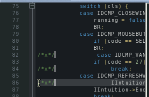

### Snippets

Type a snippet's name and press **Tab** to insert it. Snippets also appear in the completion
list, marked with `»` (for example `for»`); pick one there with Tab or Return. **Edit > Insert
Snippet...** (or the right-click menu) lists them all.

After a snippet goes in, its fields are outlined:
- Type over the selected field.
- **Tab** moves to the next field and **Shift-Tab** to the previous one.
- When you leave a field, the same name elsewhere in the snippet follows. For example, in
  `openlib` the library name goes into `FooBase`, `IFoo` and `struct FooIFace`.
- After the last field the cursor goes to the snippet's end point.
- **Esc** finishes early.

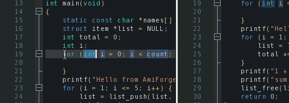

| Snippet | Inserts |
|---|---|
| `main` | `main()` with the usual includes |
| `openlib` | `OpenLibrary` + `GetInterface` with an error check, and the matching `DropInterface`/`CloseLibrary` |
| `window` | `OpenWindowTags` and an IDCMP loop (close gadget, Esc) |
| `timer` | a timer.device request: port, `TimeRequest`, `OpenDevice`, `TR_ADDREQUEST`, clean-up |
| `rexx` | sending a command to an ARexx port and reading the result |
| `tags` | a `struct TagItem` array |
| `for`, `while`, `if`, `switch` | the statements |
| `struct`, `class` | a struct; a C++ class with constructor and destructor |

#### Your own snippets

**Edit > Edit My Snippets** opens `ENVARC:AmiForge/Snippets`, creating it with an example if it
isn't there. Saving the file loads the snippets straight away. The format is snipMate's:

```
# a comment
snippet hello  print a line
	IDOS->Printf("${1:Hello, world}\n");${0}

snippet loop  count down
	for (int ${1:i} = ${2:10}; ${1} > 0; ${1}--) {
		${0}
	}
```

- `snippet <name>  <description>` starts a snippet.
- Each body line starts with a tab, or up to four spaces.
- In the body:
  - `${1:text}` is field 1 with default text, and `${2}` or `$2` is an empty field.
  - A field number used again copies that field.
  - `${0}` is where the cursor ends.
  - `\$`, `\}` and `\\` give a literal `$`, `}` and `\`.
- A tab at the start of a body line (after the one that marks the line) is one indent step.
- Every line gets the indentation of the line where you typed the snippet.
- A snippet with a built-in snippet's name replaces it.

### Symbol outline

The **Symbols** tab beside **Project** (or **View > Symbols**) lists what the current file
defines, in source order:
- C and C++: functions (with `Class::method` names), structs, classes, unions, enums,
  namespaces, typedefs, `#define`s and global variables;
- assembler: labels (functions marked with `.type ..., @function`), `.macro`, `.equ`/`.set`
  and `#define`.

Click an entry to go there. The list updates about a second after you stop typing.

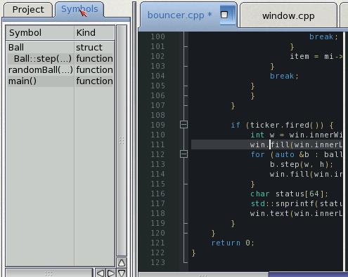

### Find All References

Put the cursor on a name and press **Shift-F12** (or **Edit > Find All References**, or
right-click). Every use of the name as a whole word, outside comments and strings, is listed in
the **Find** tab, across the project's files and any other open files. Click a line to go there.
The uses in open files are highlighted; **Esc** clears the highlights.

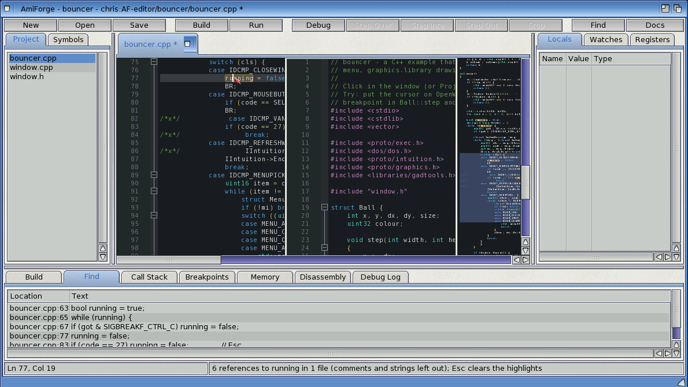

### Rename Symbol

Put the cursor on a name and press **F2** (or **Edit > Rename Symbol...**, or right-click), then
type the new name.
1. A requester shows how many changes there will be in which files, and warns if the new name is
   already in use.
2. **Rename** changes every whole-word use outside comments and strings:
   - open files are changed in the editor, one Undo step per file, so you can check them before
     saving;
   - files that aren't open are written straight away.

The new name must be a valid C identifier, and not a keyword.

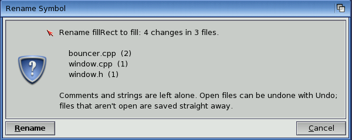

### Keys

| Keys | Action |
|---|---|
| Shift-F12 | Find All References |
| F2 | Rename Symbol |
| Amiga-T | Add Next Occurrence |
| Alt-click | Add a cursor |
| Esc | One cursor again; end a snippet; clear reference highlights |
| name + Tab | Insert a snippet; Tab / Shift-Tab move between its fields |

### Limitations

- Find All References and Rename Symbol work on the text, not on what the compiler knows.
  Different things with the same name (a local `i` in two functions, a member and a global
  called `count`) are all included, so check the list or the requester before renaming.
- The outline reads declarations written in the usual way; heavy macro use can hide a function.
- The minimap follows the left view only.
- Alt-drag doesn't make a rectangular selection (Alt-click adds cursors instead).

## AutoDocs

The SDK documents every library function in its AutoDocs (`SDK:Documentation/AutoDocs`).
AmiForge reads them directly:

- **F1** (or the Help key, or the **Docs** button) on a function name opens its entry. Interface
  calls such as `IIntuition->OpenWindowTags` work, and so do the `Tags`/`TagList`/`A` variants of
  a name.
- **Help > AutoDocs Browser** lists every entry. Type in **Find** to narrow the list.
- **Links:** names of other functions in an entry (`exec.library/AllocVec`, `OpenWindow()`) are
  links. Click one to follow it, **Back** returns, and double-clicking any word looks it up.
- **SDK Documentation** opens the SDK's documentation drawer, with the SDK manual (PDF) and the
  guides for the compiler and tools.


## Projects

A project is an `.afp` file in the project's drawer. It lists the sources (relative to that
drawer) and the build settings, and remembers breakpoints and watches.

- **Project > New Project** asks where to save the `.afp`. It adds the C, C++, assembler and
  header files already in that drawer, or writes a starter `main.c` if there are none. Saved
  projects get a Workbench icon that opens them in AmiForge.
- **Project > Open Project**, or **Open Recent**: the last ten projects. Open Project's requester
  starts in the projects folder; when the open project lives somewhere else, it starts in the
  drawer above that project instead, so its neighbours are one click away.
- **Project > Browse Projects** (Amiga-U) and **Set Projects Folder** (see below).
- **Add Files** and **Remove File** change the file list. Removing doesn't delete the file.
- **Project > Settings**:

| Setting | Default |
|---|---|
| Program file | the project's name |
| C compiler / C++ compiler | `gcc` / `g++` (from `SDK:gcc/bin` if they aren't in the path) |
| C flags | `-O0 -gstabs -Wall` |
| C++ flags | `-O0 -gstabs+ -Wall` |
| Assembler flags | `-gstabs` |
| Linker flags / libraries | (none) / `-lauto` |
| Program arguments | (none) |
| Console | a new console window; or a file or console spec such as `CON:0/0/640/200/Out/CLOSE` |
| Stop at main() when debugging | on |

Keep `-gstabs` (C) and `-gstabs+` (C++) in the flags to debug at the source level. The debugger
reads stabs, the debug format OS4's own tools use.

Without a project, Build, Run and Debug work on the file being edited, as a one-file project.

### The projects folder and the project browser

The projects folder is the drawer where you keep your projects. It starts as the examples drawer
that comes with AmiForge (`PROGDIR:Examples`); **Project > Set Projects Folder** picks another.
Open Project and New Project from Template start there.

**Project > Browse Projects** (Amiga-U) lists:
- **Recent**: the projects on the Open Recent list that still exist;
- **Projects in** the folder: every drawer in it, or one drawer further down, that has an `.afp`
  file, sorted by name. AmiForge doesn't look inside a project's own drawer, so `obj/` and
  similar sub-drawers are skipped.

The columns are the project's name, its description and its drawer. The description is the
first line of the `description=` in the `.afp` (the one Package Release uses, so Project >
Settings isn't needed to set it), or else the first line of a `README`, `README.txt` or
`README.md` in the drawer.

Double-click a project, or select it and click **Open**. **Change Folder** sets the projects
folder and lists it; **Refresh** reads it again.

When AmiForge starts with no project to open (none given, and no last project), it shows the
browser. **Show at startup** turns that off.

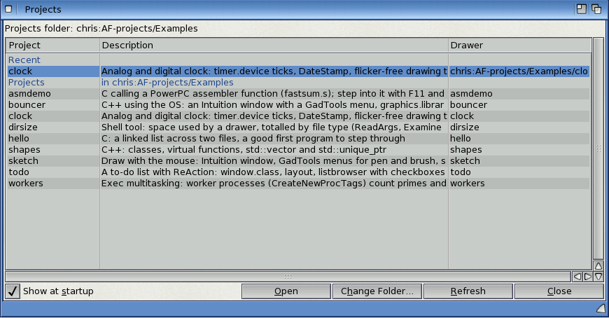

## GUI designer, project templates and release packaging

### The GUI designer

**Tools > GUI Designer** edits a window built from ReAction classes, and writes the C code
that makes it. The design is kept in a `.afg` file in the project.

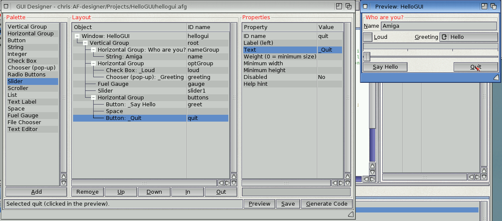

Opening the designer:
- If the project has one `.afg` file, the designer opens it.
- Otherwise a file requester asks which one to open. Type a new name to start a new design.
  A new design starts with a vertical group holding one button.

The designer window has three columns:

| Column | What it does |
|---|---|
| **Palette** | The objects you can add: vertical and horizontal groups, Button, String, Integer, Check Box, Chooser, Radio Buttons, Slider, Scroller, List, Text Label, Space, Fuel Gauge, File Chooser and Text Editor. Select one and click **Add**, or double-click it. |
| **Layout** | The window and its objects as a tree. A new object goes into the selected group, or after the selected object. **Up** and **Down** move it among its neighbours. **In** moves it into the group above it, **Out** moves it out of its group, and **Remove** deletes it. |
| **Properties** | The selected object's properties. Click one, type the new value in the field underneath and press Return. Yes/no and choice properties (such as Frame) change each time you click them again. |

Properties every object has:
- **ID name**: the C name in the generated code. `ok` becomes `MAIN_OK`, and the object is
  `gui->obj[MAIN_OK]`.
- **Label (left)**: a label shown to the left of the object. Put `_` before a letter to make it the
  keyboard shortcut.
- **Weight**: its share of the spare space. 0 means its minimum size.
- **Minimum width** and **Minimum height**.

Gadgets also have **Disabled** and **Help hint**: the hint is a bubble shown when the mouse
rests on the gadget.

Groups have:
- **Frame**: none, group, button or field. A frame title makes a group frame.
- **Frame title**.
- **Even sizes**: all children the same size.

Each kind also has its own properties: a button's text, a chooser's items (separated by `|`),
a slider's range, and so on.

The **window** is the first row of the tree. Its properties are:
- **Code name**: the generated functions are called `<name>_gui_...`.
- **Title**.
- **Size**: 0 means as small as the contents allow.
- **Resizable**.

The **preview** window is built from the real ReAction classes and is rebuilt after every
change. Click a gadget in the preview to select it in the tree. **Preview** brings the window
back if you closed it.

#### Generate Code

**Generate Code** saves the `.afg` file and writes `<name>_gui.h` and `<name>_gui.c` next to it.
It also adds them, and the `.afg`, to the project.

The header declares:
- an `enum` of IDs;
- `struct <name>_gui`, holding the window object, the open window, `obj[]` with every object, and
  a `quit` flag;
- the functions: `_create`, `_open`, `_close`, `_dispose`, `_signal` (the signal to wait for) and
  `_handle`. `_handle` processes the window's input, and returns FALSE when the program should
  end.

A program's main loop is then:

```c
static struct main_gui gui;
if (main_gui_create(&gui) && main_gui_open(&gui)) {
    uint32 sig = main_gui_signal(&gui);
    while (!(IExec->Wait(sig | SIGBREAKF_CTRL_C) & SIGBREAKF_CTRL_C))
        if (!main_gui_handle(&gui)) break;
}
main_gui_dispose(&gui);
```

**Your code goes in `<name>_gui.c`**, between the `/* USER-BEGIN ... */` and `/* USER-END ... */`
lines:
- There is one section for each gadget, inside a `switch` on the gadget's ID. Each starts with a
  comment saying what `code` holds for that kind of gadget.
- There's one for includes and globals at the top.
- There's one for the close gadget. By default it sets `gui->quit`.

Generating the code again keeps everything between the markers, and replaces the rest. A
section whose gadget you deleted is kept at the end of the file, in an `#if 0` block, so nothing
you wrote is lost. If you add the gadget back, its code goes back in its place.

The generated code uses the interfaces explicitly (`IIntuition->NewObject(...)`), with no
`__USE_INLINE__`. It builds with the project's default flags and `-lauto`.

#### The .afg file

The `.afg` file is plain text, one object per line, indented two spaces per level of nesting:

```
# AmiForge GUI (edit with Tools > GUI Designer)
window name=main title="My Program" width=320
vlayout id=root
  hlayout id=opts title=Options
    checkbox id=fast text=_Fast checked=1
    chooser id=mode items="Low|Medium|High" label=_Mode
  button id=ok text=_OK weight=0
```

You can edit it by hand. Values with spaces go in quotes, and inside quotes `\"`, `\\` and `\n`
work as in C.

### New Project from Template

**Project > New Project from Template** lists the templates in `AmiForge/Templates`:

1. Choose a template.
2. Enter the project's name (letters, digits, `-` and `_`) and the drawer to make it in.
3. Enter the author: it goes into the comments and the version string, and is remembered.

AmiForge makes a drawer with the project's name, writes the files and the `.afp`, and opens it.
Every template builds with **F7**. **Ctrl-F5** runs it.

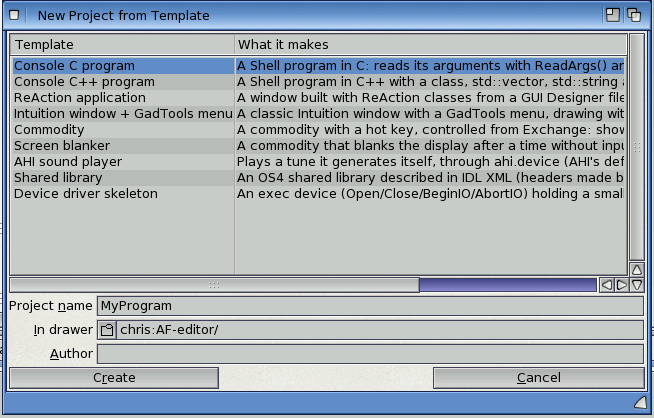

| Template | What it makes |
|---|---|
| Console C program | A Shell program that reads its arguments with `ReadArgs()` |
| Console C++ program | A Shell program with a class, `std::vector`, `std::string` and algorithms |
| ReAction application | A window designed in a `.afg` file, with its code generated and the buttons already doing something |
| Intuition window + GadTools menu | A classic Intuition window with a GadTools menu, drawing with graphics.library |
| Commodity | A commodity with a hot key, controlled from Exchange; shows a window when the key is pressed |
| Screen blanker | A commodity that blanks the screen with a starfield after a time without input, or on a hot key. `TEST` blanks it for three seconds |
| AHI sound player | Synthesises notes and plays them through `ahi.device` |
| Shared library | A library described in IDL XML, with its headers and function table made by the SDK's `idltool`, and a test program |
| Device driver skeleton | An exec device (Open, Close, BeginIO, AbortIO) that keeps a small buffer, and a test program |

#### The library and device templates

The library and device projects build `<name>.library` or `<name>.device`, linked with
`-nostartfiles`.

Their **Run** command (Project > Settings > Run command) is `Execute run-test`. That script:
1. flushes the old copy from memory;
2. compiles `test_<name>.c`;
3. runs it against the library or device just built.

The library's functions are described in `<name>.xml`. To add one:
1. Describe it in the XML.
2. Run `SDK:C/idltool -i -p -n -c <name>.xml` to remake `include/` and `<name>_vectors.c/.h`.
3. Write the function in `<name>.c`.

#### Making your own templates

A template is a drawer in `AmiForge/Templates` with a `template.def`:

```ini
[template]
name=My template
description=What it makes, in one line
order=90                          ; where it comes in the list
[project]                         ; .afp settings for the new project
output=${LOWER}
libs=-lauto
[files]
file=main.c -> ${LOWER}.c         ; copied, and added to the project
extra=ReadMe                      ; copied, but not part of the build
generated=include/x.h             ; made by a command below; added to the project
open=${LOWER}.c                   ; opened afterwards
[create]
command=SDK:C/idltool -i x.xml    ; run in the new drawer after copying
gui=${LOWER}.afg                  ; generate GUI code from this file
```

Substitutions work in file contents and in the destination names:

| Substitution | Value |
|---|---|
| `${NAME}` | the name as typed |
| `${IDENT}` | the name as a C identifier |
| `${UPPER}` | `${IDENT}` in upper case |
| `${LOWER}` | `${IDENT}` in lower case |
| `${AUTHOR}` | the author |
| `${DATE}` | the date, as d.m.yyyy |
| `${YEAR}` | the year |

- Add `:upper`, `:lower` or `:ident` to any of them, as in `${NAME:upper}`.
- `$${` gives a literal `${`.
- For a `gui=` file, a file in the template with the same name as the generated `.c` can supply
  user sections. That's how the ReAction template's buttons come with working code.

### Package Release

**Build > Package Release** makes an archive ready to upload to Aminet.

1. **The release details.** A dialog asks for them; they're saved in the project:
   - version;
   - author, as `Name <email>` (Aminet needs the email);
   - a short description (Aminet allows 40 characters);
   - the Aminet category;
   - a longer description;
   - the release compiler flags. By default these are the debug flags with `-g`/`-gstabs`
     removed, and `-O0` becomes `-O2`.

   Problems that would get the upload rejected are listed before anything is built.
2. **The release build.** The project is built from scratch with the release flags, into
   `obj-release/`, so the debug build in `obj/` is untouched.
3. **The archive.** In the project's `release/` drawer, AmiForge makes:
   - `stage/<Name>/`, holding the stripped program, its icon and `<Name>.readme`;
   - a drawer icon;
   - an `Install` script with an icon. It copies the drawer into a drawer chosen in a requester,
     or into the drawer given on the command line (`Install Work:Tools`).

   It packs these into `release/<Name><version>.lha`, and writes the Aminet readme beside it as
   `release/<Name><version>.readme`.

The Build tab shows each step, ending with a listing of the archive.

AmigaOS 4 has no LhA that can create archives, but it has `xad2lha`, which converts any archive
XAD can read into LhA. So AmiForge packs the drawer with the SDK's `tar`, then converts it.

## Building and running

- **F7** (or Amiga-B) builds. Only the sources that changed, or whose headers changed, are
  compiled again. **Rebuild All** and **Clean** are on the Build menu, and **Compile File**
  (Amiga-K) compiles just the current file.
- Errors and warnings are listed in the Build tab and marked in the editor. Click one, or press
  **F4** / **Shift-F4**, to go to it.
- Object files go into `obj/` in the project drawer.
- C++ programs are linked with `-athread=native`, which the C++ runtime needs.
- The compilers run with a 4 MB stack.
- The build runs in the background, so you can keep editing. Build > Stop Build ends it.

**Ctrl-F5** (or F6, Amiga-E) builds if needed, then runs the program in a console window in the
project's drawer, with the program arguments from the project settings.

## Debugging

**F5** builds if needed and starts the program under the debugger. If "Stop at main()" is on,
it stops at the start of `main`.

| Action | Keys |
|---|---|
| Start / continue | F5 |
| Stop | Shift-F5 |
| Step over (the next line; calls run at full speed) | F10 |
| Step into (into functions that have source) | F11 |
| Step out (until the current function returns) | Shift-F11 |
| Run to the line with the cursor | Ctrl-F10, or right-click > Run to Cursor |
| Step one machine instruction | F8 |
| Toggle a breakpoint | F9, or click the margin |

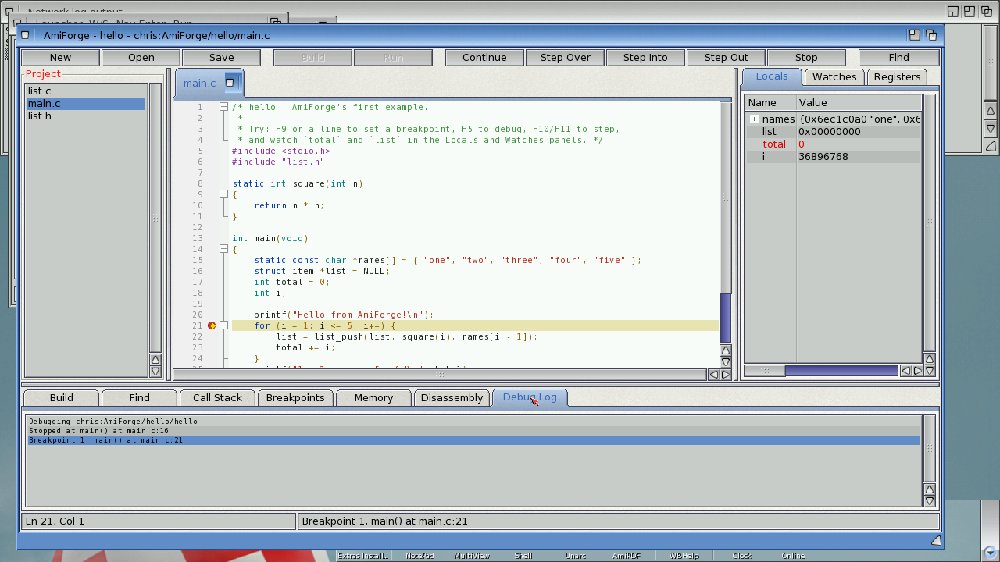

### The panels

- **Locals**: the parameters and local variables of the selected frame. Structs, arrays and
  pointers open with their arrow. Values that changed since the last stop are red.
- **Watches**: expressions evaluated at every stop. Add one with the field under the list, from
  Debug > Add Watch (which uses the selection), or with right-click > Add Watch. Expressions can
  use:
  - variables, `.`, `->`, `[i]`, `*`, `&` and casts;
  - arithmetic and comparisons;
  - registers (`$r3`, `$pc`, `$lr`).
- **Registers**: the PowerPC registers. Changed ones are red.
- **Call Stack**: click a frame to see its source line (green arrow), locals and watches.
- **Breakpoints**: the checkbox enables or disables a breakpoint, Delete removes it, and a click
  goes to it. A breakpoint on a line without code moves to the next line that has some. A
  breakpoint can carry a condition; it then stops only when the condition is non-zero.
- **Memory**: type an address (`0x1234ABCD`) or an expression (`p`, `&buf`, `list->next`). A
  pointer shows the memory it points to.
- **Disassembly**: the code around the PC, with the source lines in between. `=>` marks the
  current instruction and `*` marks a breakpoint.


### Crashes

If the program crashes (a DSI, an alignment error, an illegal instruction...), the debugger
stops it instead of the Grim Reaper. You see the source line, the call stack and the registers.
For a DSI, the DAR register holds the bad address. Shift-F5 ends the program.

### Assembler

Assembler sources built with `-gstabs` step line by line like C. **F8** steps single
instructions anywhere, and the Disassembly tab shows where you are.

### How it works

The debugger is AmiForge's own; it doesn't use GDB:
- It runs the program in a process that has an exec debug hook.
- It plants `trap` instructions for breakpoints and steps in software, by decoding the branch at
  the PC.
- It reads the program's stabs for lines, functions, types and variables.
- Traps only ever go into the program's own code, never into the OS.

## Edit and Continue

Change your code while the program is stopped in the debugger, press **Ctrl-F9**, and carry
on: AmiForge compiles the changed file and patches the new code into the running program. The
program keeps its state: its variables, open windows, files and memory stay as they were.

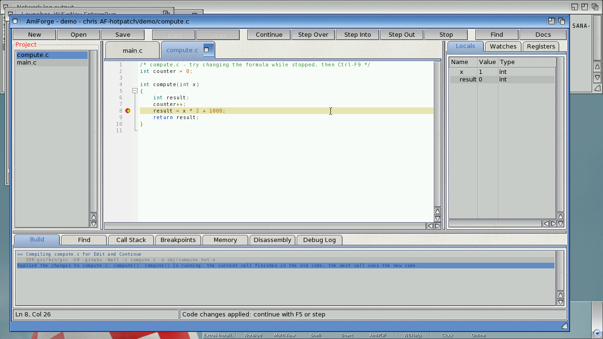

### Using it

1. Debug the program (**F5**) and stop it: at a breakpoint, after a step, or with Pause.
2. Edit one or more C or C++ files of the project.
3. Press **Ctrl-F9**, or choose **Debug > Apply Code Changes**.

AmiForge saves the files, compiles each source that changed since the program was built (or
since its last apply) with the project's flags, and applies it. The Build tab shows the
compile and a summary such as:

    Applied the changes to compute.c: compute(). compute() is running: the current call
    finishes in the old code, the next call uses the new code.

Then continue (**F5**) or step as usual. Breakpoints in the file move to the new code, and
stepping, locals, watches and the call stack work in it. You can apply changes to the same
file as often as you like.

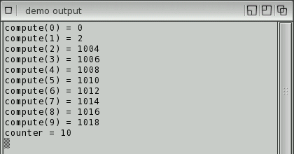

In this example `compute()` was changed from `x * 2` to `x * 2 + 1000` while stopped inside
the call for 1: that call finished with the old formula, every later call used the new one,
and the global `counter` carried on from where it was.

### What happens to code that's running

- A function that is **running** when you apply (the one you are stopped in, or one further up
  the call stack) finishes its current call in the old code. Its **next** call runs the new
  code. To see the new version straight away, step out and call it again.
- Everything else (other files, the C library, the OS) is untouched.
- The patch lasts until the program ends. The next run (**F5**) builds the project normally and
  runs the new code from the file.

### What you can change

| Change | Works? |
|---|---|
| Function bodies: statements, expressions, control flow | Yes |
| Calls to functions the program already contains (your own, the C library, OS interfaces) | Yes |
| New functions, `static` or not, in the changed file | Yes |
| New string literals and constant data | Yes |
| C++ methods, constructors, destructors, virtual functions | Yes (objects keep their vtables, which lead to the new code) |
| Several files at once | Yes: each changed file is applied in turn |
| A new global or `static` variable | No: restart the program |
| A different size or type for a variable (`buf[64]` to `buf[128]`) | No: restart the program |
| Calling a C library function the program didn't use before (it isn't linked in) | No: rebuild and restart |
| Changed `struct` or class layouts that existing data uses | Not detected; existing objects keep the old layout. Restart |
| Assembler files | No |
| C++ exceptions thrown through a changed function | Not caught (the new code has no unwind tables); AmiForge says so when it applies a file that uses them |

When a change can't be applied, nothing is changed and the Build tab says why, for example:

    Can't apply the changes to compute.c: extra is a new static variable: restart the
    program to use it.

### How it works

1. The file is compiled to `obj/<name>.hot.o` with the project's flags.
2. AmiForge's debugger links the object itself, against the running program (it reads the
   program's symbol table):
   - its code and constant data go into newly allocated executable memory;
   - its global and static variables are placed over the program's **existing** copies, found
     by name (static variables by name within the same source file), so the new code works on
     the program's data. A new or resized variable, or data that can't be matched, stops the
     patch;
   - references to other files, the C library and interface pointers are bound to the program's
     addresses; calls too far away for a relative branch go through small stubs;
   - C++ vtables and type information stay the program's.
3. The first instruction(s) of each old function are replaced with a branch to the new version.
   Earlier patches of the same function are redirected too.
4. The new code's debug information (stabs) is added to the debugger's, so breakpoints,
   stepping and variables work in it.

A patch is refused if a function's first instructions are being executed by a frame (only
possible right after an instruction step at a function's entry); step once more and apply
again.

## Debugger tools: Windows inspector, leak tracker, profiler

Three tools build on AmiForge's debugger. Each has a tab in the bottom panel: **Windows**,
**Leaks** and **Profile**.

### Windows: the live Intuition inspector

**Debug > Inspect Windows** shows the program's screens, windows and gadgets as a tree. The
**Windows** tab refreshes itself every time the program stops. While it runs, press **Refresh**.

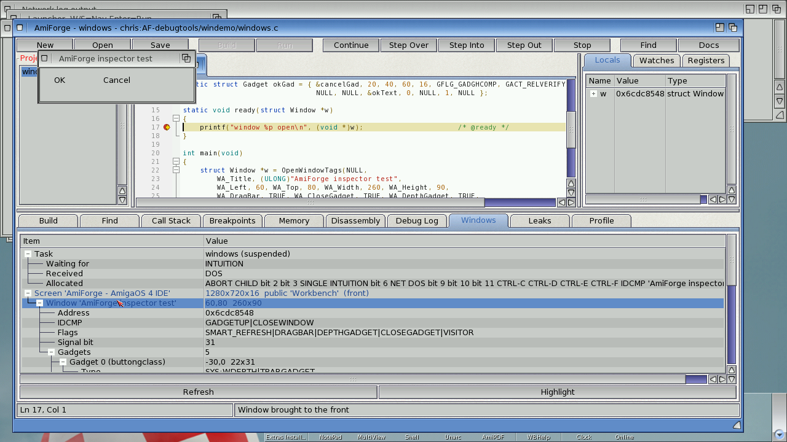

- **Task**: the program's state (running, waiting...) and its signals, by name:
  - **Waiting for**: what it is blocked on;
  - **Received**: what has arrived;
  - **Allocated**: the signals it owns.

  A window's IDCMP port appears as `IDCMP 'title'`, so you can see straight away that a program
  is waiting for input on its window, or for CTRL-C.
- **Screens**: those the program's windows are on, and any opened since debugging started
  (likely the program's own). Each shows its size, depth and public name.
- **Windows**: every window whose IDCMP port signals the program's task. Each shows:
  - position and size;
  - IDCMP flags and window flags, decoded (`CLOSEWINDOW|GADGETUP`, `SMART_REFRESH|DRAGBAR|...`);
  - the port's signal bit.
- **Gadgets**: each one with its ID, type (`BOOLGADGET`, `SYS:CLOSE`, or the BOOPSI class, such as
  `layout.gadget`), position, size, flags and activation flags. A gadget's text or label is shown
  too.

**Click a window or gadget** (or select it and press **Highlight**) to bring the window to the
front and flash a frame around it on the screen. That's useful when a program has several
windows, or a gadget is hard to find. The frame is drawn twice per flash, so it leaves nothing
behind.

Notes:
- ReAction windows show their root `layout.gadget`. Gadgets nested inside layouts are not listed
  (layout.gadget has no public way to list its children).
- Windows opened by other tasks the program starts are not shown: only windows whose port
  signals the program's own task.

### Leaks: what the program never released

Turn on **Debug > Track Leaks**, or the **Track leaks when debugging** box in Project > Settings.
The project remembers the setting. Then debug as usual (F5). When the program ends, the **Leaks**
tab lists everything it acquired and didn't release, grouped by the line that acquired it.

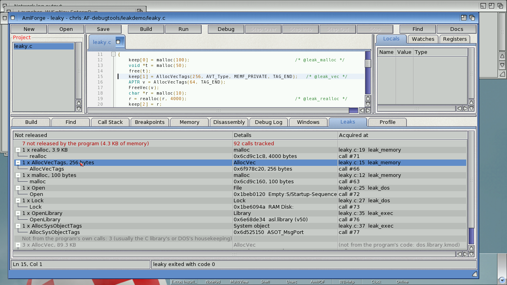

| Tracked | Released by |
|---|---|
| `AllocVec`, `AllocVecTagList`, `AllocVecTags` | `FreeVec` |
| `AllocMem` | `FreeMem` (the size is checked) |
| `AllocSysObject`, `AllocSysObjectTags` | `FreeSysObject` |
| `CreatePool` | `DeletePool` |
| `OpenLibrary` | `CloseLibrary` (opens are counted) |
| `GetInterface` | `DropInterface` |
| `Open`, `FOpen`, `OpenFromLock` | `Close` |
| `Lock`, `DupLock`, `ParentDir`, `CreateDir`, `DupLockFromFH`, `ParentOfFH` | `UnLock` (`OpenFromLock` takes the lock over) |
| `malloc`, `calloc`, `realloc` (and so C++ `new`) | `free` |

- Each group shows how many items and how many bytes, and the source line and function that
  acquired them. **Click it** to go to that line.
- Under each group are the items themselves: address and size, plus for files and locks the
  file's name, for libraries the name and version, and for system objects the `ASOT_` type.
- **Problems** are listed at the top:
  - memory freed twice;
  - memory freed with the wrong function (`FreeVec()` of memory from `malloc()`);
  - `FreeMem()` with a different size from the `AllocMem()`.
- Only the program's own calls count. Allocations an OS function makes for itself while the
  program calls it are not recorded (for example, the memory `Open()` uses internally). When a
  library function allocates on the program's behalf, the leak is shown at the program's line
  that called it.
- The summary line counts how many calls were tracked. If more than 8192 arrive between two
  polls (10 ms), some are lost, and the summary says so.

How it works: while the program runs, exec's and dos's functions are patched with `SetMethod`, as
`QEMUCopyFix` does. Each patch checks first whether the caller is the program's task; every other
task goes straight through. The patch records the call and its return addresses: the LR plus
the stack's back chain. `malloc` and `free` go through the program's own newlib interface, which
is patched when the program reaches `main()`. All patches are removed as soon as the program
ends, and when AmiForge stops debugging or quits.

Limitations:
- `malloc` calls made before `main()` (C++ static constructors) are not tracked.
- Resources acquired by other tasks the program starts are not tracked.
- The leaked resources are still leaked afterwards: the tracker reports them, it doesn't free them.

### Profile: where the time goes

**Debug > Profile** (**Shift-F7**) builds the program if needed and runs it under the profiler. It
doesn't stop at `main()` or at breakpoints. A sampler process at priority 10 reads the program's
registers about every millisecond. When the program ends (or you press Stop), the **Profile** tab
lists its functions, and the editor marks its hot lines.

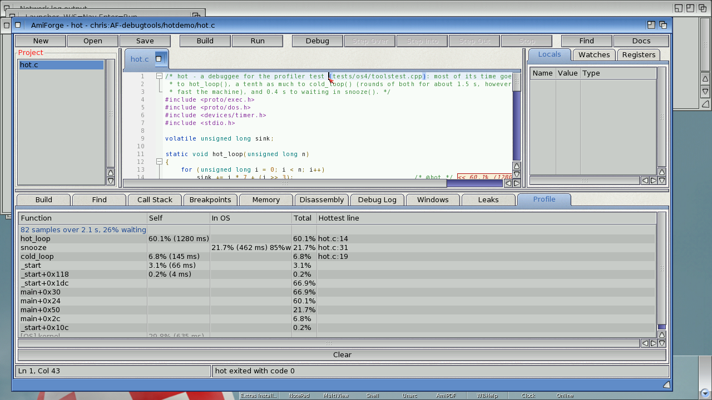

| Column | Meaning |
|---|---|
| **Self** | Time with the program counter inside the function: a percentage, and milliseconds. |
| **In OS** | Samples in the OS (a library, the kernel, or waiting) when this function was the nearest program function on the call chain: it called the OS and the OS was busy, or the task was waiting. `w` is the waiting share. |
| **Total** | Samples with the function anywhere on the call chain (itself or its callees). |
| **Hottest line** | Click the row to go there. |

- Rows starting **[OS]** are the OS functions themselves (`newlib.library: memcpy`,
  `kernel: ...`), named through the system's debug symbols.
- Lines with samples get an end-of-line note in the editor:
  - `<< 23.4% (117)` is time spent on that line;
  - `<< 30.1% in OS (151)` is time spent in calls made from that line.
- **Clear** (or Debug > Clear Profile) removes the notes.
- The header shows the number of samples and how much of the time the program was waiting.
- **Samples are weighted by time.** Each sample stands for the time since the previous one,
  measured with the EClock. Under QEMU the sampler's wakeups come late while the CPU is busy
  (every 15–25 ms instead of every 1 ms), but percentages and milliseconds still add up to the real
  run time. Fewer samples means coarser detail: run the program for a second or more.
- Code with no stabs function range (for example the last function of a file built with
  `-gstabs`) is named after its symbol; offsets are merged (`main+0x30` counts as `main`).

### Notes on the debugger itself

Making these tools work turned up three things about the debugger core (`os4_session.c`, each in
a block marked `debugtools`):

- **The stall "kick" is skipped while the profiler samples, and once the program has returned.**
  A CPU-bound debuggee hits the OS4 dispatch stall described in `debugger-notes.md` over and
  over, and every kick costs it 20 ms or more: a 1 s program could take more than 30 s under the
  debugger. The sampler's frequent rescheduling keeps the task dispatched, so no kick is needed
  then. After the program has returned, the process belongs to DOS's cleanup and must not be
  suspended.
- **A process stuck in DOS's cleanup gets a normal priority.** DOS cleans an ended process up at
  priority -10, spinning in the kernel (kernel+0x127F0, the spin in `debugger-notes.md`). On a
  busy machine it could stay there indefinitely, so the program's exit was never reported. Every
  200 ms after the program returns, if the process is still there with a lowered priority, it is
  set to 0, and it then finishes at once. Seen and fixed on both guests.
- **Kill doesn't restore the entry context once the program has returned.** Doing that to a
  process in DOS's cleanup crashed it (a DSI in dos.library). Now the process is given a normal
  priority and allowed to finish.

## Git and GitHub

The **Git** menu works on the repository that holds the project, meaning the nearest drawer
above it with a `.git` drawer. It uses SimpleGit (`SDK:C/sgit`), and its output appears in the
Build tab.

| Command | What it does |
|---|---|
| Status, Diff, Log | Show the repository's state |
| Commit... | Saves everything, adds the project's files and the `.afp`, and commits with your message |
| Pull, Push | Pull or push the current branch from or to `origin` |
| Clone Repository... | Clones a URL into a drawer you choose, then opens its `.afp` or offers to make a project |
| GitHub Setup... | Your name and email for commits, and your GitHub user name and personal access token |

Getting set up:

1. **Git > GitHub Setup**: enter your name and email. For pushing, also enter your GitHub user
   name and a personal access token (github.com > Settings > Developer settings > Personal access
   tokens, with repository access). They're kept in `ENVARC:AmiForge/`.
2. **Git > Clone Repository**: paste the URL (`https://github.com/user/project`) and choose a
   drawer on a disk with long file names.

Notes:
- Without a token, Push and Pull open a console window where SimpleGit asks for your user name
  and token.
- **Certificates:** SimpleGit's built-in certificate list is older than GitHub's current
  certificates, so AmiForge sets `GIT_SSL_NO_VERIFY`. The connection is still encrypted, but the
  server's certificate isn't checked.
- **Long file names:** git's object and pack files have names of 38 characters or more. Classic
  FFS (`DOS\1`–`DOS\5`) cuts names at 30 characters, which breaks a repository: cloning fails
  with "target OID for the reference doesn't exist". Keep repositories on long-name FFS
  (`DOS\7`), SFS/02 or NGFS. `RAM:` is fine for a quick try.
- **Networking:** check with `ShowNetStatus` that there is a default gateway.

## Git panel, resource editors, ARexx, distributed builds and explanations

### The Git panel

AmiForge reads git repositories itself (loose objects, packs and deltas, the index), so
everything that only looks at the repository is instant: SimpleGit is only started for
commands that change something.

#### Change markers

A thin bar next to the text shows how the file differs from the last commit (HEAD):

| Bar | Meaning |
|---|---|
| green | lines you added |
| blue | lines you changed |
| red line | lines were deleted here |

The markers follow your typing (a moment after you stop) and are updated when you save.
**Click a bar** to see what the lines were in HEAD.

#### The Git tab


**Git > Git Panel** (or the **Git** tab at the bottom) shows the repository of the project:

- **Branch**: the current branch. Choose another one to switch to it (AmiForge asks first if
  there are uncommitted changes, and re-reads open files that changed). Switching to a branch
  at another commit uses SimpleGit's checkout, which resets changed files and deletes untracked
  ones; AmiForge lists what would be lost before it goes ahead. Switching to a branch at the
  same commit, and **New Branch...** (a branch at the current commit, which it switches to),
  keep your uncommitted work.
- The changed files, with their state: *changed*, *staged*, *staged, changed*, *added*,
  *deleted*, *untracked*. Files matched by `.gitignore` aren't listed.
- **Stage** (`git add`), **Unstage**, **Discard...** (throws away the file's unstaged changes;
  for an untracked file, deletes it), **Diff** (or double-click a file): the file's changes in a
  read-only tab, as a unified diff.
- **Blame** and **Commit...** (the same as Git > Commit: it stages every project file first,
  including any you unstaged).

#### Blame


**Git > Blame (toggle)** adds a margin with the commit, author and date of each line (shown on
the first line of each block from the same commit). Lines you haven't committed say so.
Moving the cursor shows the line's commit in the status bar; **click the margin** for the
whole commit message. AmiForge follows the file's history back through up to 60 commits that
changed it.

### The hex editor


Files that aren't text (or any file, with **File > Open as Hex...**) open in a hex editor
tab:

```
00000000  46 4F 52 4D 00 00 1A 2C  49 4C 42 4D 42 4D 48 44 |FORM...,ILBMBMHD|
```

- Type hex digits over the hex columns, or characters over the text column; the byte under
  the cursor is highlighted in both and described in the status bar. Typing at the very end
  adds bytes.
- **Amiga-Z** undoes, **Amiga-L** goes to an offset (`1A2B`, `0x1A2B`, `$1A2B`, or `#1234`
  for decimal), **Amiga-F** finds bytes (`4E 75`) or text (`FORM`, or `"4E75"` in quotes for
  text that looks like hex), **F3** finds the next one.
- **Save** writes the bytes back exactly as they are; nothing else in the file changes.

### Icons and pictures


- Opening a **.info** file opens the **icon editor**: the icon's image and type, its default
  tool, stack size, position (or none) and tool types (select one to edit it; **Add**,
  **Change**, **Remove**). **Save** writes the icon back; the image isn't touched.
- Opening a **picture** (IFF ILBM, PNG, JPEG, GIF, or anything else a datatype understands)
  shows it in a window of its own, with its size, depth and format in the title. Esc closes it.

### ARexx

AmiForge has an ARexx port, **AMIFORGE** (AMIFORGE.1 for a second copy). Commands return
their results in `RESULT`; `RC` is 5 when a FIND finds nothing and 10 for a bad argument.

| Command | Template | What it does |
|---|---|---|
| OPEN | FILE/A/F | Open a file |
| SAVE / SAVEAS | — / FILE/A/F | Save the current file |
| CLOSE | FORCE/S | Close it (FORCE: without asking) |
| GOTO | LINE/N/A,COL/N | Move the cursor |
| GETLINE, GETCOL, GETFILE, GETWORD | | The cursor's line, column, the file, the word at the cursor |
| GETTEXT | ALL/S | The selection ("" if none); ALL: the whole file |
| GETLINETEXT | LINE/N | A line's text |
| INSERT / REPLACE | TEXT/F | Insert at the cursor / replace the selection (`\n`, `\t`, `\\`) |
| SELECT | FROMLINE/N/A,TOLINE/N/A | Select whole lines |
| FIND | TEXT/A/F | Find from the cursor; RESULT is the line |
| BUILD, RUN, DEBUG, STOP | | Build, run, debug, stop debugging |
| PROJECT / GETPROJECT | FILE/A/F | Open a project / its .afp |
| STATUS | TEXT/F | Show text in the status bar |
| REQUEST | TEXT/A/F | Ask OK/Cancel; RESULT 1 or 0 |
| QUIT | FORCE/S | Quit |
| HELP | COMMAND | The commands, or one command's template |

Arguments can be given in order or by name (`GOTO LINE=12 COL=5`).

#### Macros

`.rexx` files in **PROGDIR:Rexx/** (next to AmiForge) and in the project's **Rexx/** drawer
appear in the **Macros** menu; they run with AMIFORGE as their host. **Rescan Macros** picks up
new ones. Three come with AmiForge:

- **HeaderComment**: a comment with the file's name and today's date at the top.
- **SortLines**: sorts the selected lines.
- **IfZero**: wraps the selection (or the cursor's line) in `#if 0` / `#endif`.

A macro started from a Shell (`rx MyMacro.rexx`) should begin with
`IF ADDRESS() = 'REXX' THEN ADDRESS AMIFORGE`, like these.

### Distributed builds (distcc)

Compiling under emulation is slow. With **Build > Distributed Builds (distcc)...** AmiForge
compiles C and C++ files with `SDK:C/distcc`: the preprocessor and the linker still run on the
Amiga, but the compiling - most of the time - happens on another machine with a PPC AmigaOS
cross-compiler.

1. On the machine that runs QEMU (macOS or Linux, with Docker): `tools/distcc-server.sh start`.
   It builds a small image from the same GCC 11 cross-compiler the SDK has and runs `distccd`
   on port 3632 of `127.0.0.1`.
2. In AmiForge: **Build > Distributed Builds**, tick the box and give the host as the Amiga
   sees it: QEMU's user networking forwards the guest's gateway address to the host's
   `127.0.0.1`, so that's `10.0.2.2` by default (or e.g. `192.168.101.2` with
   `net=192.168.101.0/24`). Several hosts can be listed: `host[:port][/jobs]`.
3. Build. The build log shows "Compiling x.cpp (distcc)". If the server can't be reached,
   distcc compiles on the Amiga as before.

The setting is saved in the project (`distcc=1`, `distcchosts=...`); tick "Use these hosts for
other projects too" to keep them in `ENVARC:AmiForge/DistccHosts`.

### Explanations


AmiForge knows the usual Amiga-specific causes of build errors and crashes:

- In the **Build** tab, an error or warning it recognises gets an extra line,
  `Explain: ...`; double-click it (or **Build > Explain Error**) for the full explanation. It
  covers, among others: OS functions called without their interface (`IIntuition->...`),
  missing `<proto/...>` headers and OS constants, Amiga types without `<exec/types.h>`,
  `%d` with 32-bit Amiga types, redeclared `SysBase`/`IntuitionBase`, undefined interfaces
  (`-lauto`), C++ without `-athread=native`, `__USE_INLINE__` macros clashing with C++ names,
  APTR casts in C++, `STRPTR` and string literals, OS3 headers and timer names, big stack
  frames, multiple definitions, `-lm`, small-data overflows.
- When the debugger catches a crash, the **Debug Log** explains it from the registers and the
  call stack: a NULL pointer (and which field, from the faulting instruction's offset), a NULL
  interface when the line calls `IXxx->`, freed or uninitialised memory (MungWall's
  `0xDEADBEEF` / `0xABADCAFE`), a crash inside an OS function from a bad argument, a stack
  overflow (with the `$STACK:` cookie to fix it), calling a NULL function pointer, jumping to
  data, misaligned access, traps from `assert()`/`abort()`. **Debug > Explain Crash** shows it
  again.


## The examples

| Example | What it shows |
|---|---|
| `hello` | C. A linked list across two files, a good first program to step through |
| `shapes` | C++. Classes, virtual functions, `std::vector`, `std::unique_ptr` |
| `asmdemo` | C calling a PowerPC assembler function (`fastsum.s`); step into it with F11 and F8 |
| `bouncer` | C++ using the OS. RAII wrappers for an Intuition window with a GadTools menu, graphics.library drawing, IDCMP input and timer.device pacing. Click in its window to add balls |
| `clock` | C++ using the OS. An analog and digital clock in a resizable window: timer.device wakes it four times a second, `DateStamp()` and `DateToStr()` give the time and date, and the face is drawn into an off-screen bitmap (a friend of the screen's) and blitted in, so it never flickers. No floating point: the hands use a sine table |
| `todo` | C++ with ReAction. window.class and a layout with a listbrowser (a checkbox per item), a string gadget and buttons, one C++ class per gadget group. Return adds an item; Clear Done removes the ticked ones. The list is saved in `ENVARC:TodoExample` after every change |
| `dirsize` | A C++ Shell tool. `dirsize [DIR] [TOP n] [NOREC]`: walks the drawers with `ExamineDir()`, totals the sizes by file type in a `std::map` and prints them sorted, with the biggest files. Ctrl-C stops it with `***Break`. Its program arguments are set in the project (`SDK:Include TOP 3`) |
| `workers` | C++ and exec multitasking. `workers [WORKERS n] [LIMIT n]` splits counting primes between n processes started with `CreateNewProcTags()`. Each gets its job on its own message port and sends progress messages back; Ctrl-C is passed on to all of them. The workers use only exec and dos (not the C library, which is set up per process) |
| `sketch` | C++ drawing program. An Intuition window with GadTools menus (pen colour and brush size, as mutually exclusive check marks), drawing with `IDCMP_MOUSEMOVE`, an ASL save requester and an IFF ILBM written with iffparse.library; MultiView opens the result |

Each example's classes own its OS resources (windows, bitmaps, ports, timer requests, IFF
handles) and give them back in their destructors: turn on **Debug > Track Leaks** and run one
to see nothing left over.

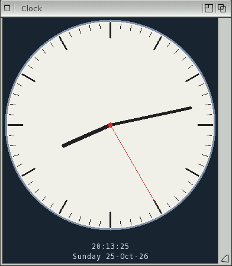

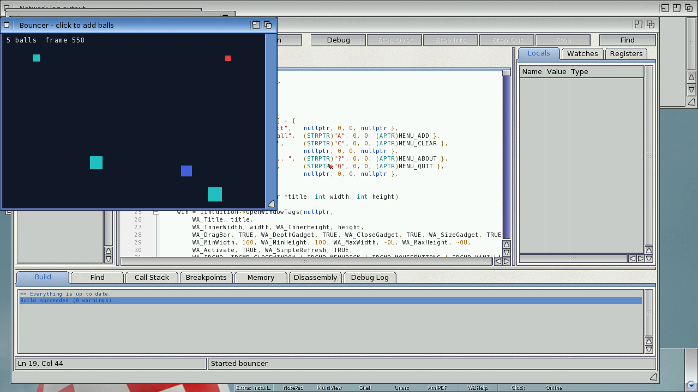

## Running under QEMU

AmiForge works on QEMU's `sam460ex` machine with AmigaOS 4.1 FE, with one fix needed:

- **QEMUCopyFix**: QEMU doesn't emulate the 460EX's DMA engine, which exec uses for large memory
  copies, so copies of 256 KB or more silently lose data. GCC's C++ compiler then reads
  corrupted headers and fails with nonsense errors. Run `C:QEMUCopyFix` at boot (from
  `S:User-Startup`). It makes `CopyMem`/`CopyMemQuick` copy with the CPU. Real hardware doesn't
  need it.
- **Speed:** compiles are slow under emulation. A small C file takes a few seconds; a C++ file
  that includes `<iostream>` takes about two minutes. Under the debugger, each breakpoint hit or
  step costs 10–30 ms.

## Troubleshooting

| Problem | What to do |
|---|---|
| "Couldn't run the command (is the SDK installed?)" | Check that `SDK:` is assigned and `SDK:gcc/bin/gcc` exists |
| "as: Unknown command" or "A build tool wasn't found" | The SDK install is incomplete: `SDK:gcc/bin` should hold `as` and `ld` (AmiForge adds `SDK:gcc/bin` and `SDK:C` to the build's path itself) |
| C++ builds fail with strange errors in standard headers (QEMU) | Run `C:QEMUCopyFix` (see above) |
| A breakpoint shows a hollow circle | It's disabled, or the line has no code; check the Breakpoints tab |
| Locals are empty or say `<unreadable>` | Build with `-gstabs` / `-gstabs+` and without optimisation (`-O0`) |
| The debugger stopped "in Kickstart" | You paused in OS code; use Step Out or Continue |
| F1 says the SDK isn't installed | The AutoDocs come from `SDK:Documentation/AutoDocs` |
| Clone fails with "target OID ... doesn't exist" | The drawer is on a disk with 30-character names; use one with long names |
| Clone fails with "failed to connect" | No route to the internet: check `ShowNetStatus` for a default gateway |
| The program's drawer can't be deleted after stopping a crashed program | A known limitation: Stop ends the program without running its C library cleanup, so a lock it held (such as its current directory) stays until a reboot |
| An installer from Package Release says "not executable" in a Shell | Archives don't keep the script bit: use `Execute Install <drawer>`, or double-click its icon |

## Keyboard reference

| Keys | Action |
|---|---|
| F1 / Help | AutoDoc for the word at the cursor |
| Ctrl-Space | Complete the word |
| Ctrl-click / F12 | Open an `#include` / go to a definition |
| Right mouse button | Context menu |
| F3 / Shift-F3 | Find next / previous |
| F4 / Shift-F4 | Next / previous error |
| F5 | Debug / continue |
| Shift-F5 | Stop debugging |
| Ctrl-F5 / F6 | Build and run |
| F7 | Build |
| F8 | Step one instruction |
| F9 | Toggle breakpoint |
| F10 / F11 / Shift-F11 | Step over / into / out |
| Ctrl-F10 | Run to cursor |
| Amiga-N / O / S / A / W | New / open / save / save as / close file |
| Amiga-P | Open project |
| Amiga-U | Browse projects |
| Amiga-F / R / H / L | Find / replace / find in files / go to line |
| Amiga-D / J | Open include / go to definition |
| Amiga-/ | Comment / uncomment |
| Amiga-B / K / E | Build / compile file / run |
| Amiga-Q | Quit |
| Ctrl-F9 | Apply code changes while stopped (Edit and Continue) |
| Shift-F7 / Amiga-I | Profile the program |
| Shift-F12 | Find All References |
| F2 | Rename Symbol |
| Amiga-T | Add the next occurrence as a cursor |
| Alt-click | Add a cursor |
| Esc | One cursor again; end a snippet; clear reference highlights |
| name + Tab | Insert a snippet; Tab / Shift-Tab move between its fields |

Help > Keyboard Shortcuts shows this list in AmiForge.

## Files and settings

| File | What's in it |
|---|---|
| `project.afp` | A project: an ini-style text file with `[project]` settings, `[files]`, `[breakpoints]` and `[watches]` |
| `obj/` | Object files, in the project's drawer |
| `ENVARC:AmiForge/RecentProjects` | The Open Recent list |
| `ENVARC:AmiForge/ProjectsFolder` | The projects folder (unset: `PROGDIR:Examples`) |
| `ENVARC:AmiForge/ShowBrowser` | `0` to not show the project browser at startup |
| `ENVARC:AmiForge/GitName`, `GitEmail`, `GitHubUser`, `GitHubToken` | Git settings |
| `ENVARC:AmiForge/Theme`, `SplitView`, `Minimap` | Editor view settings |
| `ENVARC:AmiForge/Snippets` | Your own snippets |
| `ENVARC:AmiForge/DistccHosts` | The default distcc hosts |
| `ENVARC:AmiForge/Author` | Your name and e-mail for templates and releases |
| `*.afg` | A GUI designed in Tools > GUI Designer |
| `PROGDIR:Templates/` | Project templates |
| `PROGDIR:Examples/` | The example projects, and the default projects folder |
| `PROGDIR:Rexx/` | ARexx macros (the Macros menu) |

An example `.afp`:

```ini
[project]
name=hello
output=hello
cflags=-O0 -gstabs -Wall
libs=-lauto
stopatmain=1
description=C: a linked list across two files, a good first program to step through

[files]
file=main.c
file=list.c
file=list.h

[breakpoints]
bp=main.c:22:1

[watches]
watch=total
```
